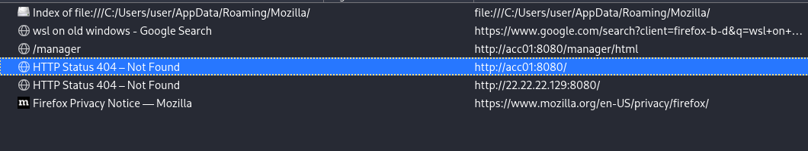
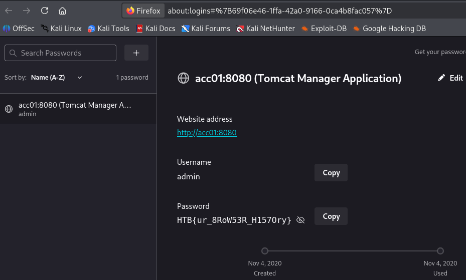

> [!NOTE]
> - Mức độ: Dễ 
> - Loại: Forensics 
> - Url: https://app.hackthebox.com/challenges/Insider
> - Mô tả: Đã có báo cáo về một mối đe dọa tiềm ẩn từ người nội bộ, và chúng ta cần xác định xem họ đã truy cập vào những gì. Bạn có thể hỗ trợ việc này không?

> - Giải nén thu được thư mục `Mozilla`
> - Trong có thư mục `Firefox` trong có có file cấu hình, và các thư mục profile của người dùng có thể có dữ liệu nhạy cảm 
> - Liệt kê thư mục `Profiles` chứa các thư mục ghi lại các phiên hoạt động của các người dùng khác nhau 
> - Trong đó có thư mục `2542z9mo.default-release` là profile của người dùng thực tế 

```
└─$ ls -al                                 
total 0
drwxr-xr-x 1 kalilinux kalilinux   80 Nov  4  2020 .
drwxr-xr-x 1 kalilinux kalilinux  116 Nov  4  2020 ..
drwxr-xr-x 1 kalilinux kalilinux 1512 Nov  4  2020 2542z9mo.default-release
drwxr-xr-x 1 kalilinux kalilinux   20 Nov  4  2020 yodxf5e0.default
```

> - Tạo profile mới `firefox -P` hoặc dùng profile hiện có 
> - Sao chép nội dung thư mục `2542z9mo.default-release` vào trong thư mục profile của người dung vừa tạo 
> - `firefox -P <name_profile>` mở firefox với profile vừa tạo 
> - Truy cập lịch sử ta thấy truy cập `acc01:8080` đang chú ý khác các dịch vụ thông thường



> - Xem danh sách mật khẩu đã lưu lấy được thông tin xác thực `acc01:8080` trong đó có flag 


 