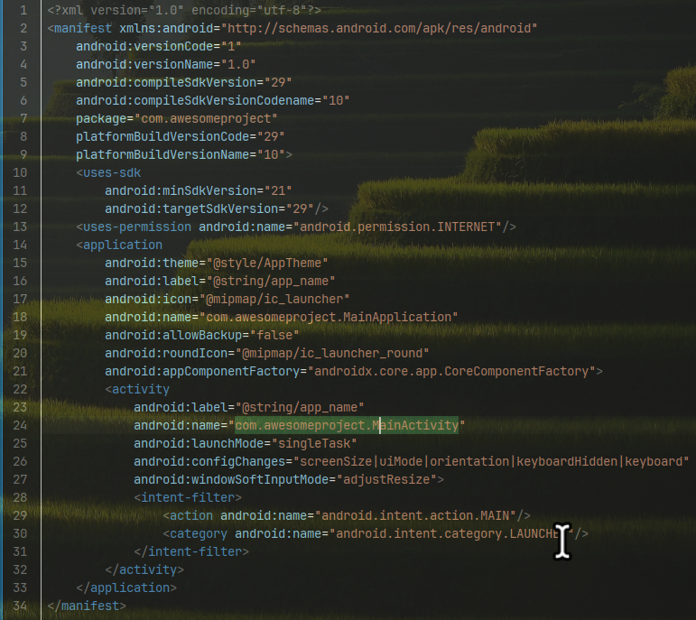
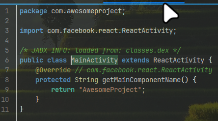
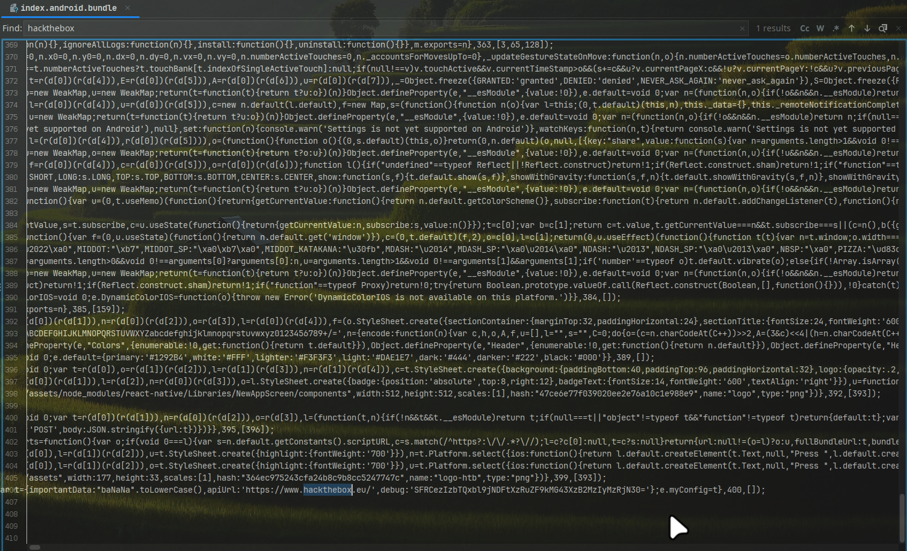

 > [!NOTE]
> - Loại: Mobile
> - Mức độ: Rất dễ 
> - Url: [Don't Overreact](https://app.hackthebox.com/challenges/Don't%2520Overreact)
> - Mô tả: Thử thách reverse 1 file apk để tìm flag

> Decompiler tệp apk bằng JADX 

> - Nội dung file Manifest.xml cho chúng ta biết điểm khởi động của thiết bị là `com.awesomeproject.MainActivity`
> - Xin cấp quyền truy cập internet 



> Nội dung `MainActivity` kế thừa ReactActivity và ghi đè hàm getMainComponentName() trả về chuỗi `AwesomeProject` 



> Chạy thử file apk trên máy ảo thì màn hình chỉ hiển thị dòng chữ `Hackthebox`


> - Trong tệp apk chứa file index.android.bundle chứa thông tin về 1 url hackthebox 
> - Nội dung debug là 1 đoạn dữ liệu base64 `SFRCezIzbTQxbl9jNDFtXzRuZF9kMG43XzB2MzIyMzRjN30=`



> - Giải mã `SFRCezIzbTQxbl9jNDFtXzRuZF9kMG43XzB2MzIyMzRjN30=` thu được flag 

```
❯ echo SFRCezIzbTQxbl9jNDFtXzRuZF9kMG43XzB2MzIyMzRjN30= | base64 -d
HTB{23m41n_c41m_4nd_d0n7_0v32234c7}
```
