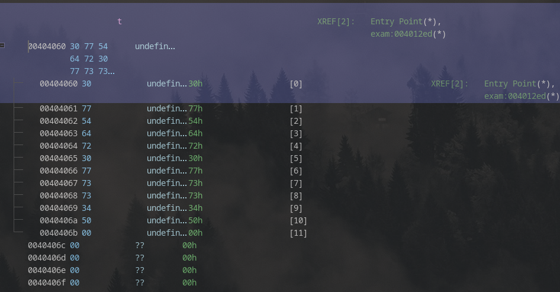
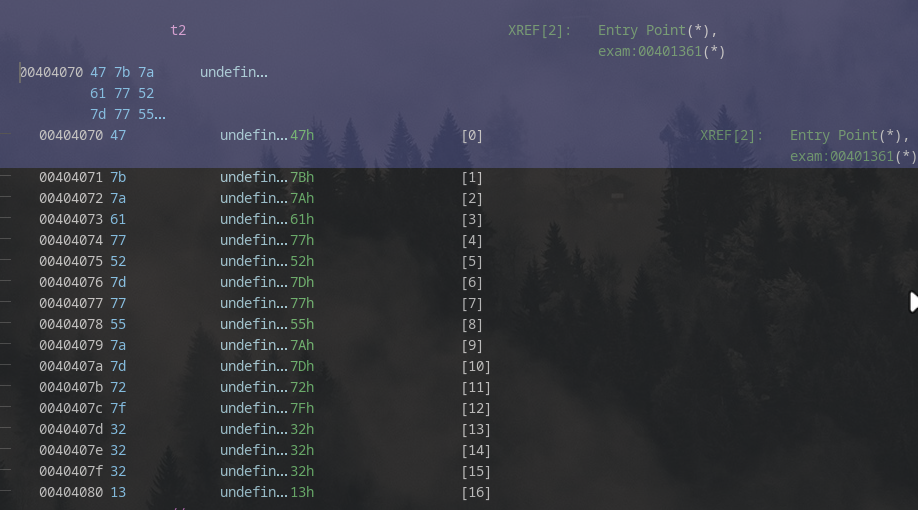

> [!NOTE]
> - Mức độ: Rất dễ 
> - Loại: Reversing
> - Url: [Hunting License](https://app.hackthebox.com/challenges/Hunting%2520License)
> - Mô tả: DỪNG LẠI! Này nhà thám hiểm, bạn đã có giấy phép săn tìm di vật còn hiệu lực chưa? Nếu chưa, bạn sẽ phải thi lại trước khi được phép tiến vào các tuyến đường không gian đấy!

> - Chương trình có hàm main() 
> - In ra tùy chọn Y/N nếu người dùng nhập `y/Y/\n` chương trình sẽ tiếp tục
> - Chương trình gọi hàm exam()

```c
undefined8 main(void)

{
  char cVar1;
  int iVar2;
  
  puts("So, you want to be a relic hunter?");
  puts("First, you\'re going to need your license, and for that you need to pass the exam.");
  puts("It\'s short, but it\'s not for the faint of heart. Are you up to the challenge?! (y/n)");
  iVar2 = getchar();
  cVar1 = (char)iVar2;
  if (((cVar1 != 'y') && (cVar1 != 'Y')) && (cVar1 != '\n')) {
    puts("Not many are...");
                    /* WARNING: Subroutine does not return */
    exit(-1);
  }
  exam();
  puts("Well done hunter - consider yourself certified!");
  return 0;
}
```

> - Hàm exam() chứa logic chính chương trình 
> - Chương trình có 3 lớp xác thực 
> - Lớp thứ nhất yêu cầu nhập `PasswordNumeroUno` 
> - Lớp thứ 2 gọi hàm `reverse(local_1c,t,0xb)` để lấy thông tin xác thực so sánh với thông tin người dùng nhập 
> - Lớp thứ 3 gọi hàm `xor(local_38,t2,0x11,0x13)` để lấy thông tin xác thực so sánh thông tin người dùng nhập 

```c

void exam(void)

{
  int iVar1;
  char local_38 [28];
  char local_1c [12];
  char *local_10;
  
  local_10 = (char *)readline("Okay, first, a warmup - what\'s the first password? This one\'s not even hidden: ");
  iVar1 = strcmp(local_10,"PasswordNumeroUno");
  if (iVar1 != 0) {
    puts("Not even close!");
                    /* WARNING: Subroutine does not return */
    exit(-1);
  }
  free(local_10);
  local_1c[0] = '\0';
  local_1c[1] = '\0';
  local_1c[2] = '\0';
  local_1c[3] = '\0';
  local_1c[4] = '\0';
  local_1c[5] = '\0';
  local_1c[6] = '\0';
  local_1c[7] = '\0';
  local_1c[8] = '\0';
  local_1c[9] = '\0';
  local_1c[10] = '\0';
  local_1c[0xb] = '\0';
  reverse(local_1c,t,0xb);
  local_10 = (char *)readline("Getting harder - what\'s the second password? ");
  iVar1 = strcmp(local_10,local_1c);
  if (iVar1 != 0) {
    puts("You\'ve got it all backwards...");
                    /* WARNING: Subroutine does not return */
    exit(-1);
  }
  free(local_10);
  local_38[0] = '\0';
  local_38[1] = '\0';
  local_38[2] = '\0';
  local_38[3] = '\0';
  local_38[4] = '\0';
  local_38[5] = '\0';
  local_38[6] = '\0';
  local_38[7] = '\0';
  local_38[8] = '\0';
  local_38[9] = '\0';
  local_38[10] = '\0';
  local_38[0xb] = '\0';
  local_38[0xc] = '\0';
  local_38[0xd] = '\0';
  local_38[0xe] = '\0';
  local_38[0xf] = '\0';
  local_38[0x10] = 0;
  xor(local_38,t2,0x11,0x13);
  local_10 = (char *)readline("Your final test - give me the third, and most protected, password: ")
  ;
  iVar1 = strcmp(local_10,local_38);
  if (iVar1 != 0) {
    puts("Failed at the final hurdle!");
                    /* WARNING: Subroutine does not return */
    exit(-1);
  }
  free(local_10);
  return;
}
```

> - Để xác định thông tin xác thực bước 2 cần xác định giá trị của t được truyền vào `reverse(local_1c,t,0xb)` 
> - Giá trị của t `0x3077546472307773733450` tương đương `0wTdr0wss4P`
> - Hàm reverse() đảo ngược `t` nên thông tin xác thực số 2 là `P4ssw0rdTw0`



```c
void reverse(long param_1,long param_2,ulong param_3)
{
  undefined4 local_c;
  
  for (local_c = 0; (ulong)(long)local_c < param_3; local_c = local_c + 1) {
    *(undefined1 *)(param_1 + local_c) = *(undefined1 *)(param_2 + (param_3 - (long)local_c) + -1);
  }
  return;
}
```

> - Xác định thông tin xác thực số 3
> - Giá trị của t2: `0x477B7A6177527D77557A7D727F32323213`
> - `xor(local_38,t2,0x11,0x13)`  
> 	- `local_38` chuỗi chứa dữ liệu sau giải mã
> 	- `t2` chứa dữ liệu mã hóa 
> 	- `0x11` là số kí tự cần giải mã 
> 	- `0x13` khóa cho phép XOR
> - Hàm nhận chuỗi mã hóa, số kí tự cần giải mã, và khóa xor sau đó sẽ thu được thông tin xác thực thứ 3 `ThirdAndFinal!!!`



```c
void xor(long param_1,long param_2,ulong param_3,byte param_4)

{
  undefined4 local_c;
  
  for (local_c = 0; (ulong)(long)local_c < param_3; local_c = local_c + 1) {
    *(byte *)(param_1 + local_c) = *(byte *)(param_2 + local_c) ^ param_4;
  }
  return;
}
```

> - Kết nối đến hệ thống để trả lời câu hỏi 
> - Loại file ELF, kiến trúc x86_64
> - Thư viện chứa hàm readlin() là `libreadline.so.8` 

```shell
❯ file license 
license: ELF 64-bit LSB executable, x86-64, version 1 (SYSV), dynamically linked, interpreter /lib64/ld-linux-x86-64.so.2, BuildID[sha1]=5be88c3ed329c1570ab807b55c1875d429a581a7, for GNU/Linux 3.2.0, not stripped

❯ ldd license 
	linux-vdso.so.1 (0x00007f5ba8f53000)
	libreadline.so.8 => /usr/lib/libreadline.so.8 (0x00007f5ba8eba000)
	libc.so.6 => /usr/lib/libc.so.6 (0x00007f5ba8c00000)
	libncursesw.so.6 => /usr/lib/libncursesw.so.6 (0x00007f5ba8b7d000)
	/lib64/ld-linux-x86-64.so.2 => /usr/lib64/ld-linux-x86-64.so.2 (0x00007f5ba8f55000)
```

```
What is the file format of the executable?
> ELF
[+] Correct!

What is the CPU architecture of the executable?
> x86-64
[+] Correct!

What library is used to read lines for user answers? (`ldd` may help)
> GLIBC_2.2.5
[-] Wrong Answer.
What library is used to read lines for user answers? (`ldd` may help)
> linux-vdso.so.1
[-] Wrong Answer.
What library is used to read lines for user answers? (`ldd` may help)
> libreadline.so.8
[+] Correct!

What is the address of the `main` function?
> 00401172
[+] Correct!

How many calls to `puts` are there in `main`? (using a decompiler may help)
> 5
[+] Correct!

What is the first password?
> PasswordNumeroUno
[+] Correct!

What is the reversed form of the second password?
> ^CConnection closed by foreign host.

  ~/Doc/HackTheBox/C/R/V/rev_hunting_license   main !152 ?48
❯ telnet 154.57.164.72 35701
Trying 154.57.164.72...
Connected to 154.57.164.72.
Escape character is '^]'.
What is the file format of the executable?
> ELF
[+] Correct!

What is the CPU architecture of the executable?
> x86-64
[+] Correct!

What library is used to read lines for user answers? (`ldd` may help)
> libreadline.so.8
[+] Correct!

What is the address of the `main` function?
> 00401172
[+] Correct!

How many calls to `puts` are there in `main`? (using a decompiler may help)
> 5
[+] Correct!

What is the first password?
> PasswordNumeroUno
[+] Correct!

What is the reversed form of the second password?
> 0wTdr0wss4P
[+] Correct!

What is the real second password?
> P4ssw0rdTw0
[+] Correct!

What is the XOR key used to encode the third password?
> 0x13
[+] Correct!

What is the third password?
> ThirdAndFinal!!!
[+] Correct!

[+] Here is the flag: `HTB{l1c3ns3_4cquir3d-hunt1ng_t1m3!}`
Connection closed by foreign host.
```